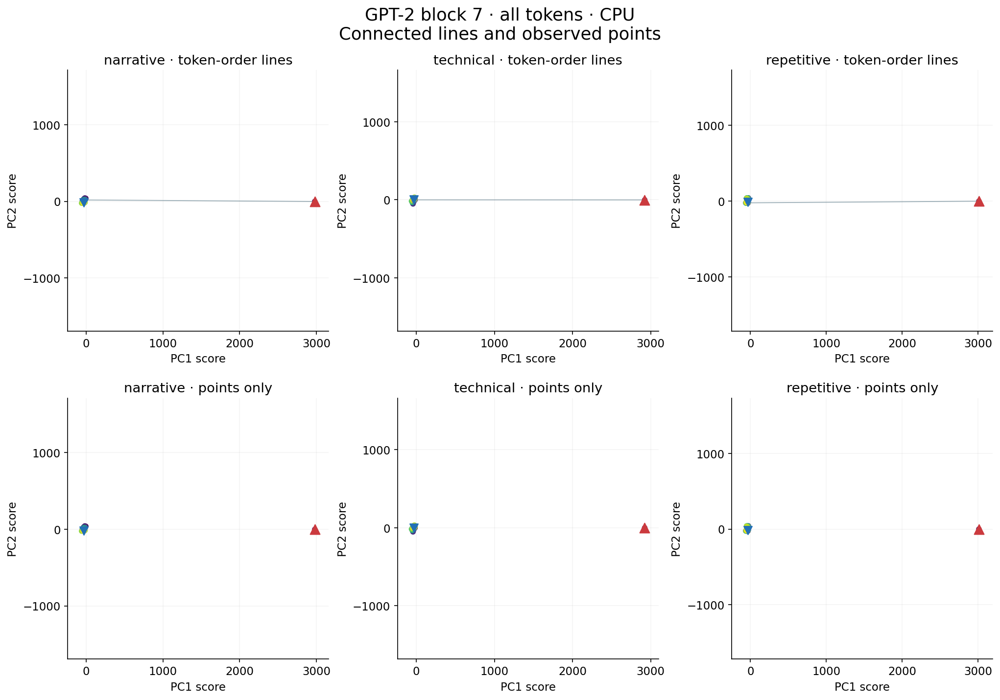

# Principal Component Geometry and Feature Readout in Transformer Representations

**When a plot of a transformer's hidden states stretches along one long axis, what puts the points there? And what can the other directions tell us about the text?** In GPT-2's middle layers, the first token can sit so far from the others that it accounts for most of the apparent concentration. Once its saved state is left out of the analysis, a second pattern emerges. Directions learned on one set of articles still help tell whether a particular occurrence of a token was more surprising than usual on a new article.

Kentaro Sato · [Paper (PDF)](paper/transformer-pc-geometry-and-feature-readout.pdf) · [Manuscript](paper/manuscript.md) · [How the readout works](#from-hidden-states-to-a-readout) · [日本語の概要](#日本語の概要) · [Code and saved results](#check-a-result)

## What makes the long axis?

Each point below is GPT-2's hidden state after one token. The top row connects consecutive tokens. The bottom row shows the **same coordinates** as individual points. Look for the first token (red triangle) and the gap between it and the cluster. Drawing a line across that gap gives a very different impression of where the observations lie.

*Paper Figure 1. The columns show a narrative, a technical passage and a repetitive passage, all after GPT-2 block 7. Colour indicates token order. The blue downward triangle marks the last token.*

**Validation on three known texts.** The first principal component (PC1), the direction of greatest variation, accounted for 96–98% of the variance in each passage. Refitting PCA after excluding just the first saved state reduced that share to about 7%, 7% and 17%, respectively. All tokens still went through the model. None of the three point clouds met the prespecified criterion for points distributed along a continuous arc in this condition. [Point distributions and refitted views](paper/manuscript.md#3-short-text-geometry-observations-that-create-the-long-axis-and-variation-around-it)

**Confirmatory article test.** In 64 English WikiText articles, the first token had the longest state vector in every article at GPT-2 block 6. After its exclusion, the median absolute correlation between PC1 score and state length fell from about 1.00 to 0.09. This overturned the initial hypothesis that the strong correlation would persist among the other tokens. [Article results and controls](paper/manuscript.md#41-the-treatment-of-the-first-token-strongly-changes-variance-concentration)

## From hidden states to a readout

A separate PCA for each passage lets us inspect its shape. To test whether a feature can be read on *another* article, the new article must use the same coordinates and prediction rule as the training articles. The following three measurements connect those questions.

**1. Measure concentration within one text.** Centre the included states and fit PCA. If $\lambda_j$ is the variance along component $j$, the fraction explained by PC1 is

$$
V_1=\frac{\lambda_1}{\sum_j\lambda_j}.
$$

Excluding the first saved state and fitting the centre and axes again measures how much the geometry depends on that observation.

**2. Fix a coordinate system for transfer.** Pool the included states from the training articles and estimate their centre $\mu_{\mathrm{train}}$ and top eight directions (the columns of $U_{\mathrm{train}}$). For the hidden state $h_t$ after token $t$ on a new article, the eight coordinates are

$$
z_t=U_{\mathrm{train}}^\top(h_t-\mu_{\mathrm{train}}).
$$

The axes, feature scales and fitted regression coefficients are fixed before evaluation. One target is **current-token surprisal**. It measures how improbable the token was under the model's distribution *before* it arrived. The regression tries to recover that value from the state *after* the model has processed the token.

**3. Ask what those coordinates add.** For each evaluation article, compare a baseline regression with a jointly fitted regression that adds the eight PC scores. If $\mathrm{SSE}$ is the sum of squared prediction errors, the gain is

$$
\Delta R^2_{\mathrm{PC}}=
\frac{\mathrm{SSE}_{\mathrm{base}}-\mathrm{SSE}_{\mathrm{PC}}}{\mathrm{SS}_y}.
$$

Positive values mean a smaller prediction error. In ordinary scoring, $\mathrm{SS}_y$ is target variation around the article mean. To compare repeated occurrences of the same token ID in the same article, we centre targets and predictions within each group and use the variation around group means. The multi-model test also trains on within-group deviations, with position and state length as baseline features. A second comparison asks whether PCs beat eight random orthogonal directions, averaging errors over 20 random sets. Decisions use article medians, bootstrap intervals and prespecified minimum effects. [Methods and decision rules](paper/manuscript.md#2-study-design-and-measurements)

## Which readouts transfer?

**Confirmatory results.** With the first state excluded, a shared direction retained its correlation with token position on separate articles. In a subsequent GPT-2 block 6 test, shared PCs improved surprisal readout beyond a baseline that accounted for token identity. They also beat matched random directions when comparing repeated occurrences of the *same* ID within an article. Under that study's original training rule, random directions had the advantage after GPT-2's final normalisation. [Transfer results](references/tables/appendix_E.md) · [Token-ID comparisons](references/tables/appendix_F.md)

The three-model test trained directly on differences within each article and token ID, then evaluated on 64 new articles. **Four of six conditions met both minimum-effect criteria** for improvement over the baseline and over random directions.

| Base model | Middle layer | After final normalisation |
|---|---|---|
| GPT-2 | Inconclusive | Supported |
| OPT-1.3B | Supported | Inconclusive |
| Qwen2.5-1.5B | Supported | Supported |

For GPT-2's middle layer, the interval for improvement over the baseline cleared its threshold, but the one for the advantage over random directions crossed its threshold. The earlier GPT-2 test also used different training and evaluation articles and different interval levels. [Paper Tables 8 and 8b](paper/manuscript.md#44-support-for-within-group-incremental-value-varies-by-model-and-extraction-point)

**Exploratory analyses of saved data.** Much of the additional surprisal readout after accounting for position and state length lay in PC2–8. Vector direction added information even with flexible length controls, although the advantage over random directions was unclear at OPT's middle layer. On the earlier GPT-2 final-layer data, restricting training to recurring IDs already reversed the PC-versus-random ranking. Training on within-group differences increased the advantage further. [Component and direction analysis](references/tables/appendix_J.md) · [Training comparisons](references/tables/appendix_I.md)

Article medians can hide costly failures. At Qwen's middle layer, the median gain was **+0.071**. A loss of **−24.225** on one article drove the mean down to **−0.310**. These are differences in $R^2$ on held-out articles, where prediction errors can be much larger than the target variation. [Failure article and distribution](paper/manuscript.md#65-typical-improvements-coexist-with-large-losses-concentrated-in-a-few-articles)

## What remains open

Within individual texts, variation around the main axis was associated with position, decoded token length and surprisal. Those residual coordinates are fitted separately for each text. How they relate to the shared directions that transfer across articles remains open. The readouts establish statistical associations in the selected English passages, models and extraction points. Which computations produce the geometry or use these directions causally, and how well the readouts generalise to other domains, remain questions for further work. [Scope and limitations](paper/manuscript.md#8-limitations-and-unresolved-questions)

## 日本語の概要

GPT-2が短い文章を読むとき、各トークンを処理した直後の内部状態を点にして並べると、細長い線が見えます。ところが同じ図から線を消すと、**先頭の1点だけが遠く、残りは狭い範囲に集まっている**ことが分かります。調べた3短文では、第7ブロックの第1主成分が占める分散は96–98%でした。文章全体をモデルに読ませたまま、保存した先頭の点だけを集計から外すと、約7%、7%、17%まで下がりました。

では、残りの点には何が表れているのか。ある記事群で座標軸と読み出し方を決めてから別の記事で試すと、同じ記事に同じトークンが繰り返し現れる場合でも、**その出現が文脈上どれくらい予想外だったか**を読み取れる条件がありました。3モデル・2か所で比較すると、基準モデルとランダムな方向の両方を事前の基準以上に上回ったのは6条件中4条件。個別の記事では予測が大きく外れることもあり、記事ごとに見た結果も報告しています。[図表と根拠の対応表](references/FIGURE_TABLE_MAP.md)

## Check a result

| To… | Start here |
|---|---|
| Trace the plotted points or a reported number to its evidence | [Figure and table map](references/FIGURE_TABLE_MAP.md) · [Complete numerical tables](references/README.md) |
| Inspect the protocols, saved analyses and experiment code | [Research materials](research/pc_geometry_rerun/README.md) · [Readable source-code guide](docs/CODE_GUIDE.md) |
| Locate the original observations and exploratory arrays | [Inventory of 19 separate archives](references/DATA.md) |
| Check the files in a checkout | Run `.venv/bin/python tools/verify_package.py` from its root with Python 3.11+. [Environment setup, verification and restoration](docs/REPRODUCIBILITY.md) |

## Citation

Kentaro Sato (2026), *Principal Component Geometry and Feature Readout in Transformer Representations: Sensitivity to the First Token, Features in Local Residuals, and Readout from Fixed Shared Principal Components*. [DOI 10.5281/zenodo.23969557](https://doi.org/10.5281/zenodo.23969557) · [Citation metadata](CITATION.cff) · [Licensing and source attribution](licenses/README.md) · [Contact](mailto:info@metaclan.jp)
