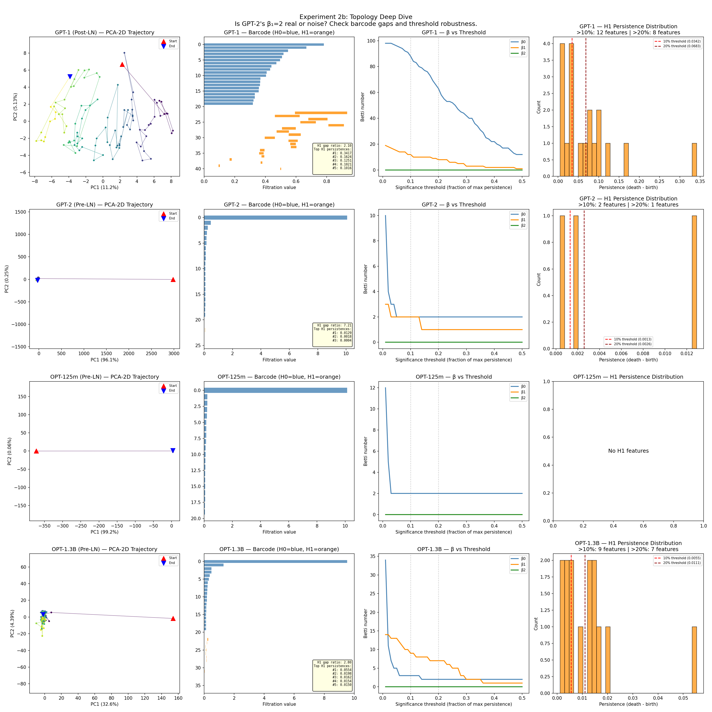
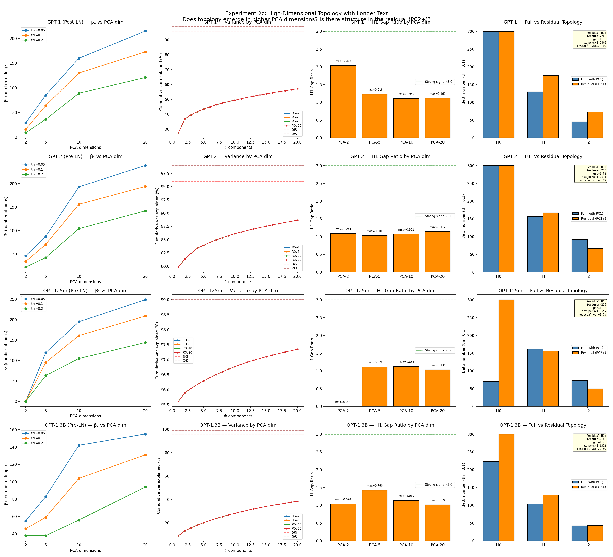
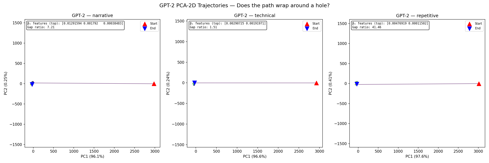
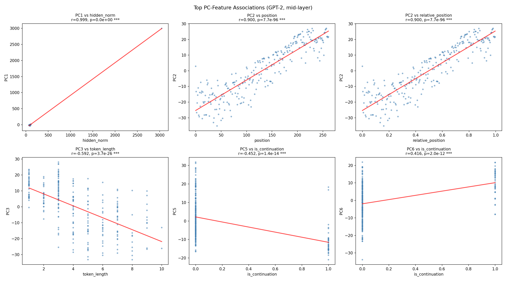
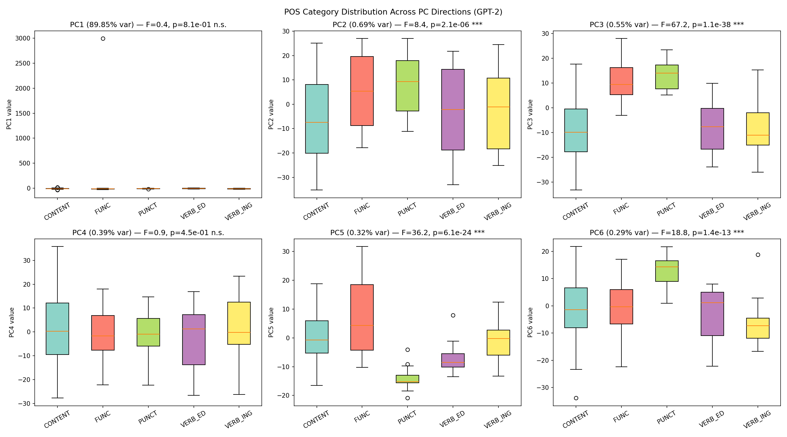
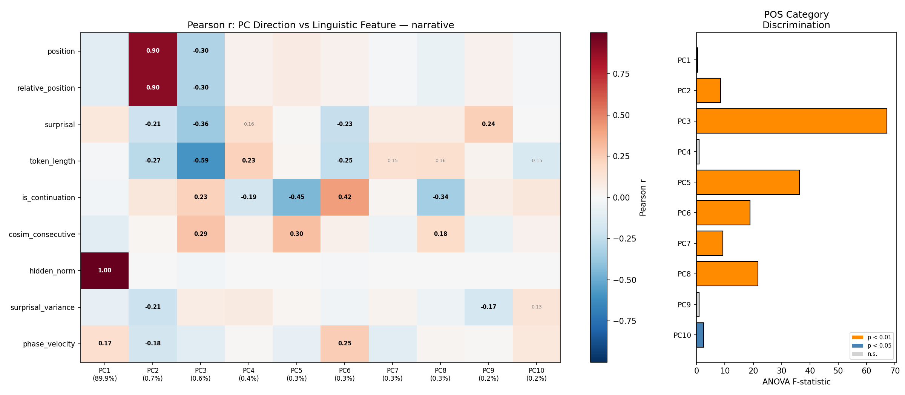

# The Arc and Its Thickness: Topological Triviality and Geometric Structure of Transformer Hidden-State Manifolds

**Kentaro Sato**
info@metaclan.jp

---

## Abstract

Pre-LayerNorm (Pre-LN) Transformer hidden states are known to concentrate on low-dimensional subspaces, with PCA explaining over 90\% of variance in two components. We investigate the topology and fine-grained geometry of these subspaces across four models (110M--1.3B parameters). Using persistent homology, we find that the hidden-state manifold is **topologically trivial**: it is neither a torus ($T^2$) nor a sphere ($S^2$), but a contractible arc dominated by a single principal component encoding hidden-state norm (Pearson $r = 0.999$). All detected $H_1$ features are noise artifacts of high-dimensional sparsity (gap ratio $< 2.0$ across all conditions, $\beta_1$ monotonically increasing with PCA dimension). However, probing the arc's residual dimensions --- its "thickness" --- reveals **highly structured geometric encoding**: PC2 encodes absolute token position ($r = 0.90$, $p \sim 10^{-96}$), and PC3 jointly encodes prediction difficulty and part-of-speech category ($r = -0.59$ for token length, ANOVA $F = 67$ for POS, $p = 10^{-38}$). These associations replicate across text types. Our findings recharacterize the low-dimensional structure of Pre-LN representations as a 1D arc with linguistically meaningful thickness, and suggest that the principal axes of hidden-state variation constitute a natural coordinate system for representation analysis and targeted intervention.

**Keywords:** Transformer hidden states, persistent homology, manifold topology, PCA, probing, LayerNorm, geometric structure

---

## 1. Introduction

The internal representations of Transformer-based language models reside in low-dimensional subspaces despite the high dimensionality of the embedding space (Aghajanyan et al., 2021). This phenomenon is particularly pronounced in Pre-LayerNorm (Pre-LN) architectures (Xiong et al., 2020), where PCA with $k = 2$ components can explain over 90\% of hidden-state variance at middle layers, while Post-LN models distribute variance more uniformly (Ethayarajh, 2019).

The extreme dimensionality reduction raises a natural question about the **topology** of the resulting low-dimensional structure. In dynamical systems and physics, the distinction between a torus ($T^2$), a sphere ($S^2$), and other surfaces carries profound implications. A torus admits two independent periodic orbits, suggesting that hidden states might encode two independent cyclic features. A sphere is simply connected, ruling out periodic structure. This distinction also has practical consequences for hidden-state intervention methods (Li et al., 2024; Turner et al., 2024): the geometry of the representation space determines which directions of perturbation are meaningful.

A separate body of work has established that Transformer representations encode rich linguistic information in a linearly accessible form (Alain \& Bengio, 2017; Hewitt \& Manning, 2019; Tenney et al., 2019). However, these probing studies typically examine the full representation space without considering its principal structure. If hidden states concentrate on a low-dimensional subspace, the question becomes: **how is linguistic information distributed across the principal axes of that subspace?**

This paper reports three main findings:

1. **Topological triviality.** The Pre-LN hidden-state manifold is contractible (topologically equivalent to a point or disk). It is neither a torus nor a sphere. Persistent homology detects no significant $H_1$ features across all models, PCA dimensions (2--20), text types, and significance thresholds.

2. **Structured thickness.** Despite topological triviality, the residual PCA dimensions (PC2--PC10, collectively contributing 4--8\% of variance) encode linguistically meaningful features in a highly organized manner: token position in PC2, prediction difficulty and part-of-speech in PC3, and subword characteristics in higher components. These associations replicate across text types.

3. **A natural coordinate system.** The PCA decomposition constitutes a linguistically interpretable coordinate system for hidden states: norm (PC1), position (PC2), and lexical difficulty (PC3). This decomposition provides a principled basis for direction-specific analysis and intervention in representation space.

---

## 2. Background and Related Work

### 2.1 Low-Dimensional Structure in Transformer Representations

The tendency of neural network representations to concentrate on low-dimensional subspaces has been documented across architectures. Li et al. (2018) measured intrinsic dimensionality of loss landscapes; Aghajanyan et al. (2021) demonstrated that fine-tuning operates in low-dimensional subspaces. For Transformers, Ethayarajh (2019) showed that contextualized representations become increasingly anisotropic in deeper layers. The Pre-LN normalization structure (Xiong et al., 2020), which normalizes sublayer inputs before residual addition, has been identified as a key architectural factor driving extreme variance concentration.

### 2.2 Topological Data Analysis in Machine Learning

Persistent homology (Edelsbrunner \& Harer, 2010) has been applied to analyze the topology of learned representations, including understanding loss landscapes (Rieck et al., 2019) and characterizing how topology evolves through network layers (Naitzat et al., 2020). The Betti numbers ($\beta_0$: connected components, $\beta_1$: loops, $\beta_2$: voids) provide a topological fingerprint that distinguishes spheres ($\beta = (1, 0, 1)$), tori ($\beta = (1, 2, 1)$), and other surfaces. To our knowledge, persistent homology has not previously been applied to characterize the topology of Transformer hidden-state trajectories.

### 2.3 Probing Representations

Linear probing (Alain \& Bengio, 2017; Hewitt \& Manning, 2019; Tenney et al., 2019) assesses what linguistic information is linearly decodable from neural representations. Rather than training probe classifiers, we examine correlations between PCA components and linguistic features directly, providing a more fine-grained view of how information is distributed across the principal axes of variation. This is related to work on identifying interpretable directions in representation space (Park et al., 2024; Marks \& Tegmark, 2024).

### 2.4 Hidden-State Intervention

Recent work has explored direct manipulation of Transformer hidden states for steering model behavior. Representation engineering (Zou et al., 2023) identifies concept-level directions for intervention. Activation addition (Turner et al., 2024) and inference-time intervention (Li et al., 2024) modify hidden states by adding vectors along specific directions. These methods typically identify intervention directions via contrast pairs or probing classifiers. Our geometric decomposition suggests an alternative: the principal axes of hidden-state variation themselves provide a linguistically meaningful coordinate system for targeted intervention.

---

## 3. Methods

### 3.1 Models and Data

We analyze four pre-trained causal language models spanning two normalization strategies and three scales:

| Model | Parameters | $d_\text{model}$ | Layers | LN Type | Role |
|-------|-----------|:---:|:---:|---------|------|
| GPT-1 | 110M | 768 | 12 | Post-LN | Control |
| GPT-2 | 124M | 768 | 12 | Pre-LN | Primary |
| OPT-125m | 125M | 768 | 12 | Pre-LN | Replication |
| OPT-1.3B | 1.3B | 2048 | 24 | Pre-LN | Scale test |

Input texts include three short passages (~100 tokens each: narrative, technical, repetitive) and three longer passages (~450--550 tokens each: narrative, technical, mixed). Hidden states are extracted at the middle layer ($\lfloor L/2 \rfloor$) of each model, where prior work has shown representational properties are most stable (Ethayarajh, 2019).

### 3.2 Topological Analysis via Persistent Homology

For each hidden-state trajectory $\{h(t)\}_{t=1}^T \subset \mathbb{R}^d$, we:

1. Project to $k$ PCA dimensions ($k \in \{2, 5, 10, 20\}$) and standardize.
2. Compute Vietoris--Rips persistent homology up to $H_2$ using ripser (Tralie et al., 2018).
3. Count significant features at multiple significance thresholds $\alpha \in [0.01, 0.50]$, where a feature is significant if its persistence exceeds $\alpha \cdot \max(\text{persistence})$.
4. Compute the **gap ratio** $G = p_1 / p_2$ (ratio of longest to second-longest persistence in $H_1$) as a diagnostic for genuine versus noise topology. $G > 3$ indicates a prominent feature; $G \approx 1$ indicates uniform noise.

We additionally analyze the **residual manifold** by removing PC1 and computing persistent homology on PC2--PC20 only. This tests whether topological structure exists in the "thickness" directions that is masked by PC1 dominance.

### 3.3 Threshold Sensitivity and Barcode Analysis

To ensure robustness, we sweep the significance threshold from 0.01 to 0.50 in 50 steps and record the threshold range over which $\beta_1 = 2$ (the torus signature). We also examine persistence barcodes: the absolute persistence values of $H_1$ features relative to $H_0$, which distinguishes genuine topological holes from noise.

### 3.4 Geometric Probing of PCA Components

For GPT-2 hidden states at Layer 6, we compute PCA with 10 components and correlate each component with:

- **Continuous features:** Token position (absolute and relative), surprisal ($-\log p(x_{t+1} | x_{\leq t})$), token character length, hidden-state norm, consecutive cosine similarity, phase velocity ($|\Delta\theta|$ where $\theta = \operatorname{atan2}(\text{PC2}, \text{PC1})$), windowed surprisal variance.
- **Categorical features:** Part-of-speech category (7-way heuristic classification: CONTENT, FUNC, PUNCT, VERB\_ING, VERB\_ED, ADV, NOUN\_SUFFIX) via ANOVA $F$-test.

Correlations are computed on two text types (narrative, technical) independently to assess cross-text replicability.

---

## 4. Results

### 4.1 The Manifold is Topologically Trivial

#### 4.1.1 Initial Persistent Homology (Short Texts, PCA-2D)

Table 1 shows Betti numbers at threshold $\alpha = 0.1$ for PCA-2D projections.

**Table 1.** Betti numbers ($\alpha = 0.1$, PCA-2D, short texts).

| Model | LN | Text | $\beta_0$ | $\beta_1$ | $\beta_2$ | Classification |
|-------|----|------|:---:|:---:|:---:|---|
| GPT-1 | Post | narrative | 89 | 12 | 0 | Disconnected |
| GPT-2 | Pre | narrative | 2 | 2 | 0 | Torus? |
| GPT-2 | Pre | technical | 2 | 2 | 0 | Torus? |
| GPT-2 | Pre | repetitive | 2 | 1 | 0 | Circle? |
| OPT-125m | Pre | narrative | 2 | 0 | 0 | Contractible |

GPT-2's $\beta_1 = 2$ initially appeared consistent with torus topology. However, three lines of evidence refute this interpretation.

#### 4.1.2 Persistence Barcodes Reveal Noise



**Figure 1.** Topology deep dive across four models. Each row shows one model (GPT-1, GPT-2, OPT-125m, OPT-1.3B). Columns: (a) PCA-2D trajectory colored by token position; (b) persistence barcode ($H_0$ in blue, $H_1$ in orange) --- note the near-absence of orange bars for Pre-LN models; (c) $\beta$ vs significance threshold --- $\beta_1$ drops to zero at moderate thresholds for all Pre-LN models; (d) $H_1$ persistence distribution --- all bars are concentrated near zero, with no outlier. GPT-1 (Post-LN, top row) shows a scattered point cloud with no connected manifold structure.

Barcode analysis (Table 2) shows that GPT-2's $H_1$ features have minuscule absolute persistence relative to $H_0$.

**Table 2.** $H_1$ barcode statistics (GPT-2, PCA-2D, short text).

| Text | $H_1$ features | Gap ratio | Max $H_1$ pers. | Max $H_0$ pers. | Ratio |
|------|:---:|:---:|:---:|:---:|:---:|
| narrative | 3 | 7.21 | 0.013 | 10.07 | 1 : 780 |
| technical | 2 | 1.51 | 0.003 | 9.22 | 1 : 3179 |
| repetitive | 2 | 41.46 | 0.005 | 8.53 | 1 : 1777 |

Despite the high gap ratio of 7.21 for narrative text, the $H_1$ features occupy a scale $780\times$ smaller than $H_0$. These are not topological holes in the manifold; they are fluctuations in a nearly 1-dimensional point cloud.

#### 4.1.3 High-Dimensional Analysis Confirms Noise

With longer texts (~500 tokens) and PCA dimensions from 2 to 20, $\beta_1$ increases monotonically with dimension (Table 3), the signature of high-dimensional sparsity artifacts rather than genuine topological structure.

**Table 3.** $\beta_1$ by PCA dimension ($\alpha = 0.1$, narrative\_long).

| Model | LN | PCA-2 | PCA-5 | PCA-10 | PCA-20 | Residual (PC2+) |
|-------|----|:---:|:---:|:---:|:---:|:---:|
| GPT-1 | Post | 16 | 64 | 130 | 173 | 176 |
| GPT-2 | Pre | 34 | 70 | 156 | 194 | 167 |
| OPT-125m | Pre | 0 | 95 | 161 | 209 | 156 |
| OPT-1.3B | Pre | 46 | 59 | 104 | 131 | 129 |

If genuine topological features existed, $\beta_1$ would stabilize at the true number of independent loops as PCA dimension increases beyond the manifold's intrinsic dimension. No such stabilization is observed.



**Figure 2.** High-dimensional topology analysis with longer text (~500 tokens). Each row shows one model. Columns: (a) $\beta_1$ vs PCA dimension at three significance thresholds --- $\beta_1$ increases monotonically with dimension across all models, the hallmark of sparsity-induced noise rather than genuine topology; (b) cumulative PCA variance --- GPT-2 and OPT-125m reach 85--97\% at $k=2$, while GPT-1 and OPT-1.3B require $k > 20$; (c) $H_1$ gap ratio by PCA dimension --- no condition exceeds the $G = 3$ threshold for a strong topological signal; (d) full vs residual (PC2+) Betti number comparison at threshold 0.1.

$H_1$ gap ratios are uniformly below 2.0 at PCA-5 and above (Table 4), confirming that no $H_1$ feature stands out from the noise floor.

**Table 4.** $H_1$ gap ratio by PCA dimension (narrative\_long).

| Model | PCA-2 | PCA-5 | PCA-10 | PCA-20 | Residual |
|-------|:---:|:---:|:---:|:---:|:---:|
| GPT-1 | 2.04 | 1.23 | 1.11 | 1.12 | 1.15 |
| GPT-2 | 1.09 | 1.03 | 1.07 | 1.14 | 1.00 |
| OPT-125m | -- | 1.11 | 1.13 | 1.03 | 1.10 |
| OPT-1.3B | 1.04 | 1.42 | 1.14 | 1.01 | 1.26 |

#### 4.1.4 Point Cloud Visualization

Direct visualization of GPT-2 PCA-2D trajectories confirms the quantitative findings: points distribute along a nearly horizontal line (PC1 explains 96\%), with no visible hole or wrapping structure. The trajectory moves from start to end along the arc without completing a cycle.



**Figure 3.** GPT-2 hidden-state trajectories in PCA-2D space for three text types (narrative, technical, repetitive). PC1 (horizontal axis) explains 96--98\% of variance; PC2 (vertical axis) contributes only 0.2--0.4\%. Trajectories are nearly 1-dimensional arcs from start (red triangle) to end (blue triangle), with no visible wrapping or hole structure. The topological "torus" suggested by $\beta_1 = 2$ in Table 1 is an artifact of micro-fluctuations along this arc, not a genuine 2D manifold.

#### 4.1.5 Post-LN Manifold is Disconnected

GPT-1 (Post-LN) exhibits $\beta_0 = 89$--$300$ across conditions, indicating that its hidden states do not form a connected manifold. This is consistent with the finding that Post-LN distributes variance broadly (PCA-2D explains only 16--37\% of variance).

### 4.2 The Arc's Principal Component is Hidden-State Norm

Table 5 shows the five cross-text-replicated PC--feature associations from the probing analysis.

**Table 5.** Cross-text replicated associations (GPT-2, Layer 6).

| PC | Var. explained | Feature | Narrative $r$ | Technical $r$ | Replicated |
|:---:|:---:|---|:---:|:---:|:---:|
| PC1 | 89.9--91.2\% | Hidden-state norm $\|h\|$ | +0.999 | +0.999 | Yes |
| PC2 | 0.55--0.69\% | Token absolute position | +0.900 | +0.905 | Yes |
| PC3 | 0.48--0.55\% | Token character length | $-0.592$ | $-0.619$ | Yes |
| PC3 | (same) | Surprisal | $-0.364$ | $-0.542$ | Yes |
| PC3 | (same) | POS category (ANOVA $F$) | 67.2 | 63.1 | Yes |

The near-perfect correlation between PC1 and $\|h\|$ ($r = 0.999$) is the most striking finding. The "arc" in PCA space is not a trajectory through semantic space; it is the **direction of norm variation**. Pre-LN's residual accumulation structure causes hidden-state norms to vary systematically across token positions, and this norm variation dominates PCA.



**Figure 4.** Top six PC--feature associations (GPT-2, Layer 6, narrative text). Upper left: PC1 vs hidden-state norm ($r = +0.999$) --- near-perfect linear relationship confirming that the dominant PCA axis encodes norm. Upper middle/right: PC2 vs token position ($r = +0.900$) --- precise positional encoding in a sub-percent variance axis. Lower left: PC3 vs token character length ($r = -0.592$) --- longer (more informative) tokens have more negative PC3 values. Lower middle/right: PC5 and PC6 vs subword continuation flag.

### 4.3 PC2 Encodes Token Position with High Precision

Despite contributing only 0.55--0.69\% of total variance, PC2 encodes absolute token position with $r = 0.90$ ($p \sim 10^{-96}$). This demonstrates that positional information from the embedding layer is preserved through six Transformer blocks and concentrated into a narrow spectral band of the hidden-state covariance matrix.

### 4.4 PC3 Encodes Prediction Difficulty and Lexical Category

PC3 exhibits a dual encoding: token character length ($r = -0.59$) and surprisal ($r = -0.36$ to $-0.54$). The ANOVA $F$-statistic for POS category is 63--67 ($p \sim 10^{-38}$), with clear separation between punctuation (positive PC3), function words (intermediate), and content words (negative PC3). This ordering mirrors the information-theoretic hierarchy: punctuation is most predictable, content words least.



**Figure 5.** Distribution of PCA component values by part-of-speech category (GPT-2, Layer 6). PC1 (top left) shows no POS discrimination ($F = 0.4$, n.s.) --- norm variation is POS-independent. PC2 (top middle) shows moderate discrimination ($F = 8.4$, $p < 10^{-6}$), reflecting position-dependent POS distributions. PC3 (top right) shows the strongest POS discrimination ($F = 67.2$, $p \sim 10^{-38}$): punctuation tokens (PUNCT) cluster at positive values, verb forms (VERB\_ED, VERB\_ING) at negative values, and function words (FUNC) in between. This ordering recapitulates the information-theoretic hierarchy from most to least predictable.

### 4.5 Higher Components Encode Subword and Morphological Features

PC5 ($F = 36$) correlates with subword continuation status ($r = -0.45$), and PC6--PC8 show significant but less consistent POS discrimination. PC4 and PC9 are the only non-significant components for POS.

---

## 5. Discussion

### 5.1 Recharacterizing the Low-Dimensional Structure

Prior work characterized Pre-LN hidden states as residing on a "low-dimensional manifold" based on PCA concentration (Ethayarajh, 2019; Aghajanyan et al., 2021). Our results provide a more precise characterization:

> Pre-LN hidden states distribute along a 1-dimensional arc defined by the direction of norm variation (PC1, ~90\% variance). The arc's "thickness" (PC2--PC10, ~8\% variance) is geometrically structured but topologically trivial, encoding token position, prediction difficulty, and lexical category in orthogonal directions.

This recharacterization is not merely terminological. The distinction between a 2D manifold and a 1D arc with structured thickness has implications for how we understand representation capacity. A 2D manifold suggests two degrees of freedom for encoding; a structured arc suggests a hierarchy: one dominant axis (norm/scale) with secondary axes carrying different types of linguistic information at much smaller variance scales.

### 5.2 Why is PC1 the Norm?

Pre-LN applies LayerNorm before each sublayer:
$$h_{l+1} = h_l + F_l(\text{LN}(h_l))$$
The sublayer output $F_l(\text{LN}(h_l))$ is added to $h_l$ without normalization of the sum. This causes $\|h_l\|$ to grow (or oscillate) across layers and token positions, making norm variation the dominant axis of hidden-state covariance. Post-LN normalizes after addition ($h_{l+1} = \text{LN}(h_l + F_l(h_l))$), suppressing this effect and distributing variance more uniformly --- consistent with our finding that Post-LN hidden states are not concentrated on a low-dimensional subspace.

This norm dominance has a methodological implication: PCA-based analyses of Pre-LN Transformer representations are primarily capturing norm variation, not semantic structure. The semantically relevant structure resides in the minor components (PC2+), which collectively account for less than 10\% of variance but carry linguistically interpretable information.

### 5.3 A Natural Coordinate System for Hidden States

The probing results suggest that PCA decomposition provides a linguistically interpretable coordinate system:

| Axis | Variance | Encodes | Information type |
|------|:---:|---------|-----------------|
| PC1 | ~90\% | $\|h\|$ (norm) | Scale / processing depth |
| PC2 | ~0.6\% | Token position | Sequential structure |
| PC3 | ~0.5\% | Surprisal + POS | Prediction difficulty |
| PC4+ | ~0.2\% each | Subword, morphology | Fine-grained lexical |



**Figure 6.** Left: Pearson correlation heatmap between PCA components (columns) and linguistic features (rows) for GPT-2 Layer 6, narrative text. Significant correlations ($p < 0.01$) are annotated with values. The block-diagonal structure is striking: PC1 correlates exclusively with norm, PC2 with position, PC3 with surprisal/token length, and higher PCs with subword features. Right: ANOVA $F$-statistic for POS category discrimination by PC direction. PC3 ($F = 67$) and PC5 ($F = 36$) are the strongest POS discriminators; PC1 and PC4 are non-significant.

This decomposition is notable for several reasons. First, the axes are **orthogonal by construction** (PCA), meaning each encodes an independent dimension of variation. Second, the mapping is **consistent across text types**, suggesting it reflects architectural properties rather than input-specific patterns. Third, the ordering by variance is linguistically interpretable: the model's representations are dominated by scale (norm), followed by position, followed by content-level features.

### 5.4 Implications for Hidden-State Intervention

The geometric decomposition has implications for methods that intervene on hidden states during inference (Zou et al., 2023; Li et al., 2024; Turner et al., 2024).

**Direction-specific diagnosis.** Changes in cosine similarity between consecutive hidden states --- a common coherence proxy --- can be decomposed into PC contributions. A drop driven primarily by PC1 indicates norm instability; a drop in PC2 indicates disrupted position tracking; a drop in PC3 indicates a sudden shift in prediction difficulty. This decomposition enables more targeted diagnosis of representation-level anomalies.

**Direction-specific intervention.** Current intervention methods that add vectors to hidden states operate in the full $d$-dimensional space. Our results suggest that the effective intervention space is much smaller (~10 dimensions) and that its axes have interpretable meanings. An intervention targeting prediction difficulty (PC3 direction) is qualitatively different from one targeting position tracking (PC2), even though both are "perturbations to the hidden state." The PCA decomposition provides a natural basis for selecting intervention directions without requiring task-specific contrast pairs or probe classifiers.

### 5.5 Why Topology Failed to Discriminate

The topological analysis yielded a decisive negative result: no non-trivial topology at any PCA dimension or significance threshold. This negative result is informative in two ways.

First, it establishes that the linguistic information encoded in hidden states is **geometrically but not topologically structured**. The encoding is via linear correlations (positions along principal axes), not via global manifold properties (holes, windings, genus). This is consistent with the success of linear probing methods, which assume that linguistic features are linearly decodable.

Second, it demonstrates a **methodological caveat** for applying persistent homology to neural network representations: sparsity artifacts dominate when the intrinsic dimensionality is much lower than the ambient PCA dimension. The monotonic increase of $\beta_1$ with PCA dimension, uniform gap ratios near 1.0, and sensitivity of short-text results to threshold selection are all signatures of this phenomenon. We recommend that future applications of persistent homology to neural representations verify robustness to these controls.

---

## 6. Limitations

1. **Model scale.** All models are $\leq 1.3$B parameters. The geometric decomposition may change qualitatively at larger scales (7B+), where $d_\text{model} \geq 4096$ and more PCA components may carry significant variance.

2. **Single-layer analysis.** We analyze only the middle layer. Shallow layers have lower PCA concentration (28--49\%), and the topology and geometry may differ at those depths. A layer-by-layer analysis is a natural extension.

3. **Simplified POS classification.** Our heuristic POS tagger is coarse (7 categories). Using a proper tagger (e.g., spaCy) would enable finer-grained analysis, potentially revealing structure in currently non-significant components (PC4, PC9).

4. **Pre-LN only.** The probing analysis focuses on Pre-LN architectures where PCA concentration is high. The geometric structure of Post-LN hidden states, which do not concentrate on a low-dimensional subspace, remains uncharacterized.

---

## 7. Conclusion

We investigated the topology and geometry of Pre-LN Transformer hidden-state manifolds using persistent homology and PCA-based probing. The manifold is topologically trivial --- neither a torus nor a sphere, but a contractible arc defined by the direction of hidden-state norm variation. The arc's residual dimensions encode linguistically meaningful features with high precision and cross-text replicability: token position in PC2 ($r = 0.90$), prediction difficulty and part-of-speech in PC3 ($F = 67$, $p = 10^{-38}$).

These findings recharacterize the low-dimensional structure of Pre-LN representations as a structured geometric object --- an arc with meaningful thickness --- and identify a natural coordinate system in which norm, position, and lexical difficulty are orthogonally encoded. The topological triviality of the manifold is itself informative: it implies that Transformer representations encode linguistic structure via linear geometry rather than global topology, consistent with the broad success of linear probing methods and suggesting fundamental limits on approaches that assume non-trivial manifold structure.

---

## References

- Aghajanyan, A., Gupta, S., \& Zettlemoyer, L. (2021). Intrinsic dimensionality explains the effectiveness of language model fine-tuning. *ACL*.
- Alain, G., \& Bengio, Y. (2017). Understanding intermediate layers using linear classifier probes. *ICLR Workshop*.
- Edelsbrunner, H., \& Harer, J. (2010). *Computational Topology: An Introduction*. AMS.
- Ethayarajh, K. (2019). How contextual are contextualized word representations? Comparing the geometry of BERT, ELMo, and GPT-2. *EMNLP*.
- Hewitt, J., \& Manning, C. D. (2019). A structural probe for finding syntax in word representations. *NAACL*.
- Li, C., Farkhoor, H., Liu, R., \& Yosinski, J. (2018). Measuring the intrinsic dimension of objective landscapes. *ICLR*.
- Li, K., Patel, O., Vi\'egas, F., Pfister, H., \& Wattenberg, M. (2024). Inference-time intervention: Eliciting truthful answers from a language model. *NeurIPS*.
- Marks, S., \& Tegmark, M. (2024). The geometry of truth: Emergent linear structure in large language model representations. *arXiv:2310.06824*.
- Naitzat, G., Zhitnikov, A., \& Lim, L.-H. (2020). Topology of deep neural networks. *JMLR*.
- Park, K., Choe, Y. J., \& Veitch, V. (2024). The linear representation hypothesis and the geometry of large language models. *ICML*.
- Rieck, B., Togninalli, M., Bock, C., Moor, M., Horn, M., Gumbsch, T., \& Borgwardt, K. (2019). Neural persistence: A complexity measure for deep neural networks using algebraic topology. *ICLR*.
- Tenney, I., Das, D., \& Pavlick, E. (2019). BERT rediscovers the classical NLP pipeline. *ACL*.
- Tralie, C., Saul, N., \& Bar-On, R. (2018). Ripser.py: A lean persistent homology library for Python. *JOSS*.
- Turner, A., Thiergart, L., Udell, D., Leech, G., Mini, U., \& MacDiarmid, M. (2024). Activation addition: Steering language models without optimization. *arXiv:2308.10248*.
- Xiong, R., Yang, Y., He, D., Zheng, K., Zheng, S., Xing, C., ... \& Liu, T. (2020). On layer normalization in the Transformer architecture. *ICML*.
- Zou, A., Phan, L., Chen, S., Campbell, J., Guo, P., Ren, R., ... \& Hendrycks, D. (2023). Representation engineering: A top-down approach to AI transparency. *arXiv:2310.01405*.

---

## Appendix A: Experimental Details

### A.1 Software and Hardware

All experiments were run on Apple M1 (16GB RAM) using Python 3.13, PyTorch 2.11, Transformers 5.4, scikit-learn 1.8, ripser 0.6, and scipy 1.17. Total computation time for all experiments was approximately 5 minutes.

### A.2 Reproduction

```bash
cd manifold_topology_experiment
python -m venv .venv && source .venv/bin/activate
pip install -r requirements.txt
python exp2_persistent_homology.py      # Persistent homology
python exp2b_topology_deep_dive.py      # Barcode deep dive
python exp2c_highd_long_text.py         # High-dimensional analysis
python exp5_thickness_probing.py        # PCA probing
```

### A.3 PCA Calibration Stability

PCA components were computed per-text, per-model. The cross-text replicability of PC--feature associations (Table 5) confirms that the principal directions are stable properties of the model architecture rather than artifacts of specific input texts.
