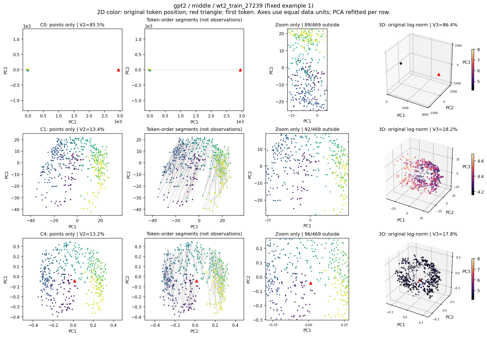
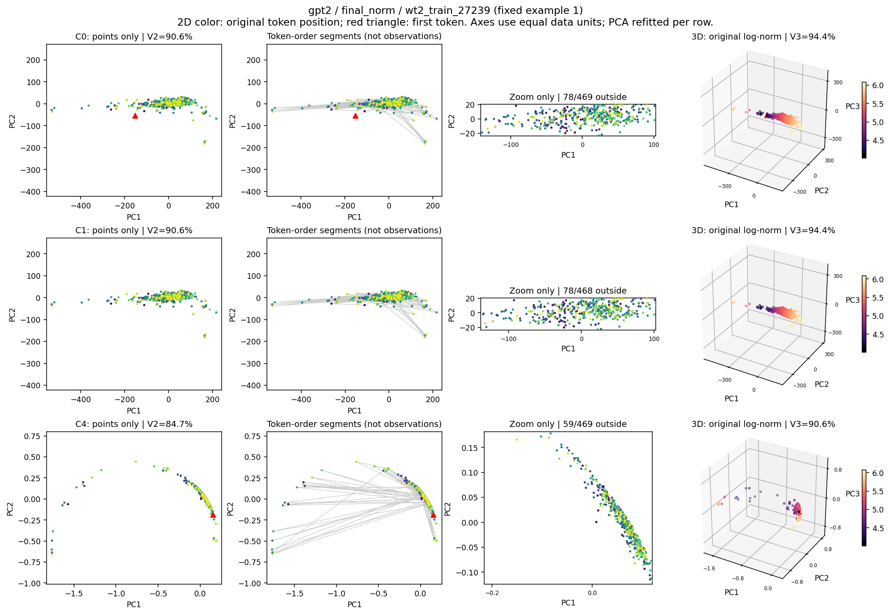

# 弧と特徴を伴う厚みはどこまで再現するか
## P4保存状態による探索的形状確認１セット

2026-10-20。EDA-0004 v1。**保存データでの解析・検算を完了し、このセットを終了した。**
元の結果・全原稿は保持した。新規モデル取得、LM forward、GPU実行はない。

## 1. 今回の結論

**曲線的な帯はGPT-2の最終正規化後で観測できる。一方、旧稿の出発点だった中央層の極端な細長さは、
GPT-2とQwenでは主に「遠い一点と密集した点群」という配置として再現した。
残りのPCと特徴との関連は広く残るが、その結果を一律に「一次元の弧の厚み」と呼ぶ範囲は限られる。**

したがって、論文へ戻す幾何の出発点として最も根拠があるのは、
**抽出点・モデル・正規化に応じて、孤立した高寄与点、細長い帯、より広がった点群が現れ、
その支配的方向から外れた変動にも測定可能な特徴関連がある**という記述である。
GPT-2最終正規化後の図は、弧や曲線的な帯を肯定的に示す条件付きの例として使える。
旧稿の中央層と同じ場所で普遍的な一次元弧が再現した、という結論は採用しない。

今回の価値は、形を見せる図と、先頭点感度・特徴の読み出しを同じ保存状態へ結び付けたことにある。
旧稿の中心的な問いを取り戻しつつ、形が成立する条件と、形の印象だけでは説明しきれない厚みを分けられた。

## 2. 先に固定した範囲

[解析カード](../../prereg/EDA-0004_v1_arc_thickness.md)と[機械可読仕様](spec.json)を
[FREEZE.json](FREEZE.json)の時刻・ハッシュで固定してから、新しい数値処理を始めた。
ユーザーが今回承認した形状確認１セットとして実施した。以前の実験・探索終了記録は当時の履歴として保持した。

- 入力：P4 run `4b013b35152b`。既存評価64記事、GPT-2・OPT-1.3B・Qwen2.5-1.5B。
- 抽出点：各モデルの中央層と最終正規化後。３モデル×２点×64記事。
- C0：全token。C1：位置0を除く。C4：全tokenを単位長化する。各条件で記事別PCAを再推定。
- 集計単位：記事。1,152記事条件を予定し、全1,152条件を解析、技術的欠測・失敗0。
- 固定代表図：`wt2_train_27239` と `wt2_train_24969`。記事IDのハッシュで事前選択。
  全64記事の一覧も全18条件を保存した。

元データのP4は別記事への転用を調べたが、今回のPCAは各記事の点の配置を描くためのもの。
今回の評価記事は結果既知であり、解析前固定をしても新たな確認実験にはならない。

## 3. 何をもって形を確認したか

図は、点だけの散布図、元token順に線を加えた図、密集部分の拡大、3D投影を並べた。
全点を使った座標のまま先頭を隠す図と、先頭を除いてPCAから再計算した図も分けた。
**結んだ線の途中に観測点が存在するか**を判断できるようにした。

数値では、分散集中に加えて、PC1の全幅に対する最大の空隙と、20等分した区間の占有率を測った。
さらに、PC1をパラメータとする直線と二次曲線を当てはめた。
token列を連続５区間に分け、４区間で当てはめた曲線で残る区間を近似し、
誤差が全変動に対してどれだけ小さいかをQで示した。Q=1は完全一致、Q=0は記事平均と同じ誤差、
負値はそれより大きな誤差を表す。全空間と2D/3D投影で別に計算した。

「全幅に点が分布した一次元グラフ近似」の便宜的な基準は、
占有率80%以上、最大空隙10%以下、最大一点のPC1寄与50%以下、二次曲線Q≥0.9の同時成立とした。
さらに曲線−直線のQ差≥0.01を「曲がりを伴う」の目安とした。
これらは形を比較するための未較正の記述基準であり、内在次元や位相型の検定ではない。
連続値も全て示し、閾値を動かした条件探索は行っていない。

## 4. 中央層では、長い線と点の分布が異なる

GPT-2中央層のC0では、先頭点がPC1の変動のほぼ全てを占め、
PC1全幅の大半に点が存在しなかった。Qwen中央層でも同じ種類の配置が強く現れた。
線を加えると、この離れた点と密集部分の間に長い軌跡が描かれる。
点だけを表示すると、その長さと、点が実際に占める範囲の違いが分かる。

GPT-2中央層C0の先頭点PC1寄与の中央値は99.50%、
最大空隙は全幅の98.28%だった。
Qwen中央層C0の最大空隙は99.92%である。
Qwenの`wt2_train_27981`だけは最大寄与点が位置1にあり、位置0の除外後もこの点が残った。
この例外も全分母・図・集計に残している。

先頭除外や単位長化の後、GPT-2中央層では色で示した位置に沿う配置が見えるが、
分散の多くを一本の曲線で近似する形にはまとまらなかった。
OPT中央層はC0の集中の強さ自体が弱く、QwenとGPT-2を同じ幾何として一括する根拠もない。

**図1。** 固定代表第１記事。行はC0/C1/C4。細い長線の途中に点が並んでいるかを、点のみの列と比較できる。
拡大図は表示域を変えたもので、域外点も解析には含む。全記事への一般化は表と一覧図で評価する。

**表1。形状の基礎指標。数値は64記事の中央値。V3は上位３成分の累積分散比。**

| モデル・点・処理 | V1 | V3累積 | 最大点のPC1寄与 | 最大空隙/全幅 | 20区間占有率 |
| --- | --- | --- | --- | --- | --- |
| GPT-2 / 中央層 / C0 | 83.9% | 86.0% | 99.5% | 98.3% | 10% |
| GPT-2 / 中央層 / C1 | 7.6% | 18.1% | 0.8% | 2.8% | 100% |
| GPT-2 / 中央層 / C4 | 7.8% | 18.2% | 0.7% | 2.3% | 100% |
| GPT-2 / 最終正規化後 / C0 | 85.1% | 95.8% | 6.2% | 9.1% | 95% |
| GPT-2 / 最終正規化後 / C1 | 85.1% | 95.8% | 6.2% | 9.1% | 95% |
| GPT-2 / 最終正規化後 / C4 | 75.7% | 92.6% | 6.3% | 20.8% | 65% |
| OPT-1.3B / 中央層 / C0 | 14.1% | 21.8% | 67.5% | 55.9% | 30% |
| OPT-1.3B / 中央層 / C1 | 6.1% | 13.9% | 20.8% | 36.0% | 45% |
| OPT-1.3B / 中央層 / C4 | 5.6% | 12.6% | 1.4% | 3.9% | 100% |
| OPT-1.3B / 最終正規化後 / C0 | 7.6% | 18.3% | 1.1% | 2.7% | 100% |
| OPT-1.3B / 最終正規化後 / C1 | 7.6% | 18.4% | 1.1% | 2.7% | 100% |
| OPT-1.3B / 最終正規化後 / C4 | 7.6% | 18.3% | 1.1% | 2.7% | 100% |
| Qwen2.5-1.5B / 中央層 / C0 | 99.2% | 99.3% | 99.8% | 99.9% | 10% |
| Qwen2.5-1.5B / 中央層 / C1 | 5.7% | 14.5% | 1.5% | 3.9% | 100% |
| Qwen2.5-1.5B / 中央層 / C4 | 5.8% | 14.7% | 1.2% | 2.7% | 100% |
| Qwen2.5-1.5B / 最終正規化後 / C0 | 26.8% | 45.2% | 1.6% | 3.5% | 100% |
| Qwen2.5-1.5B / 最終正規化後 / C1 | 26.7% | 45.2% | 1.6% | 3.2% | 100% |
| Qwen2.5-1.5B / 最終正規化後 / C4 | 18.7% | 36.8% | 2.2% | 4.8% | 100% |

中央層C0の二次曲線は、同じ全点への当てはめでは高いQになる一方、
離れた高寄与点を含む区間を保留すると大きく外挿して破綻した。
例えばGPT-2の2D内当てはめQ中央値は0.9858だが、
区間保留では-796になった。
この巨大な負値は、固定した二次回帰の外挿が不安定だった記録であり、
幾何そのものの「負の説明率」や、他の全ての曲線族の否定として解釈しない。
長い空隙の診断は、曲線回帰の成否とは独立して得られている。

## 5. GPT-2最終正規化後には、細長い帯と曲がりが残る

この抽出点では、先頭を外しても分布と曲線近似がほぼ保たれた。
C0の2D曲線Q中央値は0.9282で、
全幅への分布を含む固定基準に39/64記事が該当した。
そのうち直線に対する曲がりの追加価値も基準を満たしたのは19/64記事だった。
C1でも分布基準は39/64、曲がりを含めると21/64である。

ここでは「細長い帯が見える」「一部の記事で曲がりを加える価値がある」と記述できる。
ただし、全空間での曲線Q中央値はC0で0.8605、
同じ分布・Q基準に該当するのは5/64記事だった。
投影した図の形のよさと、元状態の全変動が一本の曲線に収まる強さを区別する必要がある。

C4では2Dの曲がりがより明瞭になり、曲線Q中央値は0.9665、
直線からの改善は0.0961だった。
一方、点の分布は偏り、全幅の占有・空隙を含む基準では2/64記事だった。
**曲線的な帯の見え方は再現したが、弧の全域を点が密に埋めるという主張とは分ける。**
単位長化で見えた形であることも図の条件として明示する。

**図2。** 固定代表第１記事。C0/C1には幅を伴う細長い配置、C4には曲線的な配置が見える。
原図を残したまま作った新しい可視化であり、旧稿の文章・抽出点をそのまま再実行した図ではない。

**表2。固定曲線の区間保留Qと記述基準の該当数。Qは64記事中央値。**

| モデル・点・処理 | 曲線Q：2D | 曲線Q：全空間 | 曲線−直線：2D | 2D分布基準 | うち曲がり | 全空間分布基準 |
| --- | --- | --- | --- | --- | --- | --- |
| GPT-2 / 中央層 / C0 | -796 | -2.8e+04 | -797 | 0/64 | 0/64 | 0/64 |
| GPT-2 / 中央層 / C1 | 0.1404 | -0.0413 | -0.1340 | 0/64 | 0/64 | 0/64 |
| GPT-2 / 中央層 / C4 | 0.1039 | -0.0434 | -0.1893 | 0/64 | 0/64 | 0/64 |
| GPT-2 / 最終正規化後 / C0 | 0.9282 | 0.8605 | 0.0080 | 39/64 | 19/64 | 5/64 |
| GPT-2 / 最終正規化後 / C1 | 0.9290 | 0.8613 | 0.0084 | 39/64 | 21/64 | 5/64 |
| GPT-2 / 最終正規化後 / C4 | 0.9665 | 0.8379 | 0.0961 | 2/64 | 2/64 | 1/64 |
| OPT-1.3B / 中央層 / C0 | 0.4800 | -0.3569 | -0.2219 | 0/64 | 0/64 | 0/64 |
| OPT-1.3B / 中央層 / C1 | 0.5893 | 0.0347 | 0.0667 | 0/64 | 0/64 | 0/64 |
| OPT-1.3B / 中央層 / C4 | 0.5305 | 0.0203 | 0.0199 | 0/64 | 0/64 | 0/64 |
| OPT-1.3B / 最終正規化後 / C0 | 0.5365 | 0.0368 | 0.0046 | 0/64 | 0/64 | 0/64 |
| OPT-1.3B / 最終正規化後 / C1 | 0.5358 | 0.0368 | 0.0042 | 0/64 | 0/64 | 0/64 |
| OPT-1.3B / 最終正規化後 / C4 | 0.5355 | 0.0370 | 0.0046 | 0/64 | 0/64 | 0/64 |
| Qwen2.5-1.5B / 中央層 / C0 | -1.11e+07 | -1.49e+08 | -1.11e+07 | 0/64 | 0/64 | 0/64 |
| Qwen2.5-1.5B / 中央層 / C1 | 0.5453 | 0.0358 | 0.0082 | 0/64 | 0/64 | 0/64 |
| Qwen2.5-1.5B / 中央層 / C4 | 0.5542 | 0.0375 | 0.0111 | 0/64 | 0/64 | 0/64 |
| Qwen2.5-1.5B / 最終正規化後 / C0 | 0.7039 | 0.2451 | 0.0016 | 0/64 | 0/64 | 0/64 |
| Qwen2.5-1.5B / 最終正規化後 / C1 | 0.7039 | 0.2452 | 0.0018 | 0/64 | 0/64 | 0/64 |
| Qwen2.5-1.5B / 最終正規化後 / C4 | 0.6526 | 0.1826 | 0.0175 | 0/64 | 0/64 | 0/64 |

OPT・Qwenでは、今回の全条件で同じ分布・Q基準に該当する記事は0だった。
連続指標には差があり、Qwen最終正規化後はOPTより集中と近似Qが高い。
基準に達しなかった結果を一括して「同じ形」とは扱わない。

## 6. 残りの変動には特徴との関連がある

PC2〜8からPC1二次曲線で説明できる成分を差し引き、残った７座標を操作的な厚みとした。
この厚みを加えて、位置・元ノルム・token文字数・現在token surprisalを区間保留で予測した。
弧が成立しない条件では、以下を「残りのPCの構造」と読む。

元ノルムと文字数の追加関連は全18条件で中央値の95%記述区間が正だった。
位置との関係は条件で分かれ、GPT-2中央層ではC0の厚みに位置の関連がある一方、
C1/C4ではPC1座標を超える厚みの追加価値は明瞭でなかった。
GPT-2最終正規化後のC0/C1では、位置への厚み追加はむしろ悪化した。
厚みの全成分に同じ特徴や同じ役割があるという描像は得られていない。

surprisalについては、PC1座標に加え、位置、元ノルム、文字数、既存訓練頻度を比較相手へ含めた。
厚み追加の中央値は全18条件で正の記述区間だった。ただし記事平均・最悪値を併記すると、
安定性の違いが非常に大きい。これは同一記事内の固定PCAに条件付けた結果であり、
既存の別記事転用や同一ID内比較とは別の解析である。

**表3。対照特徴を含めたsurprisal予測への厚み追加。正の件数はΔR²>0の記事数。**

| モデル・点・処理 | 厚み追加ΔR²：中央値 [95%区間] | 記事平均 | 正の件数 | 最小値 |
| --- | --- | --- | --- | --- |
| GPT-2 / 中央層 / C0 | 0.0426 [0.0199, 0.0722] | 0.0423 | 46/64 | -0.4475 |
| GPT-2 / 中央層 / C1 | 0.0555 [0.0406, 0.0873] | 0.0579 | 50/64 | -0.3902 |
| GPT-2 / 中央層 / C4 | 0.0483 [0.0254, 0.0839] | 0.0594 | 48/64 | -0.2648 |
| GPT-2 / 最終正規化後 / C0 | 0.1135 [0.1029, 0.1271] | 0.1174 | 63/64 | -0.0018 |
| GPT-2 / 最終正規化後 / C1 | 0.1134 [0.1029, 0.1271] | 0.1175 | 63/64 | -0.0019 |
| GPT-2 / 最終正規化後 / C4 | 0.1472 [0.1308, 0.1666] | 0.1499 | 64/64 | 0.0153 |
| OPT-1.3B / 中央層 / C0 | 0.0545 [0.0309, 0.0666] | 0.0552 | 50/64 | -0.2844 |
| OPT-1.3B / 中央層 / C1 | 0.0326 [0.0235, 0.0453] | 0.0479 | 50/64 | -0.1775 |
| OPT-1.3B / 中央層 / C4 | 0.0417 [0.0161, 0.0557] | 0.0447 | 47/64 | -0.1379 |
| OPT-1.3B / 最終正規化後 / C0 | 0.0429 [0.0146, 0.0580] | 0.0252 | 46/64 | -0.2900 |
| OPT-1.3B / 最終正規化後 / C1 | 0.0420 [0.0157, 0.0581] | 0.0250 | 45/64 | -0.2749 |
| OPT-1.3B / 最終正規化後 / C4 | 0.0419 [0.0162, 0.0563] | 0.0249 | 46/64 | -0.3137 |
| Qwen2.5-1.5B / 中央層 / C0 | 0.1278 [0.1072, 0.1432] | -2.51e+06 | 60/64 | -1.61e+08 |
| Qwen2.5-1.5B / 中央層 / C1 | 0.0994 [0.0857, 0.1338] | -6.33e+05 | 61/64 | -4.05e+07 |
| Qwen2.5-1.5B / 中央層 / C4 | 0.1205 [0.0952, 0.1439] | 0.1243 | 62/64 | -0.1837 |
| Qwen2.5-1.5B / 最終正規化後 / C0 | 0.0320 [0.0156, 0.0577] | 0.0386 | 48/64 | -0.2526 |
| Qwen2.5-1.5B / 最終正規化後 / C1 | 0.0315 [0.0153, 0.0568] | 0.0385 | 49/64 | -0.2570 |
| Qwen2.5-1.5B / 最終正規化後 / C4 | 0.0162 [0.0059, 0.0284] | 0.0171 | 44/64 | -0.3456 |

Qwen中央層のC0/C1では、`wt2_train_27981`に巨大な外挿失敗があった。
C0の同記事のΔR²は約−1.61億、C1は約−4,051万である。
その結果、中央値が正でも記事平均は大きく負になった。
この値は別の拡大行列解からの全予測再構成でも一致し、計算経路の取り違えではない。
保存予測の点検では位置1が二乗誤差の99.99%以上を占めた。その点の元ノルムは
11558.8で、同foldの学習側の範囲
45.3〜70.2を大きく越えていた。
この範囲外への予測失敗は[保存予測の診断記録](failure_diagnostics.json)に残した。
C4では同じ規模の破綻は消えるが、元C0/C1の結果を置換しない。
同じ記事は既存EDA3でも不安定性が記録されていた。今回の予測器は異なるので、失敗量を直接比較しない。

ΔR²が1を超える場合もある。基礎モデルのR²が負であれば改善幅は1を超えうるため、
「全情報の100%以上を説明した」という意味にはならない。基礎・追加後のR²も全表に保存した。

既存[EDA3](../p4_components_v1/ANALYSIS_REPORT_JA.md)は、共有基底と同一記事×ID内の学習で
PC2〜8の追加価値を示している。今回の形状座標で得た関連と並べることで、
支配的変動の外側に測定可能な構造があるという記述を補強できる。
各記事の局所PCAと、別記事に固定した共有PCAの成分番号は同一視しない。

## 7. 旧稿との対応と、論文に戻せる記述

| 旧稿で担っていた役割 | 今回の観測 | 記述の候補 |
| --- | --- | --- |
| 中央層のほぼ一次元の弧 | GPT-2/Qwenでは遠い一点と密集した点群が主。先頭除外で集中が大幅低下 | 「極端な分散集中の見え方と、その観測点への依存」を図とともに導入する |
| 弧としての形の肯定的な提示 | GPT-2最終正規化後に細長い帯、単位長化後に明瞭な曲がり。記事ごとの偏りあり | 「GPT-2の特定抽出点で観測した、幅と偏った標本分布を伴う曲線的な帯」と条件を付す |
| 厚みが特徴を担う | 残りの７座標にノルム・長さ・surprisalとの関連。位置・安定性は条件依存 | 「支配的変動から外れた成分にも特徴関連が残る」と述べ、既存転用実験へ接続する |
| 層状の内部幾何 | 今回比較した中央/最終の差は明瞭。全層の配置は未取得 | 支配軸と残余変動の階層、抽出点による変化を区別して書く |

本文の構成としては、**形の観測 → 先頭点と正規化への感度 → 残る変動の特徴 → 別記事への転用と条件差**
という流れが今回の証拠に合う。
タイトルへ「弧」を戻す場合には、GPT-2最終正規化後の条件付き観測が根拠になる。
旧稿の中央層の弧がそのまま再現したかのように題名・要旨を決める根拠は得られていない。
今回、原稿そのものは変更していない。

## 8. 解釈の範囲と小実験で足りないもの

今回の曲線族はPC1をパラメータとする二次グラフに限る。
折り返し、多枝、より高次の曲線や局所的な形を網羅しない。
PCA座標は記事全点から作り、連続５区間の当てはめはその座標に条件付けている。
隣接tokenの依存、座標を作る際の保留区間の利用、未調整の多重比較がある。
95%区間・便宜的な形状基準は、未知データに対する確認的な検定や真の内在次元の認定には使わない。
今回の厚みはPC1二次グラフを引いた７座標で、曲線の法線方向への最短距離ではない。
意味の専用軸、モデル内部での因果的利用、離散的な品詞の層、全Transformerに共通の形は未検証である。

今の保存データで、形の節を条件付きで書く材料はそろった。
**追加GPU実験を直ちに必要とはしない。**
次の不足を論文で主張したい場合だけ、目的を限定した取得が候補になる。

| 欲しい判断 | 保存データに足りないもの | 最小の取得候補 |
| --- | --- | --- |
| 旧図の条件そのものを再現したか | 旧３文章の同じ原状態と旧抽出点。旧コードのGPT-2 L6は`hidden_states[7]`で第７ブロック、今回のmiddleは第６ブロック | GPT-2で旧３文章を旧token化条件に合わせ、第６・第７ブロック、最終ブロック正規化前後を明示して保存。原点図/先頭感度を固定して１回照合 |
| 深さに沿って弧が形成・変化するか | P4には中央/最終の２点のみ。P1も選定４点で全層ではない | 事前に固定した少数文章で全ブロックと最終正規化前後を保存。各層の記述PCAと共通座標での層比較を分ける |
| 今回定めた形の条件が別文章でも再現するか | 今回の64記事は既知。旧３文章の再実行も未知記事での確認を兼ねない | 今回の対象・曲線族・閾値を変更せず、新規記事数と終了点を先に固定した確認。綺麗な形を探すモデル追加はしない |
| 別の曲線族で説明できるか | 今回のモデル族の外側。原状態はすでに保存されている | 新規GPU取得の不足ではない。別の探索計画が必要で、今回から自動延長しない |

旧条件の厳密再現と、全層・未知記事での確認は別の問いである。
小実験を行うとしても、このうち論文に必要な判断を先に一つ決める。
現在の状態は「不足を記録して終了」であり、新規実験の開始・Colabコード配布は今回行っていない。

## 9. 検証・保全・終了記録

数値処理は約176.0秒。検算は約66.7秒。
直線/二次弧/一点＋雲/多次元雲の合成４例で実装を先に点検した。
実データでは全1,152条件の座標・分散、34,560個の曲線fold SSE、
5,672,340個の特徴予測値を別経路で再構成した。
固定代表第１記事の全18条件は直接SVDとも照合した。
元P4 C0/C1 V1との差は最大1.33e-15、
特徴予測の最大絶対差は4.55e-08、
記事bootstrap区間差は0だった。全チェックPASS。
生成・検証は同じagentによる別工程の自己監査であり、独立レビューではない。

元の原稿・P1〜P4・EDA1〜3・ZIP・コード・図は上書きしていない。
最終保全記録は[終了照合](../../evidence/eda4_final_checks_2026-10-20.json)へまとめる。
当てはめの極端な負値も保存し、都合のよい条件や記事だけを採用しなかった。
この形状確認１セットを完了して終了する。追加曲線、追加モデル、再取得、原稿編集へ自動延長しない。

## 資料

- [全指標・区間・最悪値](DETAIL_TABLES.md)
- [固定２記事の全図と全64記事一覧へのリンク](GALLERY.md)
- [全18条件の形状要約図](figures/01_geometry_overview.png)
- [C0の座標を保持した先頭非表示と、C1再推定の比較](figures/02_fixed_basis_vs_refit.png)
- [全特徴の厚み追加と95%記述区間](figures/03_thickness_readout.png)
- [全記事数値](article_results.json)、[固定集計](summary.json)、[検算記録](verification.json)
- [実装](numeric.py)、[解析](analyze.py)、[別経路検算](verify.py)、[図生成](plots.py)
- 旧稿：[本文](../../../../paper/the_arc_and_its_thickness.tex)、
  [旧点群図](../../../../paper/figures/fig3_gpt2_pointclouds.png)、
  [旧作図コード](../../../../experiments/topology/exp2b_topology_deep_dive.py)、
  [旧抽出コード](../../../../experiments/utils/extraction.py)
