# 固定代表図と全記事一覧

代表記事は解析前にIDハッシュで固定した２件。形の良し悪しによる選択なし。
2D/3Dのデータ単位は等縮尺。記事別にPCAを当て直しており、軸・符号・表示範囲は記事間で異なる。
中央90%拡大は各軸の5〜95百分位を表示域にしたもの。二軸の共通域なので域外点数は10%を超えうる。
域外点も全指標に含む。赤三角は位置0、2D色は元token位置、3D色はlog1p(元ノルム)。

## GPT-2 / 中央層

### 固定代表1：wt2_train_27239

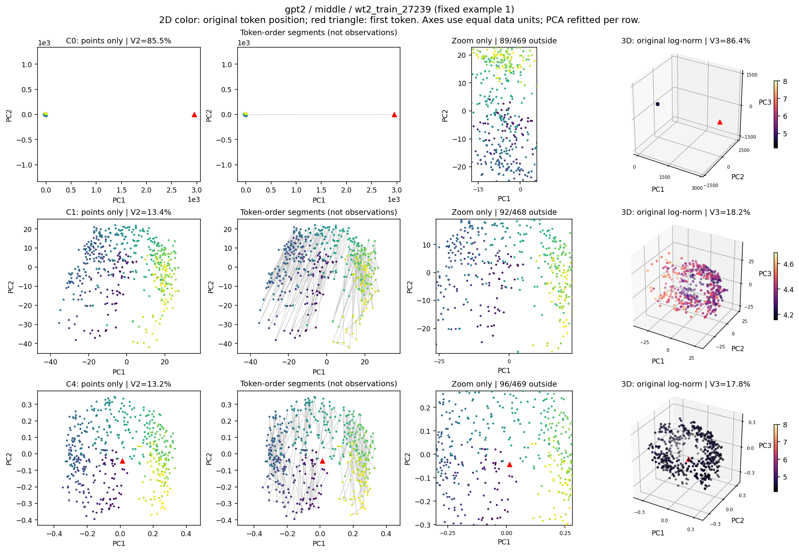

### 固定代表2：wt2_train_24969

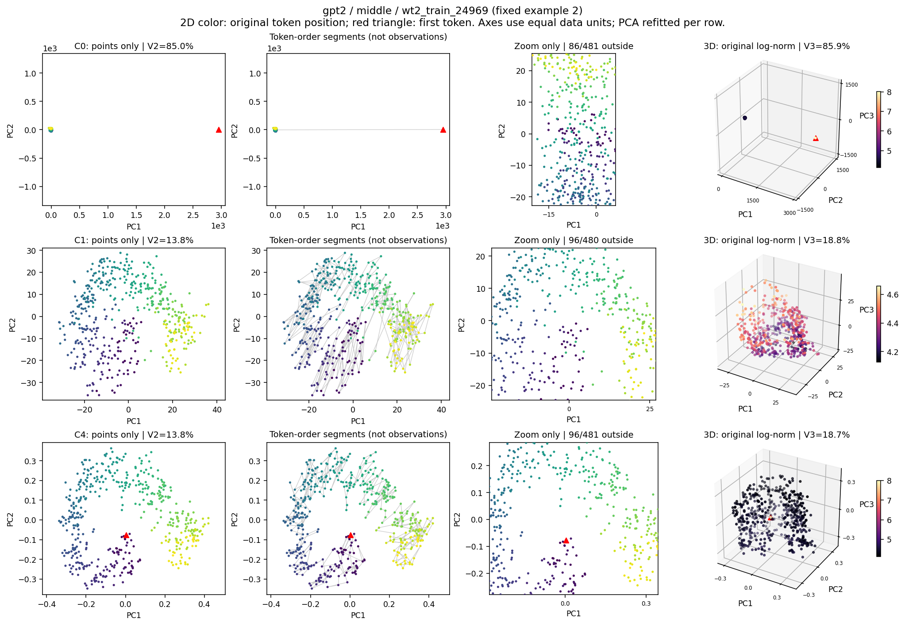

[全64記事の散布図：C0](figures/atlas_gpt2_middle_C0.png)

[全64記事の散布図：C1](figures/atlas_gpt2_middle_C1.png)

[全64記事の散布図：C4](figures/atlas_gpt2_middle_C4.png)

## GPT-2 / 最終正規化後

### 固定代表1：wt2_train_27239

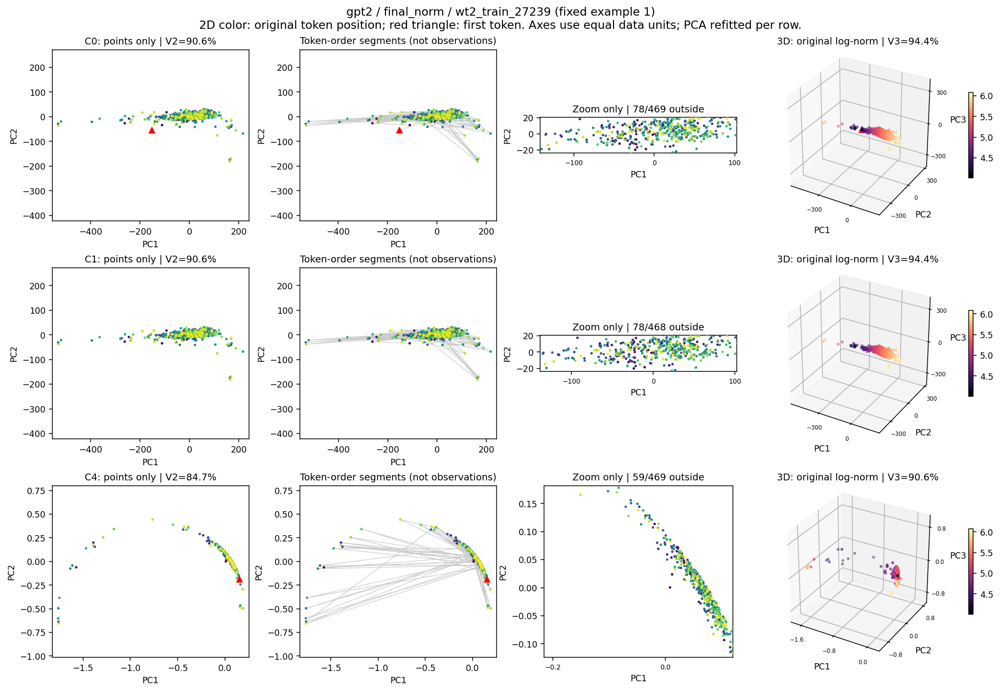

### 固定代表2：wt2_train_24969

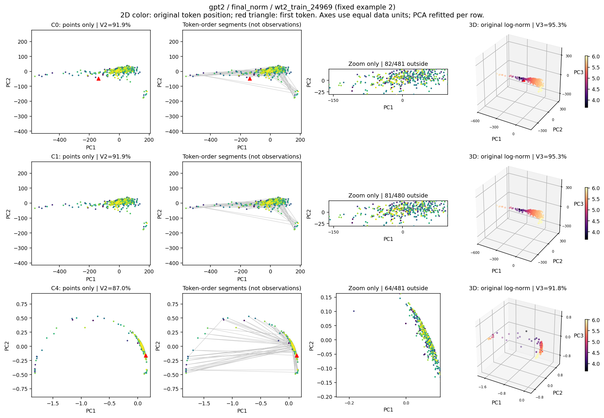

[全64記事の散布図：C0](figures/atlas_gpt2_final_norm_C0.png)

[全64記事の散布図：C1](figures/atlas_gpt2_final_norm_C1.png)

[全64記事の散布図：C4](figures/atlas_gpt2_final_norm_C4.png)

## OPT-1.3B / 中央層

### 固定代表1：wt2_train_27239

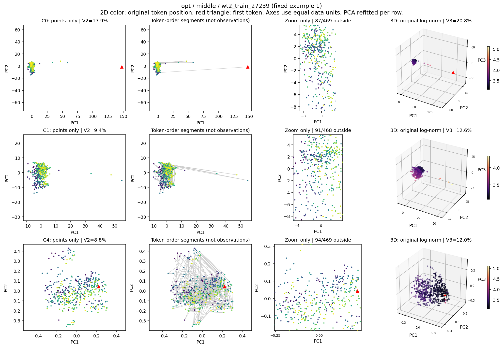

### 固定代表2：wt2_train_24969

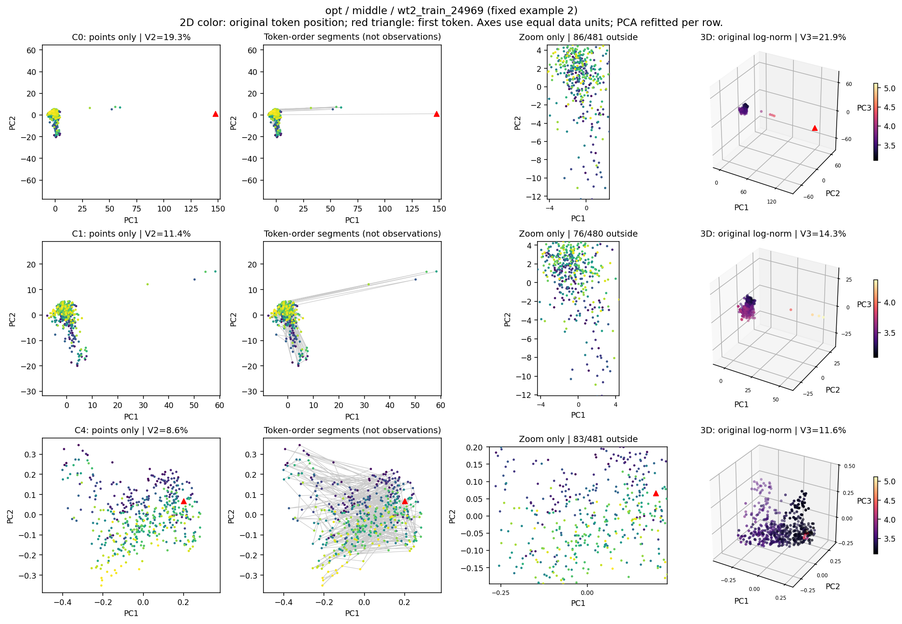

[全64記事の散布図：C0](figures/atlas_opt_middle_C0.png)

[全64記事の散布図：C1](figures/atlas_opt_middle_C1.png)

[全64記事の散布図：C4](figures/atlas_opt_middle_C4.png)

## OPT-1.3B / 最終正規化後

### 固定代表1：wt2_train_27239

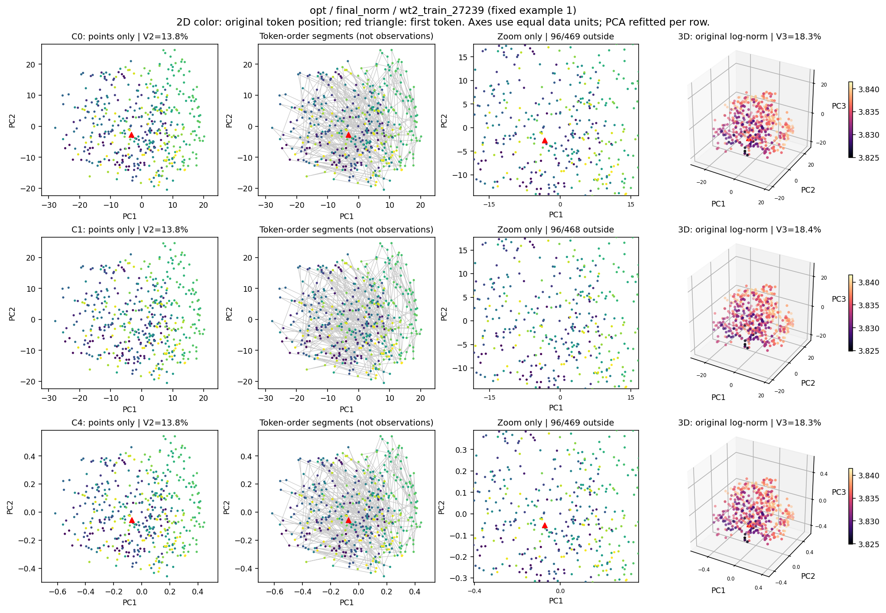

### 固定代表2：wt2_train_24969

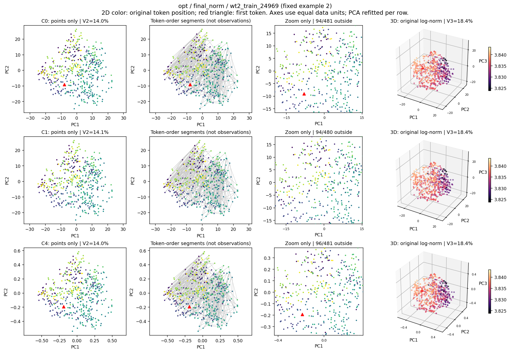

[全64記事の散布図：C0](figures/atlas_opt_final_norm_C0.png)

[全64記事の散布図：C1](figures/atlas_opt_final_norm_C1.png)

[全64記事の散布図：C4](figures/atlas_opt_final_norm_C4.png)

## Qwen2.5-1.5B / 中央層

### 固定代表1：wt2_train_27239

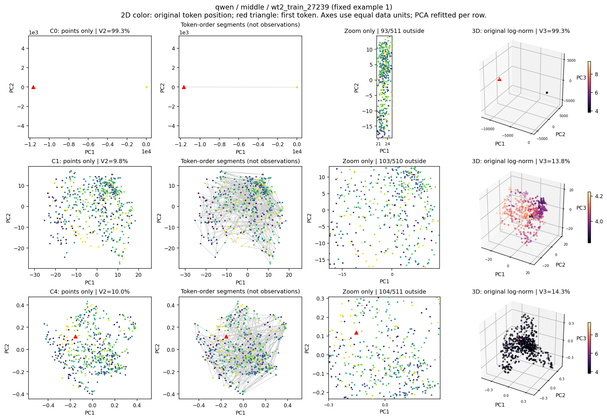

### 固定代表2：wt2_train_24969

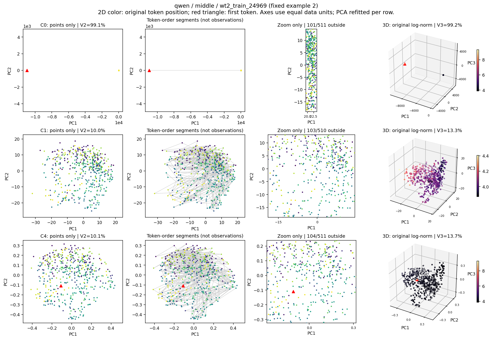

[全64記事の散布図：C0](figures/atlas_qwen_middle_C0.png)

[全64記事の散布図：C1](figures/atlas_qwen_middle_C1.png)

[全64記事の散布図：C4](figures/atlas_qwen_middle_C4.png)

## Qwen2.5-1.5B / 最終正規化後

### 固定代表1：wt2_train_27239

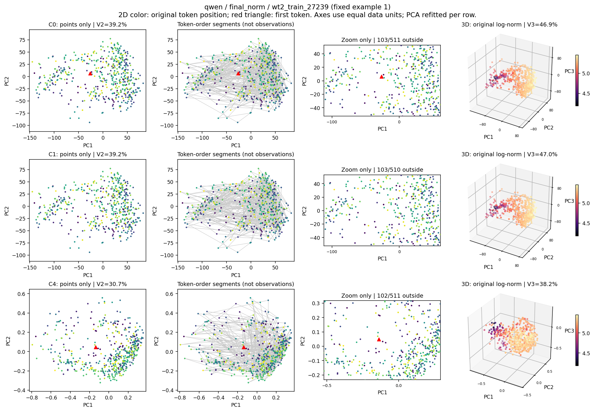

### 固定代表2：wt2_train_24969

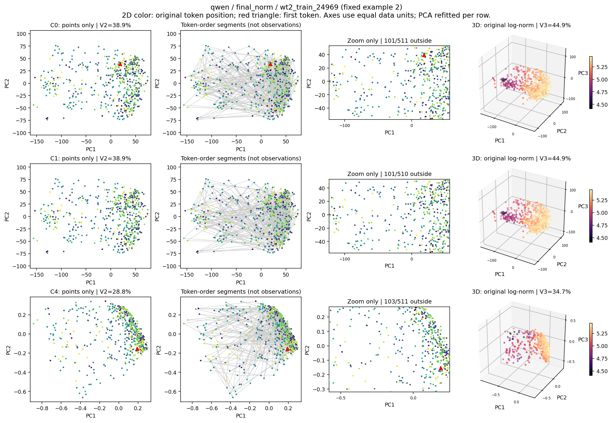

[全64記事の散布図：C0](figures/atlas_qwen_final_norm_C0.png)

[全64記事の散布図：C1](figures/atlas_qwen_final_norm_C1.png)

[全64記事の散布図：C4](figures/atlas_qwen_final_norm_C4.png)
