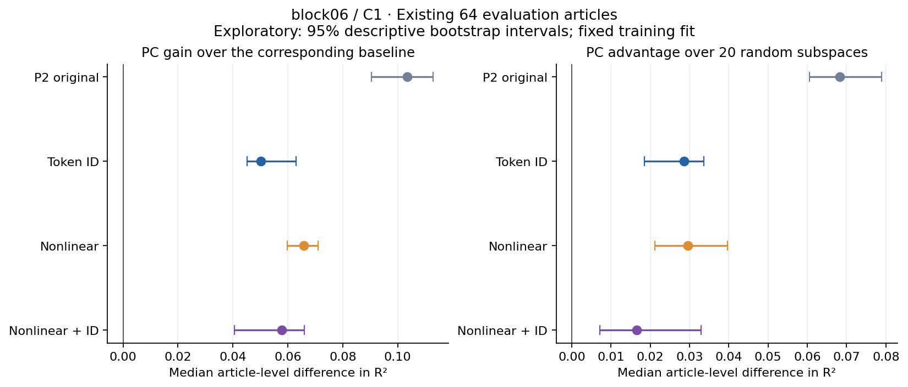
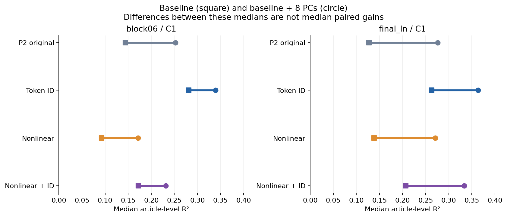
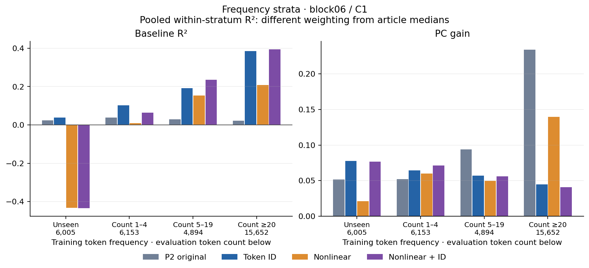

# P2探索的追加解析 語彙と非線形の比較を強めたときに残るPCの効果

2026-10-20。既存のP2 ZIPだけを使った追加解析。**主条件では、トークンIDごとの傾向を比較モデルに加えると、PCの上乗せは約半分に縮まったが、消えなかった。** 一方、長さ・頻度などの組合せを多数入れたモデルは、IDモデルより予測が悪かった。「複雑な比較を入れたので、あらゆる交絡を除けた」とは言えない。

元P2の結果を知ってから設計した**探索的解析**である。元の[確認的P2レポート](../../receipts/6966c146e980_p2_v1_final/ANALYSIS_REPORT_JA.md)、仮説判定、原ZIP、原観測、凍結コードはそのまま保持した。言語モデルの再実行は0回。今回は保存された数値から、小さな回帰モデルだけをCPUで当てはめた。

## まず平たく言うと

前回は「文章のどこに出たか、長さ、頻度、状態の大きさ」から予想する相手とPCを比べた。今回はさらに「このトークンは、そもそもどれくらい予測しにくい傾向があるか」を訓練記事で覚えられる相手を用意した。

この相手は前回よりよく予測できた。そのため、以前PCの手柄に見えていた上乗せは小さくなった。それでもPCを加えると改善が残った。現状の適切な言い方は、**「トークンごとの傾向を考慮しても、固定された8PCには、この比較モデルが拾い切れない現在トークンの予測しにくさに関する情報が残る」**である。

「PCの独立した意味機能を発見した」「語彙がPC効果の半分の原因だった」とは言えない。比較モデルの調整手順も元P2から変わっており、改善量の減少を原因別の寄与率として分解した分析ではない。

## 何と比べたか

| 名前 | 使う情報 |
| --- | --- |
| 元P2 | 元の8変数の線形ridge。保存済み予測器を再利用 |
| ID | 元の8変数と、トークンIDごとの縮約した傾向 |
| NL | 元の8変数、位置・長さ・頻度・ノルムの区分線形関数と全2変数間の組合せ、文字形状12指標 |
| NL ID | NLとトークンIDごとの傾向を併用 |

ここで「語の種類」はGPT-2のトークンIDを指す。単語の途中や空白付きの断片も含むため、品詞・意味分類ではない。長さも個別復号トークンの文字数・UTF-8 byte数である。ノルムは保存された隠れ状態から得るため、比較モデル全体が文字列情報だけを使っているわけではない。

IDは8数値列＋ID効果、NLは200数値列、NL IDは200数値列＋ID効果。訓練で未出のIDは効果を0にし、他の特徴で予測する。NLの「非線形」は入力特徴の曲線・積を指し、最終予測式はこれらの特徴に対する正則化線形回帰である。任意の非線形関数を学習したわけではない。

## 主条件の結果

GPT-2の第6ブロック後block06、先頭観測を除いたC1。各モデル64評価記事、1記事511トークン。以下のR²・増分・優位差はそれぞれ**記事内で計算してから取った中央値**で、中央値同士の引き算は増分中央値と一致しない。

| 比較モデル | PCなしのR² | PC追加後のR² | PCの上乗せ ΔR² | ランダム方向への優位差 |
| --- | ---: | ---: | ---: | ---: |
| 元P2 | 0.144 | 0.252 | 0.1035 | 0.0682 |
| ID | 0.281 | 0.339 | 0.0501 | 0.0286 |
| NL | 0.093 | 0.171 | 0.0658 | 0.0295 |
| NL ID | 0.172 | 0.232 | 0.0579 | 0.0165 |

IDモデルは訓練内の交差検証でも、今回の3候補中で誤差が最小だった。評価側の基礎R²も元P2の0.144から0.281へ上がり、全64記事で基礎R²が正だった。この比較でPC増分は **0.05010 [0.04521, 0.06296]**、ランダム20組平均への優位差は **0.02856 [0.01844, 0.03363]**。前者は63/64記事、後者は59/64記事で正。残りの負値も保存・集計した。

元P2の増分0.103522に対する今回の増分0.050095の比は **48.4%**。これは二つの増分中央値の比であり、「能力の48%」「因果的に独立な情報が48%」ではない。記事ごとの対応差を取ると、増分の変化中央値は-0.05204である。

図の区間は64記事を単位に10,000回再標本化した**95%の記述区間**。今回の複数モデル選択を補正した確認的検定ではなく、訓練fitを固定した条件付きのばらつきである。元P2の事前登録した98.75%区間とH1/H2判定は変更していない。

## 組合せを増やせば強くなるわけではなかった

NL単独の基礎R²中央値は0.093で元P2を下回り、NL IDは0.172でIDの0.281を下回った。訓練内CVも同じ順序で、block06の基礎MSEはID 6.174、NL 8.058、NL ID 7.504。今回の曲線・組合せは十分に安定した比較モデルにならなかった。

NL IDでも主条件のPC増分は0.05788 [0.04046, 0.06600]で残り、ランダム優位差は0.01647 [0.00710, 0.03298]だった。ただし、予測の弱い基礎モデルを上回った結果だけから、PCの特別な役割を強く主張しない。IDモデルとの比較の方が、今回の候補内では予測力の高い相手に対する証拠になる。

非線形モデルの失敗は隠さない。基礎R²の最小値はblock06でNL −0.667、NL ID −0.510。未出トークン群での基礎R²低下も目立った。有限訓練標本での過適合や訓練範囲外への外挿は説明候補だが、この解析では原因を切り分けていない。正則化の候補境界を選ぶ例もあり、最適な比較モデルを尽くしたとは言えない。

## 別条件ではどうだったか

IDモデルに対する全6条件の結果を示す。C0は全点で推定したPCA、C1は先頭を外して推定、C4は単位ノルム化して推定したPCA。surprisalの予測評価は、どの条件も元位置1〜511にそろえた。

| 点 | 条件 | PC増分 | ランダム優位差 | 増分が正の記事 |
| --- | --- | ---: | ---: | ---: |
| block06 | C0 | 0.04870 | 0.02444 | 62/64 |
| block06 | C1 | 0.05010 | 0.02856 | 63/64 |
| block06 | C4 | 0.06419 | 0.03710 | 64/64 |
| final_ln | C0 | 0.11257 | 0.02693 | 64/64 |
| final_ln | C1 | 0.11256 | 0.01805 | 64/64 |
| final_ln | C4 | 0.12006 | 0.03841 | 64/64 |

final_ln/C1のID比較では増分中央値0.11256で、元P2の0.13673の約82%が残る。block06と同じ減り方ではない。基礎モデルにもそれぞれの点のノルムを使っているため、層の差をそのまま情報処理の因果的な差とは解釈しない。

全24組は[詳細表](DETAIL_TABLES.md)に掲載した。特にblock06/C0のNL IDでは、PC増分は0.04418で正だが、ランダムへの優位差は0.00361、95%記述区間は[−0.00182, 0.00784]で0をまたいだ。**PCを加えると改善することと、PCが任意の8方向より優れていることは別の主張**である。

## 見覚えのないトークンでも残るか

評価32,704トークンのうち、訓練で未出は6,005（18.4%）、訓練頻度1〜4は6,153、5〜19は4,894、20以上は15,652だった。全頻度群に64記事が寄与する。

block06/C1のID比較では、未出トークン群でもPC増分0.0778、ランダム優位差0.0307だった。頻出群ではPC増分が元P2の0.2339からIDの0.0448へ縮んだ。単に見たことのあるIDを覚えるだけでは説明し切れない一方、頻出トークンの傾向を比較に含めることが結果を大きく変えている。

これらは**頻度群内のトークンをプールしたSSTで割る補助集計**で、主表の記事中央値とは重みと分母が異なる。群の値を足し合わせたり、トークン数を独立した反復数と数えたりしない。未出IDでも綴りの断片・類似ID・話題が共有され得るので、「語彙全般から独立した意味情報」の証拠にはしない。

NL IDの未出群でもPC増分は0.0766だが、ランダムへの優位差は−0.0117だった。NL IDが全群で優れた比較相手になったわけではない。

## 元P2からどう見解を更新するか

- **維持できること：** 元P2の指定した単純な比較モデルに対するH2支持はそのまま。今回の探索では、より予測力の高いID比較でもPCの追加予測は残った。
- **弱めること：** 元の増分全体を、トークン固有の傾向とは別の情報とみなすこと。主条件では比較を強めると増分がかなり縮んだ。
- **まだ言えないこと：** 全語彙・全非線形交絡からの独立、PCごとの専用機能、意味の因子、因果機構、他モデルや他領域への普遍性。
- **今回再評価していないこと：** P2-H1の位置方向転用とP1の先頭特異性。今回の予測対象は、現在トークンを既に読んだ状態からの現在トークンsurprisalであり、次トークンの言語モデル性能が改善した結果ではない。

次の確認的検証では、今回有効だったID比較を含めて設定を先に固定し、P0/P1/P2と重ならない新しい記事で確認するのが妥当である。非線形比較の改良を続けるなら、今回の評価記事は探索用のままとし、訓練内検証で外挿・正則化を扱ってから新しい評価集合へ進む。今回、新しいColab実行や論文改訂は始めていない。

## 方法と監査

追加数値を計算する前に[EDAカード](../../prereg/EDA-0001_v1_p2_lexical.md)を保存した。ただしP2の元結果は既知であり、確認的事前登録ではない。元の訓練64記事を記事単位の4-foldに分け、各foldの訓練だけで頻度、節点、尺度、係数を学習。基礎モデルのalpha/tauを選び、その値を固定してPC追加・ランダム各組のgammaを同じ5候補から選んだ。追加モデルでは基礎変数とIDの係数も同時に再推定した。

最終当てはめは元の訓練64記事だけ。元の評価64記事では設定選択・再PCA・符号選び・標準化をしない。PCA自体はP2全訓練で固定された基底をinner CVでも使うため、inner CVはこの無教師表現に条件づけた調整であり、PCA推定から完全に分離した汎化推定ではない。全モデルと予測を[FIT COMMIT](FIT_COMMIT.json)へ記録後、別工程で評価誤差を集計した。

予定18組×64記事の追加比較と、元P2参照6組×64記事をすべて集計。合計1,536記事×条件×モデル、解析欠測0。新しい回帰モデルは18組×22＝396個、参照予測器132個。各22個は基礎、PC追加、ランダム20組。訓練内候補fitを独立した実験標本には数えない。

検証では、密行列での別解との合成照合3件が合格。保存係数から新しい予測12,950,784個を直接再構成し、元P2の384記事条件も照合した。新予測最大絶対差5.15e-14、元予測差4.97e-14、正規方程式最大相対残差1.24e-12。計算者と検証者は同じagentの自己監査で、独立レビューではない。

検証初回は、保存C0/C4には先頭NA行が残るのに照合器が511行を想定し、形状不一致で停止した。照合器で保存位置1〜511を明示選択して再実行し、合格。回帰の当てはめ・予測・元データは変更していない。初回ログ[verification.log](verification.log)と修正後[verification_v2.log](verification_v2.log)を保持した。

CPU当てはめと予測保存は47.90秒。図・集計・検算・報告作成は別工程。Python 3.13.5、NumPy 2.4.1、SciPy 1.17.0を使用。元P2環境を変更したのではなく、保存データの追加解析環境として記録した。

入力ZIP SHA-256：`730f2eb58af84fa6a6017eb2a07fe7324e4f6c4692dbec4ffb720fa2c4626d0a`。原観測1,603ファイルをZIP内INDEXと照合。元のP2/P1レポート、原稿、配布コードは保持。解析ソースは[analyze.py](analyze.py)、別工程の検算は[verify.py](verify.py)、全数値は[results.json](results.json)、全記事値は[article_results.json](article_results.json)、訓練内設定選択は[cv_results.json](cv_results.json)、最終検証は[numerical_verification.json](numerical_verification.json)。
