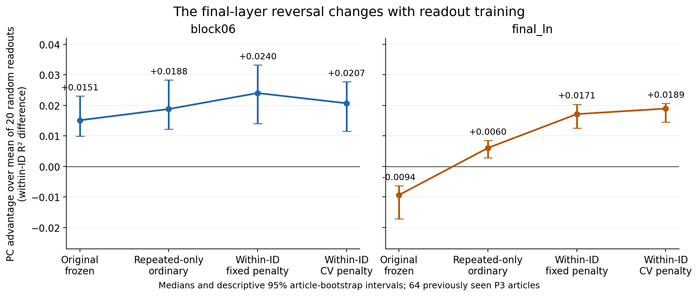
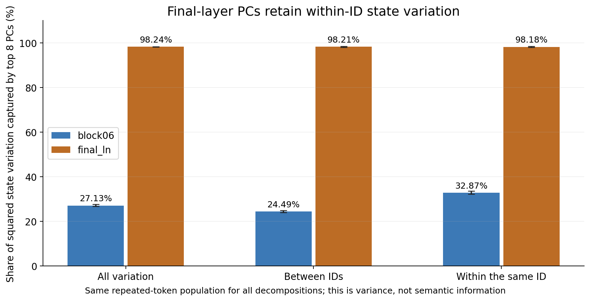
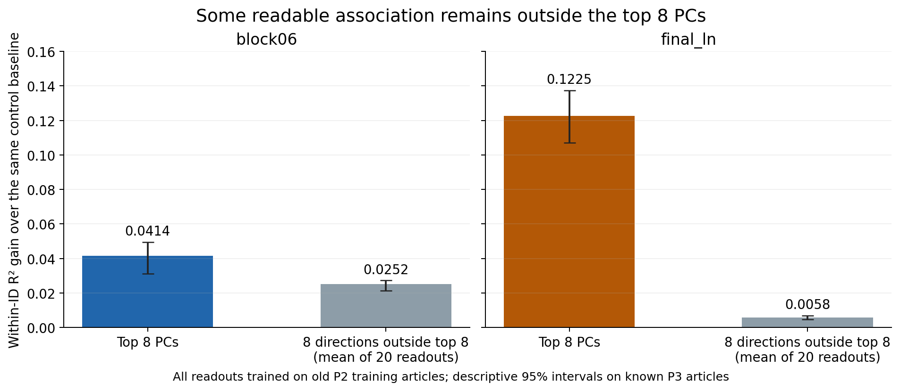

# 保存データ診断：P3の逆転は読み出しの学習設定に依存する

2026-10-20、EDA-0002。**保存データのみの探索解析を完了し、原観測からの数値検算に合格した。新しい言語モデルforwardは0。元のP3結果・判定・係数は変更していない。**

## 1. 超文系向けにいうと

今回の結果は、「最後の層ではPCに役立つ情報がない」という説明を弱めた。同じ内部データ・同じ8本のPCを使い、**読み取り係に何を練習させるかを変えると、最後の層でもPCがランダム方向を上回った**からである。

元の読み取り係は、語の種類の違いも含めた通常の予測を練習していた。一方、「同じ語片が、場所によってどれだけ意外になるか」という採点では、学習時に重視した違いの一部が消える。訓練の対象を繰り返し語に揃え、さらにその出現差を直接学ぶと、元の逆転はこの探索評価では残らなかった。

これは「新しいGPT-2を学習した」「言語モデルの性能を上げた」という話ではない。保存済みの内部数値を読む小さな回帰式を、旧P2訓練記事だけで作り直した。

もう一つの手掛かりは分散である。最後の層では、同じID内の内部状態の変動も**約98.18%が上位8PCに含まれていた**。「PCは語の種類だけを拾い、同じ語の出現差をほぼ捨てている」という単純な説明とは合いにくい。ただし98.18%は内部数値の二乗変動量であり、意味・文脈・因果効果の98.18%ではない。

**現時点の勧告：元の逆転を原因探索の前提にして、新規GPU実験へ直行しない。** 読み出し設定への依存が分かったところでこの枝を区切り、PCの関連がモデルの実際の計算でどう使われるかは未解決として保持する。

## 2. 何を固定し、何を変更したか

[計算前の探索カード](../../prereg/EDA-0002_v1_p3_reversal.md)にD1〜D3を固定した。P3の結果を既に見た後の設計なので、確認的な再追試ではない。

- 訓練は旧P2の64記事、探索評価は既知P3の64記事。P2評価64記事は使用しない。
- GPT-2の原状態、目的変数、block06/final_ln、C1、8PCとランダム20組、元の標準化を固定。
- 同じ記事の同じIDが2回以上現れるtokenを対象とし、各群の目的変数と予測から群平均を引く。位置などの交絡全般を取り除く操作ではない。
- Oは元の固定予測。Rは訓練対象のみ繰り返しIDに限定して通常のID回帰を再学習。W fixedはRと同じ訓練tokenで群内差を学習し、元の尺度・罰則を維持。W CVは群内目的に合わせて旧訓練内で罰則を選び直した。
- 全fit/CVを保存・封印した後にP3の新しい評価を計算。評価ラベルからの係数調整は0。ただしP3が既知資料であることは変わらない。

R→W fixedは同じtokenと罰則での学習目的の変更。群内中心化によってID定数等が消えることもこの変更に含む。O→Rにはsingleton除外による訓練分布・ID効果推定の変化があるので、全変化を「学習目的だけの効果」とは呼ばない。

## 3. 逆転はどう変わったか

正の差はPCがランダム20組平均より良いことを示す。全て64記事の中央値。各95%区間は記事bootstrapの記述区間で、探索選択や多重性を調整した確認的検定ではない。元P3の98.75%区間・判定はそのまま保持し、この表で置き換えない。

| 点 | 学習設定 | 基礎へのPC増分 | PC−ランダム平均 | 差の95%記述区間 | PC勝／負 |
| --- | --- | --- | --- | --- | --- |
| block06 | O 元の固定予測 | 0.033571 | 0.015092 | [0.009951, 0.023035] | 49／15 |
| block06 | R 繰り返し語だけで通常学習 | 0.039671 | 0.018779 | [0.012198, 0.028238] | 51／13 |
| block06 | W fixed 群内目的・罰則固定 | 0.046097 | 0.023997 | [0.014042, 0.033173] | 49／15 |
| block06 | W CV 群内目的・訓練内調整 | 0.041389 | 0.020663 | [0.011515, 0.027669] | 48／16 |
| final_ln | O 元の固定予測 | 0.082171 | -0.009382 | [-0.017125, -0.006356] | 19／45 |
| final_ln | R 繰り返し語だけで通常学習 | 0.098983 | 0.006024 | [0.002833, 0.008507] | 50／14 |
| final_ln | W fixed 群内目的・罰則固定 | 0.119838 | 0.017109 | [0.012541, 0.020310] | 61／3 |
| final_ln | W CV 群内目的・訓練内調整 | 0.122506 | 0.018916 | [0.014456, 0.020597] | 61／3 |

最終点の元の差は−0.009382だったが、Rで+0.006024、W fixedで+0.017109、W CVで+0.018916。W fixed/CVとも61/64記事でPCが上回る。固定罰則でも方向が変わるため、今回のCVの当たり設定だけで逆転を消した結果ではない。

block06は全系列でPC優位が残る。ただし、どの設定でも全記事がPC勝利というわけではない。

図1。点は中央値、線は95%記述区間。元の負の結果も含めて全設定を表示。

同じ記事ごとの差を取った結果も示す。以下は対応差の中央値であり、上表の中央値同士を引いた値とは一致しない。

| 点 | 同じ記事での変更 | ランダム優位差の変化 | 95%記述区間 |
| --- | --- | --- | --- |
| block06 | R_minus_O | 0.001384 | [-0.000461, 0.003429] |
| block06 | W_fixed_minus_R | 0.004365 | [-0.002818, 0.011024] |
| block06 | W_CV_minus_W_fixed | -0.002252 | [-0.008713, 0.000200] |
| block06 | W_CV_minus_O | 0.002083 | [0.000750, 0.008063] |
| final_ln | R_minus_O | 0.015924 | [0.013325, 0.020798] |
| final_ln | W_fixed_minus_R | 0.010294 | [0.007133, 0.013692] |
| final_ln | W_CV_minus_W_fixed | 0.002098 | [0.000766, 0.002899] |
| final_ln | W_CV_minus_O | 0.028675 | [0.023853, 0.034919] |

final_lnでは、O→Rの変化+0.015924、R→W fixedの変化+0.010294がともに正の記述区間だった。訓練対象と群内目的の両方が関係する。W fixed→W CVの変化は+0.002098で、元の負から正への変更はCV前に既に起きている。

## 4. PCがID間の差だけを拾っていたのか

繰り返しtokenという**同じ対象集合**の中で、記事内の全変動をID群平均の違いと群内変動に分けた。全状態・PC射影のどちらでも total=between+within が数値的に成立することを検算した。singletonを含む全tokenの分散比とは分母が異なる。

| 抽出点 | 全変動をtop8が捉える割合 | ID間変動をtop8が捉える割合 | 同一ID内変動をtop8が捉える割合 | top8自身の変動中の群内割合 |
| --- | --- | --- | --- | --- |
| block06 | 27.13% | 24.49% | 32.87% | 39.39% |
| final_ln | 98.24% | 98.21% | 98.18% | 44.72% |

final_lnではtop8の捕捉率は全体・ID間・群内でほぼ同じ約98%。top8内の群内割合44.72%も、全768次元の群内割合44.77%と近い。**同一ID内に絞るとtop8から大半の状態変動が消える、という説明は弱まる。**

block06ではtop8の捕捉率は全体27.13%、群内32.87%。両層で「状態の変動を多く捉えること」と「目的変数をよく予測すること」を同一視できない。

図2。top8が捉える二乗変動量の割合。機能情報の割合ではない。

## 5. 相関と予測の振幅

群内R²は、正解と予測が一緒に動く項から、予測の二乗変動項を差し引いたものとして分解できる。相関があっても、その相関に対して予測を大きく振り過ぎると誤差が増える。各記事の相関と「予測の標準偏差÷正解の標準偏差」を確認した。

| 点 | 設定 | PCの相関 | ランダム平均相関 | PCの予測振幅比 | ランダム平均振幅比 |
| --- | --- | --- | --- | --- | --- |
| block06 | O 元の固定予測 | 0.437648 | 0.403037 | 0.315706 | 0.309121 |
| block06 | W fixed 群内目的・罰則固定 | 0.425229 | 0.402555 | 0.461331 | 0.402832 |
| block06 | W CV 群内目的・訓練内調整 | 0.451371 | 0.432326 | 0.502138 | 0.475392 |
| final_ln | O 元の固定予測 | 0.392079 | 0.407802 | 0.497019 | 0.447447 |
| final_ln | W fixed 群内目的・罰則固定 | 0.449343 | 0.434973 | 0.481713 | 0.468481 |
| final_ln | W CV 群内目的・訓練内調整 | 0.480649 | 0.455784 | 0.517770 | 0.507740 |

元final_lnのPC予測はランダム平均より振幅比が大きい（0.497対0.447）一方、相関中央値は低い（0.392対0.408）。したがって、**振幅だけの校正ミスとも、PCに情報が全くないとも言い切れない**。群内目的で学び直すと、相関の順位もPC側が上になる（W CVで0.481対0.456）。

これらは元の予測器の振る舞いを記述する診断。評価記事の正解で傾きを調整した「修正版」を採用したわけではない。また、表の中央値を式に代入してR²中央値を再現することはできない。

## 6. 上位8PCの外には手掛かりがあるか

元のランダム方向からtop8成分を取り除き、残りを正規直交化した20組の8方向を調べた。全て同じ旧訓練CV手順。最良のランダム組を選んでいない。

| 点 | 上位8PC追加の増分（W CV） | 補空間8方向20組平均の増分 | 補空間増分の95%記述区間 | 補空間増分 正／負 |
| --- | --- | --- | --- | --- |
| block06 | 0.041389 | 0.025206 | [0.021303, 0.027222] | 64／0 |
| final_ln | 0.122506 | 0.005787 | [0.004659, 0.006930] | 60／4 |

両層でtop8の外からも基礎モデルを上回る群内予測が得られた。ただし最終点の補空間増分は0.005787で、top8追加0.122506より小さい。この有限の比較では、**上位8PCの外にも関連があるが、元の逆転の主説明を「有用なものは主に外側」とする根拠は弱い**。

図3。W CVの基礎モデルに対する増分。PCも補空間も8方向。補空間は20組平均。

補空間の線形予測可能性は、PCから統計的に独立な情報であることを意味しない。直交する方向のスコアが評価分布で相関することもある。今回PC＋補空間の併用は調べていないため、PCに対する独立した上乗せ量とは呼ばない。また、広く分散した符号化や補空間の必要性・因果性も未同定。

## 7. 説明候補の絞り込み

| 候補 | 今回の診断 | 残る限界 |
| --- | --- | --- |
| 最後のtop8はID間の違いばかり拾い、群内の状態変化をほぼ失う | 弱まる。群内変動の捕捉も98.18% | 分散の大きさは目的変数の情報量ではない |
| 有用な関連は主としてtop8外へ移った | この単純な説明は弱まる。群内学習ではtop8が優位、補空間の増分は小さい | 外側にも予測可能な関連はある。今回の20組が補空間の最良読出しではない |
| 通常学習と群内採点の組合せ、学習対象の違いが逆転に関わる | 最も直接的に整合。対象変更・目的変更の各段階で差が改善 | 原因を1つの係数や一般原理へ一意に割り当てていない |
| 最終LayerNormが逆転の原因 | 現状では根拠不足。読み出し設定だけでも逆転は消える | P2/P3に直前の状態がなく、深さとLayerNormを分離できない |
| PCが文脈の因果的な専用機構 | 未解決 | 今回は観測の読み出し。位置等の交絡、行動への因果効果は未検証 |

「読み出し設定への依存」は保存状態を変えずに確認できた性質。モデル内部の処理機序を特定したという主張ではない。P1で得たLayerNorm直前/直後の分散集中の差も保持するが、P1の記事内PCAは今回の固定読み出し比較を代替しない。

## 8. 新規実験と撤退の判断

採用された上限は[有限回計画](FINITE_PLAN_AND_GATES.md)の「保存データ診断1回＋新規比較1回まで＋条件付き介入1回まで」。上限は使い切るノルマではない。

今回の[判定記録](DECISION_AFTER_DIAGNOSIS.md)は、**元の逆転を根拠とした新規GPU取得を現在は見送り、機序追跡を一旦保留する**。元の現象は固定Oの結果として正しく残るが、「最後ではPCが本質的に不利」という前提は成立しなかった。

再開候補は、同じ評価方法で異なる結果を予告できる機序仮説が具体化し、最後のLayerNorm直前を追加取得する必要性が示せた場合。入力・学習/評価分離・最小効果・精度・標本数・上限を先にカードへ固定する。現時点で取得条件を満たしたとは記録しない。新規比較で区別できなければ介入しない。介入が対照と同程度、全般的損傷だけ、または予定段階を終えても判別不能なら未解決として閉じる。

今の論文には、P1の先頭感度、P2/P3の転用、**固定予測の群内順位は学習対象・目的に依存し、目的を揃えた探索的再当てはめでは両層でPC優位が得られる**という到達点を候補として残せる。論文本文の採用・改訂は今回していない。

## 9. 分母・当てはめ・不確実性

| 集合 | 記事数 | 通常token数 | 群内対象token数 | 群内群数 | 対象外singleton数 |
| --- | --- | --- | --- | --- | --- |
| P2旧訓練 | 64 | 32704 | 21531 | 4774 | 11173 |
| P3既知評価 | 64 | 32704 | 21630 | 4775 | 11074 |

全2点×64評価記事で解析可能、欠測0。訓練/評価の各記事は固定集合の全てを使用。独立反復数をtoken数や群数に増やさず、区間は64記事を単位とした。

W CVの基礎alphaは両層とも0.0001（候補下端）。PC gammaはblock06=0.001、final_ln=0.001。候補端だったことを隠さず、追加の探索範囲拡大は行わない。全20組の選択値・全候補損失・fold分母は[CV記録](cv_results.json)に保存した。尺度と基底は旧訓練64記事全体で固定済みで、inner CVはそれらに条件づけた調整である。

記事bootstrap10,000回、PCG64 seed20261027、各95%記述区間。訓練集合・仮説選択の変動を含まず、多重比較の確認的支持判定には使わない。P3評価を見た後の探索なので、新しい条件の未使用記事での再現性は未確認。モデル/コーパス一般化、単発語、PC1とPC2〜8の機能分離もこの診断では扱わない。

## 10. 検証・保全・実行範囲

- 開始時に前アンカーの2,537ファイルを照合、不一致0。[保全前記録](preservation_before.json)。
- [合成数学検査](test_results.json)：44モデルを罰則付き拡大行列の最小二乗解と比較し合格。群内中心化、singleton、補空間の直交性も確認。
- [保存原観測の別計算監査](numerical_verification.json)：PASS。130個の新規群内fitを拡大行列最小二乗で再計算、44個のID回帰の直接勾配を照合。7,129,472予測を元座標の重みへ展開して再構成し最大差8.08e-14。
- 元P3の群内増分・ランダム差も一致（最大差1.68e-16）。SS恒等式の相対誤差最大5.66e-16。主要記述区間は別の中央値計算でも一致。
- 全fitを封印した後に新しいP3評価を計算。係数・予測・記事別指標を保存し、原本へ書き戻していない。[FIT_COMMIT](FIT_COMMIT.json)、[全記事・全モデル表](DETAIL_TABLES.md)。
- CPU Python 3.13.5 / NumPy 2.2.6。新しいLM forward・モデル取得・GPU・外部転送0。生成と検証は同じagentの自己監査で、独立レビューではない。
- 環境確認時に既存NumPy環境にはSciPyがないと分かったため、本解析はNumPyだけで実装した。既存実験環境への追加インストールや科学条件の変更は0。

元P0〜P3、EDA-0001、全旧稿とthroughline本体は保持。最終の保全・リンク・図の確認は[最終確認](final_checks.json)に記録する。
