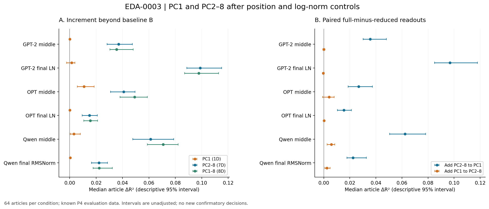
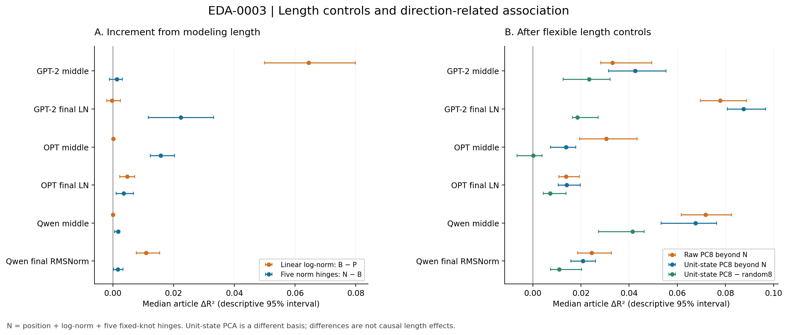
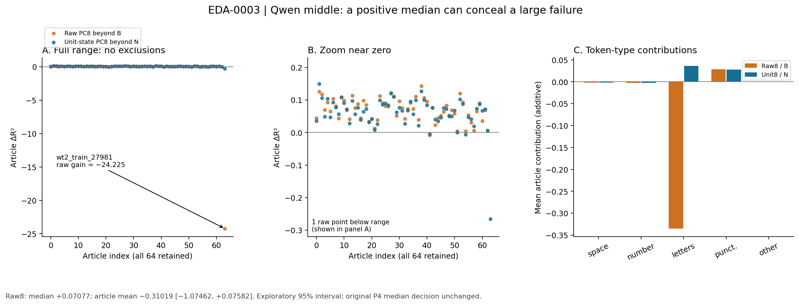
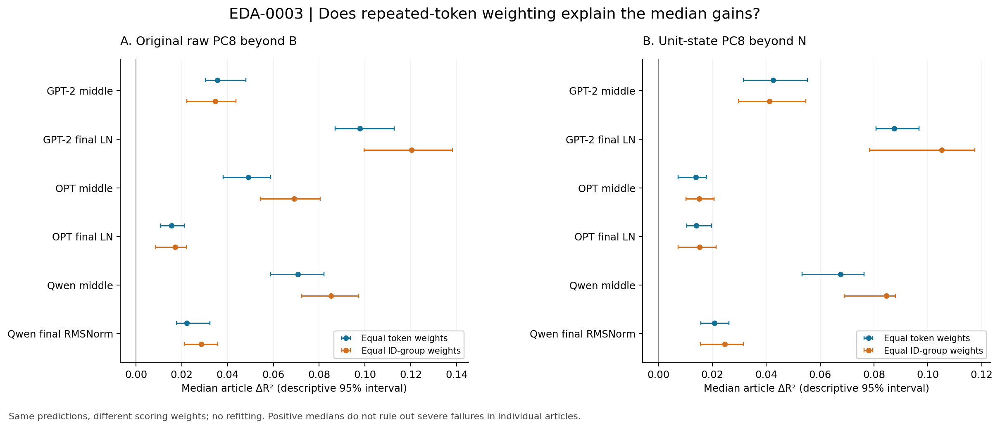

# EDA-0003：PC1と残りのPC、長さと向きの最終探索

2026-10-20。**完了／この１セットで探索終了。保存P4だけを使用、新しいLM forward・取得・GPU実行は0。旧結果・旧原稿は保持。**

## 結果を先に

今回の読み出しでは、**位置とノルムを考慮した後の追加の関連は、PC1単独よりPC2〜8の組に多く残った**。また、状態の長さを柔軟に考慮しても、向きの８方向から読める関連は６条件とも残った。ただしOPT中央層では、向きのPCを選ぶ利点をランダム方向との差としては明確に示せなかった。

同時に、**Qwen中央層には元のraw８PC読み出しが極端に外れる１記事があり、中央値は正でも記事平均は負になる**ことが分かった。「多くの記事で有利」と「大きな失敗も含め平均的に有利」は別の主張になる。この失敗を残したまま報告する。

到達点は、どの座標群・どの長さ対照・どの記事やtokenで関連が読めるかを限定したこと。モデルがその方向を因果的に利用している仕組みは未同定であり、ここで未解決の問いとして区切る。

## 1. 何を固定して調べたか

[解析条件と終了点](../../prereg/EDA-0003_v1_p4_components_radius_direction.md)を12:55:19 UTC（21:55:19 JST）にローカル固定し、12:59:15 UTCに数値解析開始。[固定記録](plan_freeze.json)と[実行記録](execution_manifest.json)を保存した。**P4の結果を知った上の探索であり、確認的な事前登録ではない**。公開レジストリの第三者時刻証明もない。

GPT-2、OPT-1.3B、Qwen2.5-1.5B baseの中央層と最終正規化後、全６条件。既存64訓練記事で新しい読み出しを当てはめ、既知の64評価記事で採点した。後者を再び未見の評価とは呼ばない。先頭tokenを除き、記事×token ID内で中心化し、反復２回以上のIDを評価する。32tokens・８ID群等の元規則を変更していない。

| 条件 | 評価記事 | 反復tokens | 記事×ID群 | 欠測 |
| --- | --- | --- | --- | --- |
| GPT-2 中央 | 64 | 20522 | 4585 | 0 |
| GPT-2 最終LN | 64 | 20522 | 4585 | 0 |
| OPT 中央 | 64 | 20522 | 4585 | 0 |
| OPT 最終LN | 64 | 20522 | 4585 | 0 |
| Qwen 中央 | 64 | 22349 | 4836 | 0 |
| Qwen 最終RMSNorm | 64 | 22349 | 4836 | 0 |

同じ記事がモデル間・層間で共有されるため、384点は384個の独立記事ではない。目的は同じtoken IDの出現ごとのsurprisal差。目的y[t]は前時刻logits[t−1]に由来し、状態h[t]はすでにtoken tを見ている。**事後的関連の読み出しで、未知の次tokenの予測性能ではない。**

記号は以下の通り。

| 記号 | 意味 |
| --- | --- |
| P | 位置４項 |
| B | P＋線形log1p(元ノルム) |
| N | B＋長さの５ヒンジ。節点は訓練10/25/50/75/90百分位 |
| A1 / A7 / A8 | B＋元PC1 / 元PC2〜8 / 元PC1〜8 |
| NR | N＋元のraw PC1〜8 |
| PU / NU | P / N＋単位長状態u=h/||h||を訓練PCAした８方向 |

元PC基底と既存20ランダム基底を使用し、１・７・８次元の比較では対照の次元も揃えた。向きのPCAは訓練記事だけから作成し、同じ20ランダム基底を単位長状態に射影した。単位長PCAと元のPCAは別の軸なので、番号を同じ意味と解釈しない。

基礎alphaは元P4 Wの0.0001に固定。追加係数のgammaは既存５候補、訓練４foldで選択した。基礎と追加の係数は共同推定し、評価記事では調整していない。平均・尺度・単位長PCAは訓練全体で共有する条件付きCVで、完全nested CVではない。元の基底も全訓練に依存する。

表のgainは基礎からのΔR²、advはPCの増分と同次元ランダム20組の増分平均との差。主題の集計は**記事中央値と20,000回記事bootstrapの記述95%区間**（seed20261029）。多重比較未調整で、確認的p値や新たな「支持」判定を作らない。

## 2. PC1とPC2〜8を切り分けた結果

| 条件 | A1_gain | A7_gain | A8_gain |
| --- | --- | --- | --- |
| GPT-2 中央 | 0.00003 [-0.00002, 0.00006] | 0.03703 [0.02829, 0.04742] | 0.03555 [0.03035, 0.04802] |
| GPT-2 最終LN | 0.00139 [-0.00236, 0.00395] | 0.09878 [0.08863, 0.11508] | 0.09771 [0.08697, 0.11270] |
| OPT 中央 | 0.01080 [0.00570, 0.01845] | 0.04093 [0.03085, 0.04948] | 0.04914 [0.03808, 0.05874] |
| OPT 最終LN | 0.00001 [-0.00001, 0.00005] | 0.01497 [0.00936, 0.02100] | 0.01556 [0.01059, 0.02114] |
| Qwen 中央 | 0.00322 [0.00033, 0.00808] | 0.06130 [0.04769, 0.07877] | 0.07077 [0.05883, 0.08210] |
| Qwen 最終RMSNorm | 0.00041 [0.00012, 0.00093] | 0.02214 [0.01648, 0.02853] | 0.02224 [0.01772, 0.03228] |

| 条件 | A1_adv | A7_adv | A8_adv |
| --- | --- | --- | --- |
| GPT-2 中央 | -0.00394 [-0.00458, -0.00320] | 0.01863 [0.00546, 0.03043] | 0.01466 [0.00340, 0.02638] |
| GPT-2 最終LN | -0.01092 [-0.01347, -0.00944] | 0.02074 [0.01677, 0.02541] | 0.01630 [0.01317, 0.02030] |
| OPT 中央 | 0.00879 [0.00235, 0.01637] | 0.02605 [0.01534, 0.03393] | 0.03000 [0.01853, 0.04176] |
| OPT 最終LN | -0.00066 [-0.00100, -0.00054] | 0.00916 [0.00522, 0.01542] | 0.00880 [0.00464, 0.01497] |
| Qwen 中央 | -0.00017 [-0.00216, 0.00284] | 0.03766 [0.02319, 0.04950] | 0.04077 [0.03207, 0.04914] |
| Qwen 最終RMSNorm | -0.00066 [-0.00121, -0.00024] | 0.01464 [0.00979, 0.02430] | 0.01198 [0.00784, 0.02446] |

PC2〜8の７方向は全６条件で正の増分を持ち、同次元ランダムとの差も今回の95%記述区間では正だった。PC1単独はGPT-2の両点とOPT最終層で明瞭な増分を示さず、Qwenでは小さい正の増分があるがランダム選択に対する優位性は明確でない。**OPT中央層は例外で、PC1単独にも増分とランダム優位差が残る。**

ただしこれは「位置とlogノルムをすでに使った後」の比較である。PC1が絶対的に無情報、分散集中が無意味、あるいはPC1が長さだけを表すとは言わない。１方向と７方向の容量も違うので、単純に「１方向あたり７倍」等とは比較できない。

| 条件 | A8_minus_A1 | A8_minus_A7 |
| --- | --- | --- |
| GPT-2 中央 | 0.03559 [0.03024, 0.04805] | 0.00009 [-0.00077, 0.00074] |
| GPT-2 最終LN | 0.09681 [0.08508, 0.11805] | -0.00036 [-0.00101, 0.00028] |
| OPT 中央 | 0.02672 [0.01864, 0.03733] | 0.00400 [-0.00095, 0.00790] |
| OPT 最終LN | 0.01549 [0.01040, 0.02123] | 0.00014 [-0.00009, 0.00033] |
| Qwen 中央 | 0.06230 [0.05048, 0.07814] | 0.00573 [0.00248, 0.00839] |
| Qwen 最終RMSNorm | 0.02236 [0.01782, 0.03262] | 0.00230 [0.00087, 0.00481] |

PC1に残り７本を足す追加価値は大きい。一方、PC2〜8にPC1を足す差はGPT-2の両点とOPTの両点で小さく区間が0をまたぐ。Qwenでは両点で小さい正の差が残る。各モデルを罰則ごと当てはめ直しているため、これは加算可能な因果的寄与の分解ではない。PC2〜8内の各PCの役割も今回分けていない。

## 3. 長さだけで説明できる部分、向きから残る部分

| 条件 | B_minus_P | N_minus_B |
| --- | --- | --- |
| GPT-2 中央 | 0.06444 [0.04993, 0.07988] | 0.00133 [-0.00115, 0.00312] |
| GPT-2 最終LN | -0.00031 [-0.00200, 0.00248] | 0.02238 [0.01166, 0.03311] |
| OPT 中央 | 0.00010 [-0.00003, 0.00019] | 0.01578 [0.01229, 0.02028] |
| OPT 最終LN | 0.00476 [0.00231, 0.00720] | 0.00355 [0.00104, 0.00671] |
| Qwen 中央 | -0.00000 [-0.00030, 0.00026] | 0.00172 [0.00060, 0.00225] |
| Qwen 最終RMSNorm | 0.01087 [0.00773, 0.01542] | 0.00162 [0.00018, 0.00338] |

線形logノルムを加えた差と、さらに非線形な長さ関係を許す差を分けると、単純な長さ対照だけでは不十分な条件が見える。例えばGPT-2最終層は線形logノルムの上乗せがほぼない一方、ヒンジ追加の増分は0.02238。OPT中央層もヒンジで0.01578増える。これはこの読み出しにおける非線形な長さとの関連であり、長さがモデルの判断を引き起こす証明ではない。

| 条件 | NR_gain | PU_gain | NU_gain |
| --- | --- | --- | --- |
| GPT-2 中央 | 0.03313 [0.02829, 0.04938] | 0.07210 [0.05922, 0.08171] | 0.04254 [0.03149, 0.05527] |
| GPT-2 最終LN | 0.07778 [0.06954, 0.08874] | 0.09808 [0.08276, 0.11717] | 0.08748 [0.08083, 0.09674] |
| OPT 中央 | 0.03055 [0.01953, 0.04329] | 0.01919 [0.01101, 0.02379] | 0.01386 [0.00734, 0.01783] |
| OPT 最終LN | 0.01383 [0.01085, 0.01939] | 0.02146 [0.01493, 0.02653] | 0.01402 [0.01061, 0.01973] |
| Qwen 中央 | 0.07180 [0.06170, 0.08248] | 0.06603 [0.05481, 0.07682] | 0.06761 [0.05332, 0.07637] |
| Qwen 最終RMSNorm | 0.02452 [0.01862, 0.03268] | 0.03035 [0.02639, 0.03474] | 0.02082 [0.01581, 0.02611] |

| 条件 | NR_adv | PU_adv | NU_adv |
| --- | --- | --- | --- |
| GPT-2 中央 | 0.01459 [0.00352, 0.02572] | 0.03427 [0.02178, 0.04668] | 0.02341 [0.01259, 0.03215] |
| GPT-2 最終LN | 0.01902 [0.01337, 0.02261] | 0.01676 [0.01253, 0.02103] | 0.01858 [0.01654, 0.02721] |
| OPT 中央 | 0.01815 [0.00565, 0.02595] | 0.00269 [-0.00210, 0.00966] | 0.00016 [-0.00650, 0.00379] |
| OPT 最終LN | 0.00722 [0.00412, 0.01381] | 0.01324 [0.00885, 0.01988] | 0.00726 [0.00435, 0.01384] |
| Qwen 中央 | 0.04136 [0.03406, 0.05035] | 0.03957 [0.02857, 0.04873] | 0.04139 [0.02722, 0.04626] |
| Qwen 最終RMSNorm | 0.01439 [0.00974, 0.02633] | 0.01789 [0.01438, 0.02767] | 0.01093 [0.00738, 0.02030] |

柔軟な長さ対照Nを超える向きの増分NU_gainは６条件で正の記述区間になった。したがって、**今回許した位置・長さの有限の説明だけで、読み出せる関連が全て消えるわけではない**。一方、向きのPC対ランダムの差はOPT中央層で0.00016 [−0.00650, 0.00379]となり、方向一般から読めることと、上位PCを選ぶ利点があることを分ける必要がある。他の５条件では正の記述区間だった。

| 条件 | NR_gain_minus_A8_gain | NR_minus_NU |
| --- | --- | --- |
| GPT-2 中央 | 0.00008 [-0.00115, 0.00188] | -0.00648 [-0.00901, -0.00349] |
| GPT-2 最終LN | -0.01703 [-0.03093, -0.00448] | -0.00734 [-0.01699, 0.00151] |
| OPT 中央 | -0.01577 [-0.01943, -0.01246] | 0.01571 [0.00872, 0.02358] |
| OPT 最終LN | -0.00166 [-0.00283, -0.00057] | -0.00017 [-0.00027, -0.00006] |
| Qwen 中央 | 0.00064 [-0.00022, 0.00148] | 0.00704 [0.00483, 0.00947] |
| Qwen 最終RMSNorm | 0.00149 [0.00072, 0.00222] | 0.00533 [0.00330, 0.00815] |

長さ対照を強めると元raw PC8の増分が減る条件は、特にGPT-2最終層とOPT中央層。記事ごとの増分変化の中央値はそれぞれ−0.01703、−0.01577で、一部が長さの非線形な説明と重複する。ただし他条件では一律に減らず、「PC効果の一定割合は長さ」と一般化できない。

N条件のrawと向きの比較もモデル依存で、GPT-2中央層では向きの方が有利、OPT中央層とQwenではrawの方が有利になる。raw射影には長さ×方向の積が含まれ、向き側は別基底かつ加法的なモデルである。**この差は長さの純粋な寄与でも、正規化による情報喪失の因果効果でもない。** 状態の単位長化は保存データの座標変換で、Transformer内部への介入ではない。

## 4. 記事の偏り：中央値だけでは捉えられない失敗

| 条件 | 元raw8：中央値 | 元raw8：記事平均 [95%] | N+向き：中央値 | N+向き：記事平均 [95%] |
| --- | --- | --- | --- | --- |
| GPT-2 中央 | 0.03555 | 0.03813 [0.03002, 0.04642] | 0.04254 | 0.04409 [0.03576, 0.05258] |
| GPT-2 最終LN | 0.09771 | 0.09963 [0.08824, 0.11072] | 0.08748 | 0.08624 [0.07548, 0.09651] |
| OPT 中央 | 0.04914 | 0.04403 [0.03471, 0.05277] | 0.01386 | 0.01125 [0.00706, 0.01542] |
| OPT 最終LN | 0.01556 | 0.01616 [0.01131, 0.02100] | 0.01402 | 0.01466 [0.00990, 0.01937] |
| Qwen 中央 | 0.07077 | -0.31019 [-1.07462, 0.07582] | 0.06761 | 0.06005 [0.04559, 0.07154] |
| Qwen 最終RMSNorm | 0.02224 | 0.02436 [0.01805, 0.03045] | 0.02082 | 0.02112 [0.01590, 0.02630] |

ここだけ右側の区間は記事**平均**のbootstrap。token区分寄与の合計としてあらかじめ定めた量を示している。全記事tokenをプールしたR²ではない。

Qwen中央層の `wt2_train_27981`（2nd Battalion 9th Marines、363反復tokens・72ID群）では、BのR²=0.03278に対しA8のR²=−24.19198、**増分=−24.22476**。A7だけでも−18.24336と大きく外す。柔軟な長さ対照後のraw8増分NRは−30.57883、向き側のNUは−0.26574。NUでは失敗幅が小さくなるが、改善に転じてはいない。ID等重みにしてもraw8の増分は−32.38148であり、繰り返し回数を揃えるだけでは解消しない。

R²は0〜1に制限されず、このように大きな負値を取りうる。今回は元P4 Wの予測を再構成しても同じ失敗を再現した。この記事を除外せず、外れ値処理も罰則の再選択もしていない。原因がノルムの異常・特定語・領域外挿等のどれかは、この固定セットから確定しない。

| 条件 | 最小A8増分の記事 | 最小 | 正/64 | １記事除外中央値範囲 |
| --- | --- | --- | --- | --- |
| GPT-2 中央 | wt2_train_13930 | -0.04067 | 57 | 0.03429〜0.03681 |
| GPT-2 最終LN | wt2_train_02187 | -0.00183 | 63 | 0.09745〜0.09798 |
| OPT 中央 | wt2_train_09228 | -0.11410 | 56 | 0.04701〜0.05127 |
| OPT 最終LN | wt2_train_23324 | -0.03294 | 53 | 0.01526〜0.01586 |
| Qwen 中央 | wt2_train_27981 | -24.22476 | 62 | 0.06934〜0.07220 |
| Qwen 最終RMSNorm | wt2_train_25496 | -0.04665 | 58 | 0.02134〜0.02314 |

１記事ずつ除いた中央値が安定していても、大損失がないとは保証しない。正の寄与上位５記事の集中度も負の失敗を扱わないため、それだけで頑健と結論しない。全記事の最小/最大、正負件数、IQR、集中度は全条件表に併記した。

## 5. token種類・頻度・位置・ID重みの偏り

| 条件 | raw8：token等重み → ID等重み | 向き：token等重み → ID等重み | 向きのID等重みランダム差 [95%] |
| --- | --- | --- | --- |
| GPT-2 中央 | 0.03555 → 0.03456 | 0.04254 → 0.04126 | 0.01599 [0.00771, 0.02938] |
| GPT-2 最終LN | 0.09771 → 0.12026 | 0.08748 → 0.10512 | 0.02804 [0.01854, 0.03226] |
| OPT 中央 | 0.04914 → 0.06912 | 0.01386 → 0.01516 | 0.00048 [-0.00237, 0.00550] |
| OPT 最終LN | 0.01556 → 0.01707 | 0.01402 → 0.01522 | 0.00771 [0.00230, 0.01478] |
| Qwen 中央 | 0.07077 → 0.08508 | 0.06761 → 0.08466 | 0.04463 [0.03454, 0.05197] |
| Qwen 最終RMSNorm | 0.02224 → 0.02852 | 0.02082 → 0.02469 | 0.01425 [0.00762, 0.02128] |

同じ保存予測を記事内で各反復IDが等重みになるよう再採点しても、raw8と向きの増分中央値は各条件で正に残る。NUのランダム優位差は、この採点でもOPT中央層が明確ではない。多数回現れるIDだけで中央値の傾向全体が生じたとは考えにくいが、前節の大きな失敗は解消しない。再学習やID別の因果効果の推定ではない。

補助区分の値は各tokenの二乗誤差改善を記事全体の目的SSで割った寄与で、区分内R²ではない。全区分の寄与が記事増分に足し合わさる。20ランダムは二乗誤差の平均であり、平均予測の誤差に置き換えていない。

- 種類ではlettersとpunct_symbolの両方が正に寄与する条件が多く、句読点だけの現象ではない。ただしlettersは「Unicode文字を含むtoken」という分類で、意味語・品詞を同定したわけではない。Qwen中央層のraw8ではletters区分が記事平均−0.33491と失敗を担い、向きNUでは同区分+0.03651になる。これは区分全般の因果的性質とは言わない。
- 頻度は訓練ID出現数で区分した。100回以上のtokenはGPT-2/OPTで54.4%、Qwenで60.8%を占めるため、寄与総量が大きいだけで１tokenあたり特別とは解釈しない。GPT-2最終層のraw8では訓練未出現ID区分にも+0.03022、100回以上区分に+0.03232の平均寄与がある。Qwen中央層のraw8では1〜9回区分が−0.36584となり、平均の負値がそこに集中する。
- 位置は先頭そのものを除いた後も前半、とくに最初の四分区間の寄与が大きい条件がある。Qwen中央層のraw8では最初の四分区間が−0.25593。NUでは全四区間の平均寄与が正になる。これは最初の四分を除外すべきという裁定ではなく、固定区分での記述である。

全種類・全頻度・全位置区分の寄与、95%区間、token割合、該当記事数、負の値を[全条件表](DETAIL_TABLES.md)に保存した。本文の例だけを都合よく選んで全体の証拠にしない。

## 6. 旧結果と論文の主張に対する含意

| これまでの見方 | 今回追加できる限定 | 残る限界 |
| --- | --- | --- |
| top8全体から追加の関連が読める | この群内読み出しではPC2〜8に多く残り、PC1の上乗せは条件依存 | PC2〜8が各々独立した意味機能を持つとは未確認 |
| ノルムを考慮しても関連が残る | 長さの非線形対照で一部縮むが、単位長の向きにも関連が残る | 有限の加法モデルであり、全交絡除去でも因果機序でもない |
| ３モデルでPCの有利さを比較できた | 向きのPC対ランダムはOPT中央層で明確でない | 全モデル・全層共通の優位性には広げられない |
| 記事中央値で有利な条件がある | Qwen中央層では大失敗１記事のため記事平均が負になる | 個々の記事への安定性・平均損失改善は保証しない |

**元P4の確認的裁定は４条件支持・２条件不確定のまま**。今回の未調整95%区間を使って、元P4の99.583333%区間・最小効果基準を緩めたり、６条件支持へ変更したりしない。元P3の通常読み出しOでの逆転も保持する。今回のW系統の分解はその結果を取り消すものではない。

原稿で採用するなら、「主成分の分散順位と追加の読み出し価値は同じではない」「長さと向きの関係はモデルと読み出しに依存する」「典型的記事と失敗の尾を区別する」という範囲が妥当。PC1の普遍的ノルム軸、PC2〜8の意味専用軸、正規化層が情報を壊す機序といった主張には進めない。**今回、原稿自体は編集していない。**

## 7. 検証・保存物・終了

合成検査４件に合格後、全６点の元P4 W全予測を再構成。今回の最大差は5.48e-11。新しい系列を含む16,355,394予測値、384記事点の13,824指標、39,936区分寄与を別計算経路で点検した。主要・補助集計840組のbootstrapと、寄与総和48組の平均bootstrapを別実装で照合。基底直交性、固有方程式、単位ノルム、群内中心化、全選択fitの拡大行列解・勾配、選択CV、保存係数再読込からの予測、区分加法性も合格した。

数値解析94.41秒、集計・別経路検算44.13秒、寄与総和の表示用集計0.75秒（図表・文章作成時間を除く）。CPU数値処理60分の固定枠内。技術的欠測・解析不能は0。生成と検証は同じagentの**自己監査**であり、独立レビューではない。

| 保存物 | 内容 |
| --- | --- |
| [全条件表](DETAIL_TABLES.md) | 全系列・全20ランダム・全記事・全token区分・CV端選択 |
| [集計JSON](summary.json) / [記事指標](article_metrics.json) | 未丸め値と全分母 |
| [寄与総和](report_data.json) | 記事平均、全６条件の最小記事、表示用集計の役割 |
| [数値検証](verification.json) / [実行完了](execution_result.json) | 各点の別計算経路・検算数・時間 |
| `results/model/point/` | 係数、基底、CV、予測、評価前FIT_SEAL、COMMIT |
| [開始時保持](preservation_before.json) / [最終照合](../../evidence/eda3_final_checks_2026-10-20.json) | 旧原本・旧結果・凍結条件・今回成果物のハッシュ |
| [結果追補](../../prereg/EDA-0003_v1_results_2026-10-20.md) | 解析カードを変えずに結果を追加 |

条件と終了点は変更せず、今回の１セットを完了した。新しいモデル・層・記事・乱数・介入・第２探索セットへ自動延長しない。追加実験枠も復活させない。因果機序は未解決として残し、次の作業を行う場合は、今回までの証拠を使った原稿整理などを別に指示する。
