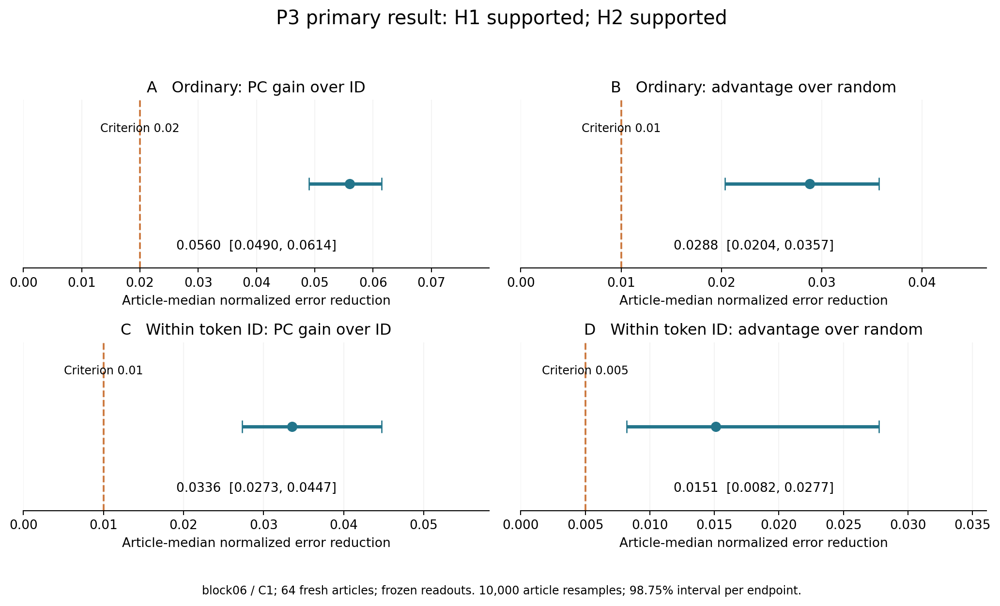
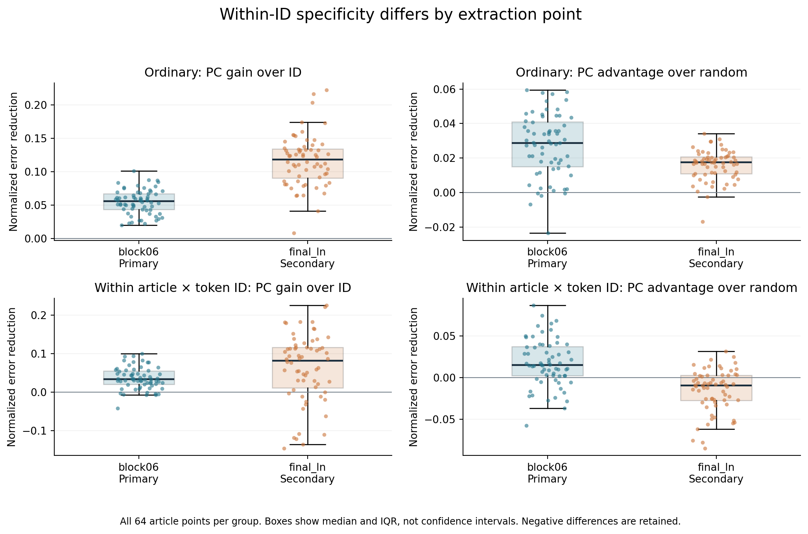
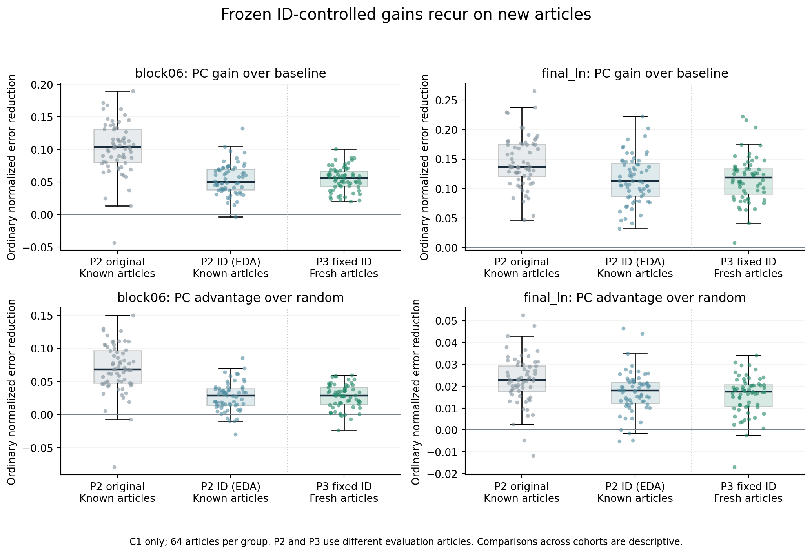

# P3 固定ID比較を未使用記事へ転用した結果

2026-10-20。**受領・原観測からの再計算ともに合格。主条件block06/C1ではP3-H1とP3-H2をともに支持する。** 前回のID比較を係数まで固定しても、新64記事でPCの追加予測が再現し、同じ記事の同じトークンIDの出現間にも追加予測が残った。

一方、**副次のfinal_ln/C1では、同一ID内の比較でPCはランダム20組平均を下回った**。今回の結果は層を指定して述べる必要がある。「文脈を担う専用軸」や因果機序を同定した結果ではない。

## 1 今回わかったこと

前回の探索的追加解析では、「語片の種類を覚えるID比較を強くしてもPCの上乗せが残る」という結果だった。今回は、その比較モデルを新しい記事に合わせて調整せず、そのまま別64記事に持ち込んだ。通常評価のPC増分中央値は0.056019で、64記事すべてで正だった。

さらに、同じ記事に繰り返し出る同じID同士を比べた。たとえば同じ語片でも出現場所によってsurprisalが変わる。その変動に対し、PCを含む固定予測の上乗せ中央値は0.033571、ランダム20組平均への優位差は0.015092だった。これは、**IDごとの定数差だけでは説明できない、出現ごとの状態との関連**を支持する。

ただし、群内のPC増分が負の記事は8/64、ランダム優位差が負の記事は15/64ある。支持判定は記事中央値とその区間に対するもので、すべての記事でPCが有利という主張ではない。

## 2 事前に固定した比較

[EXP-0003 v1](../../prereg/EXP-0003_v1_frozen_id.md)と[配布manifest](../../p3_v1/release_manifest.json)に従った。P2/EDAの結果を知った上で、新しい観測の取得前に固定したローカル事前登録であり、外部レジストリへの登録ではない。

- GPT-2の同一revision、float32/eager/TF32無効。第6ブロック後block06を主要点、最終LayerNorm後final_lnを副次点とした。
- P1/P2の全192記事と一致・近重複を除外した64記事、各512tokens。全記事が評価用で、新しい訓練記事はない。「未使用」は本研究で未使用という意味で、GPT-2事前学習から未知とは保証しない。
- P2の先頭除外条件C1の中心・8PC基底・ランダム8方向20組と、EDAのIDモデル係数・標準化・ID効果・訓練頻度を固定した。新記事で再PCA・係数調整・頻度更新は行っていない。
- ID基礎モデルには、トークンIDに加え、位置4項、復号文字数、UTF-8長、訓練頻度、元状態ノルムを含む。基礎、PC追加、ランダム20組の計22予測器を各点で評価した。未知IDの効果は0。
- 入力は512tokensのままforwardし、評価は位置1〜511。現在tokenを読んだ状態h_tと、1つ前のlogitから得た現在tokenのsurprisalを対応させる。

通常評価は記事内surprisalの平均周りSSTを分母にする。Aは`(SSE_ID − SSE_PC)/SST`、Bは`(ランダム20組の平均SSE − SSE_PC)/SST`である。

同一ID内評価は、記事×IDごとに正解と各固定予測からそれぞれの群平均を引く。その後の正解二乗和をwithin SSTとして同じ差を計算し、C/Dとする。2回以上のID群だけを対象とし、各記事で8群・32tokens以上、within SST>0を条件とした。群平均は採点にのみ用い、予測器の再学習には使っていない。

通常と群内では対象tokenとSSTが異なる。その数値の比を「何割が文脈の効果か」という寄与率へ変換できない。また、群内の採点は未知ラベルなしで群平均を予測できるという配備時の性能を意味しない。

## 3 主条件の事前登録判定

以下はblock06/C1。各量は64記事の中央値、区間は記事単位10,000回bootstrapの各98.75%区間である。主要4量へのBonferroni配分で全体約95%を狙った設定だが、有限標本bootstrapの厳密な保証ではない。訓練済みモデルに条件づけた区間で、訓練集合の選び直しによる変動は含まない。近重複を除外しても、同一コーパス内の記事間の関連を完全に排除したとはいえない。

| 量 | 記事中央値 | 98.75%区間 | 事前基準 | 正／負／NA |
| --- | --- | --- | --- | --- |
| A 通常のPC増分 | 0.056019 | [0.049032, 0.061445] | 0.02 | 64／0／0 |
| B 通常のランダム優位差 | 0.028811 | [0.020351, 0.035687] | 0.01 | 59／5／0 |
| C 同一ID内のPC増分 | 0.033571 | [0.027323, 0.044717] | 0.01 | 56／8／0 |
| D 同一ID内のランダム優位差 | 0.015092 | [0.008209, 0.027739] | 0.005 | 49／15／0 |

**P3-H1 支持：** AとBの区間下限が、それぞれ事前基準0.02と0.01を上回った。固定ID比較を超える追加予測が新記事でも再現した。

**P3-H2 支持：** CとDの区間下限が、それぞれ0.01と0.005を上回った。IDに結び付く定数差を消しても、今回のPC集合の追加予測とランダム平均への優位性が残った。

主要4量はいずれも有効64記事、NA0で、最低58記事の条件を満たす。全64記事・128記事点の保存検算完了後に判定した。C0/C4や副次点へ判定対象を移していない。

図1。破線が固定基準、点が記事中央値、横線が98.75%区間。各パネルで横軸の範囲が異なる。

## 4 最終LayerNorm後では違いがある

以下はfinal_ln/C1の副次結果。同じ区間計算を記述目的で示すが、新たな確認的仮説の支持判定は付けない。

| 量 | 記事中央値 | 記述的98.75%区間 | 正／負／NA |
| --- | --- | --- | --- |
| A 通常のPC増分 | 0.118419 | [0.104235, 0.129793] | 64／0／0 |
| B 通常のランダム優位差 | 0.017427 | [0.014890, 0.019445] | 62／2／0 |
| C 同一ID内のPC増分 | 0.082171 | [0.037663, 0.112080] | 49／15／0 |
| D 同一ID内のランダム優位差 | -0.009382 | [-0.022670, -0.004164] | 19／45／0 |

通常評価ではPC増分とランダム優位差がともに正で、前回と同方向だった。しかし同一ID内では、ID基礎への増分は正でも、ランダム優位差の中央値は-0.009382、記述区間は[-0.022670, -0.004164]で0より下にある。64記事中45記事で、ランダム20組平均の方がPC追加モデルより良かった。

したがって、「状態の8方向を加えると改善すること」と「PCAが選んだ8方向がランダム方向より有利なこと」は分けて述べる必要がある。final_lnでは後者が群内評価で残らなかった。これはblock06の事前登録判定を取り消す理由ではないが、層を越えたPCの一様な優位性を主張する根拠にもならない。

図2。点は全64記事、箱は中央値と四分位範囲で信頼区間ではない。負値と外れた記事もすべて表示している。下段右がfinal_lnの限定を示す。

## 5 予測性能そのものと記事間のばらつき

| 抽出点 | 評価 | ID基礎R² | ID＋PC R² | ID＋ランダム平均R² |
| --- | --- | --- | --- | --- |
| block06 | 通常 | 0.315882 | 0.363041 | 0.341123 |
| block06 | 同一ID内 | 0.135078 | 0.173947 | 0.150239 |
| final_ln | 通常 | 0.278637 | 0.400407 | 0.380775 |
| final_ln | 同一ID内 | 0.082559 | 0.147947 | 0.159683 |

表は各量を記事ごとに計算した後の中央値。ランダムは記事内で20組のR²を平均している。**中央値同士の差は、記事ごとの差の中央値A〜Dとは一般に一致しない。**

block06の同一ID内では、ID基礎、PC追加、ランダム平均のR²は全64記事で正だった。final_lnの同一ID内では、PC追加R²が負の記事が8/64、ランダム平均R²が負の記事が3/64あった。ID基礎へのPC増分自体も15/64記事で負だった。中央値だけで例外を隠さない。

22予測器すべてのR²要約、全128記事点のA〜D、全記事の分母は[詳細表](analysis/DETAIL_TABLES.md)に掲載し、完全な精度の値とSSE/SSTは[集計JSON](analysis/aggregates.json)に残した。

## 6 前回のP2と探索的ID比較から何が進んだか

| 抽出点 | 評価記事と比較モデル | 基礎R² | PC追加R² | PC増分 | ランダム優位差 |
| --- | --- | --- | --- | --- | --- |
| block06 | P2既知64記事・元8変数 | 0.144247 | 0.252093 | 0.103522 | 0.068226 |
| block06 | P2既知64記事・探索ID | 0.280944 | 0.339169 | 0.050095 | 0.028559 |
| block06 | P3新64記事・固定ID | 0.315882 | 0.363041 | 0.056019 | 0.028811 |
| final_ln | P2既知64記事・元8変数 | 0.127482 | 0.275932 | 0.136725 | 0.022849 |
| final_ln | P2既知64記事・探索ID | 0.262829 | 0.363573 | 0.112564 | 0.018048 |
| final_ln | P3新64記事・固定ID | 0.278637 | 0.400407 | 0.118419 | 0.017427 |

P2の元8変数比較ではblock06の増分は約0.104、探索的にID比較を強くすると約0.050へ縮んだ。P3ではそのID予測器を変更せず新記事へ転用して約0.056、ランダム優位差も約0.029となった。**ID比較を選んだ後に別の記事へ持ち出しても、同程度の規模の追加予測が残ったこと**が今回の前進である。

P2とP3では評価記事が異なるため、0.050から0.056への差をモデル改良や性能向上と解釈しない。P3で係数は変わっていない。P2元8変数比較との違いには、ID追加だけでなく正則化の調整差も含まれる。

図3。P2元比較、同じP2記事での探索的ID比較、P3の新記事での固定ID比較を並べた。記事集合をまたぐ比較は記述的なもの。箱は記事間の四分位範囲で、全記事点を表示している。

P1の主要block06での「PC1とノルムの強い関係は先頭点に大きく依存する」という結果、P2の基底転用、EDAの語彙比較は保持する。P3は8PCをまとめた固定読み出しの検証で、PC1単独とPC2〜8それぞれの機能を分離した結果ではない。

## 7 分母と保存状態

| 項目 | 結果 |
| --- | --- |
| 計画／着手／保存完了の記事 | 64／64／64 |
| 新規訓練記事 | 0 |
| 検算した記事×抽出点×条件 | 128／128（64記事×2点×C1） |
| 入力トークン数 | 32,768（位置0を含む） |
| 通常評価のトークン数 | 32,704（各記事の位置1〜511） |
| 同一ID内の対象トークン数 | 21,630（通常評価の66.14%） |
| 単発IDで群内評価から外れるトークン数 | 11,074 |
| 記事×IDの繰り返し群数 | 4,775（記事をまたぐ同一IDは別群） |
| 1記事あたりの群内対象トークン | 289〜401、中央値336 |
| 1記事あたりの繰り返しID群 | 60〜91、中央値74 |
| 訓練で未出だったIDの出現数 | 6,197／32,704（18.95%） |
| 各主要量の有効記事／NA | 64／0 |
| forward／commitイベント | 64／64（各記事1回） |
| worker失敗／no-op追加forward | 0／0 |

同一ID内の対象は繰り返し出る語片に限られるため、単発IDへの一般化はここから判断できない。群数4,775やtoken数21,630を独立した反復数として検定しておらず、不確実性は64記事を単位に評価した。二つの抽出点も同じ64記事から得たものである。

## 8 今回の証拠で言える範囲

| 主張 | 評価 |
| --- | --- |
| 固定ID対照に対する8PCの追加予測が、別記事でも残る | block06/C1のP3-H1が支持 |
| 同一記事の同一ID内でもPCの追加予測とランダム平均への優位性が残る | block06/C1のP3-H2が支持 |
| その関連がIDごとの定数差だけで尽くされる | 群内結果とは整合しにくい |
| すべての層でPCがランダム方向より有利 | final_lnの群内結果は支持しない |
| PCが意味・文脈の専用機構である | 特定できない。位置、文脈内容、未統制の非線形性等は残る |
| PC1または特定の1本のPCが原因である | 8PC集合の検証なので未分離 |
| 介入で言語モデルの次トークン性能が変わる | 今回は未検証 |
| 他モデル・他領域でも成立する | GPT-2と同一コーパス内の64記事に範囲を限定する |

論文向けに採用を検討できる表現は、次の範囲である。

> GPT-2の第6ブロック後では、既存の語彙ID対照と読み出し係数を固定して未使用64記事へ転用しても、先頭位置を除いた8PCによる現在トークンsurprisalの追加予測が残った。同一記事・同一トークンID内の変動でも、PC追加はID対照およびランダム方向の平均を上回った。一方、最終LayerNorm後では同一ID内のランダム対照への優位性は残らず、結果は抽出点に依存した。

これは今回の証拠に対応する文案であり、原稿への採用・改訂は行っていない。

## 9 次のアクション

機序をさらに調べるなら、主条件block06で同一IDの文脈を対にし、位置などを揃えた比較で「どの変化にPCの読み出しが追随するか」を先に固定する設計が有力である。final_lnの差は、全層共通の機構を前提にせず比較対象として残す。

因果を問う介入へ進む場合は、介入の位置と行動指標の時間順序を合わせる必要がある。今回のsurprisal(x_t)はh_tより前のlogitで決まるため、h_tへの介入でその既に決まったsurprisalが変わるとは扱わない。たとえばh_tの変更とその後の出力を対応させ、ノルムを揃えたランダム介入等と比べる別カードが必要になる。今回、新しい実験や介入は開始していない。

## 10 受領検算と実行記録

- [配布検証器による受領再計算](receipt_verification.json)：PASS。64記事の原状態・特徴整列、全128記事点の予測と群内採点、主要/副次区間、要約・イベント数を照合。
- [別計算手順による追加検算](extended_verification.json)：PASS。PC標準化を元状態への線形重みへ展開して1,438,976予測を再構成し、最大絶対差7.46e-14。群内平均はbincount集計で別計算し、予測差最大4.22e-14。bootstrap端点差最大6.11e-16。
- SSE等を含む記事指標の最大絶対差は9.09e-12。固定ID効果が群内中心化で消えること、長さ・固定頻度も同じID内で定数になることを照合。
- 配布凍結 2026-10-20T09:31:48.365951+00:00 → run開始 2026-10-20T09:38:12.708306+00:00 → 固定fit参照封印 2026-10-20T09:38:12.785298+00:00 → 最初のforward 2026-10-20T09:39:38.993303+00:00（UTC）。固定係数のハッシュと全forwardの参照が一致した。
- GPUはNVIDIA RTX PRO 6000 Blackwell Server Edition、VRAM 94.97GiB、ホストRAM 176.88GiB。4抽出attemptの環境契約は一致。no-opの追加forwardは0。
- 本runのsummary生成まで**118.30秒**。最終ZIP圧縮と手元への転送を含む総時間ではない。FINALは**217.83MB**で、事前容量見積り200〜260MB内だった。新VM復旧・A100との速度/数値比較は今回も未検証。
- 受領検算はローカルCPU、NumPy 2.2.6。新しい言語モデルforward・モデル取得・再学習は0。Colabから届いた原観測を使った。生成と検証は同じagentの自己監査で、独立レビューではない。

図の初回描画は同梱Pythonにmatplotlibがなかったため停止した。既存のローカル描画環境へ切り替えて3図PNG/SVGを生成し、目視確認した。`analysis/plot.log`と`plot_v2.log`を保持する。これはレポート描画環境の問題で、P3実験や数値検算の失敗ではない。

## 11 保存先と追跡

run `0113330bdd64`、capsule `14e5f40a6f46dac09874cd4d3710c59bbcd8d110566a5c3bdf27e14edea8998d`。

元ZIPと受領コピーのSHA-256：

`a2bb3006758df5931c67b0257daecfcaa3fadbd3e37214216743e93c362c0772`

元ZIPは元の場所に保持し、このreceiptにも[同一ZIPのコピー](pcgeom_p3_v1_0113330bdd64_FINAL_4b0a6d.zip)を保存した。ZIP内は634証拠ファイルとARCHIVE_INDEX.json。内包コードを実行せず、配布済みソースから検算した。

- [原観測](raw/)、[ZIPファイル一覧とハッシュ](archive_structure.json)、[受領記録](archive_receipt.json)
- [全記事と全22モデルの詳細表](analysis/DETAIL_TABLES.md)、[集計JSON](analysis/aggregates.json)
- [追加検算・集計コード](analysis/audit_aggregate.py)、[図生成](analysis/plot.py)、[本文生成](analysis/build_report.py)
- [結果追補](../../prereg/EXP-0003_v1_results_2026-10-20.md)、[最終保全照合](../../evidence/p3_final_checks_2026-10-20.json)

P0/P1/P2/EDA、配布済みP3と事前登録、全旧稿は保持した。P3の原カードにある「未取得」は凍結時点の歴史記録として残し、本結果は別追補に記録する。
