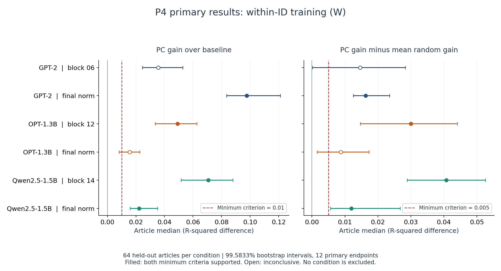
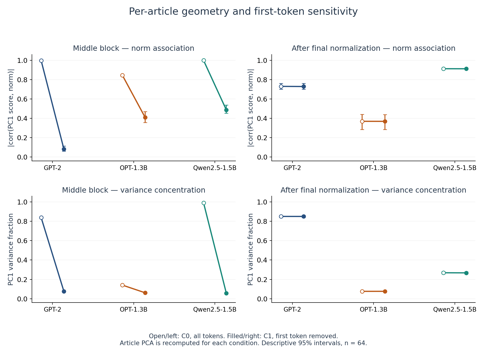
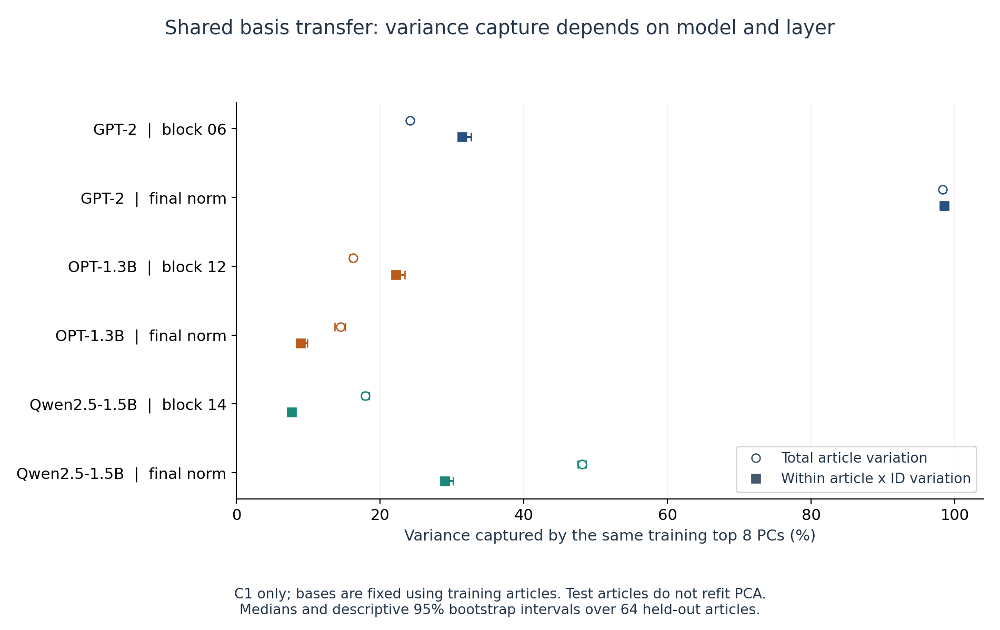
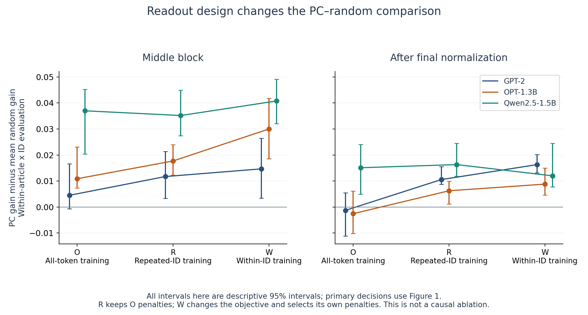

# P4 v1 解析レポート：３モデルの幾何・同一ID内の読み出しと最終判断

2026-10-20（Asia/Tokyo）。run `4b013b35152b`、FINAL snapshot `76c5c40ed614`。ユーザーがColabで実行した10 PART＋INDEXを受領し、固定コードで保存原観測を再計算した。**受領・検算は合格。新しいモデルforwardは0回。**

## 1. 今回の結論

**同じIDの出現どうしの違いを学習するW設定では、６条件のうち４条件が事前に決めたPCの追加効果とランダム方向に対する優位の基準を満たした。** GPT-2最終LayerNorm後、OPT中央層、Qwen中央層・最終RMSNorm後が該当する。GPT-2中央層とOPT最終LayerNorm後は不確定であり、効果なし・実験失敗とは判定しない。

全６条件でPC増分もランダムとの差も中央値は正で、主要12区間の下限も0を上回る。ただし「0より大きい」と「事前に決めた最小効果より十分大きい」は別である。**３モデル×２点すべてに共通する最小効果は確認できなかった。** これは共通性の否定を確定したという意味でもない。

幾何については、**先頭トークンに強く依存する中央層の集中と、先頭を外しても残る最終正規化後の集中を分ける必要がある。** GPT-2中央層のPC1分散比は83.89%→7.63%、Qwen中央層は99.19%→5.73%。一方GPT-2最終層は85.09%→85.07%でほぼ残った。OPT・Qwenの最終層まで同じ強さで集中するわけではない。

P3で見えた「GPT-2最終層でランダム方向に負ける」という結果は元の読み出し条件の観測として保持する。P4の新記事でWを事前固定すると最終層のPC優位が支持され、**最終LayerNorm後のPCが本質的に役に立たない、という説明は採らない。** 学習対象・目的・正則化に依存する関連であり、モデル内部でそれがどう利用されるかという因果機序は未解決のまま、この最終比較で区切る。

## 2. データは揃っていたか

| 確認項目 | 受領後の確認結果 |
| --- | --- |
| 分割ZIP | 10 PART＋INDEXの11個、同一run・snapshot、全SHA-256・memberサイズ・CRC一致 |
| 容量 | 2,162,593,458 bytes＝2.163 GB。最大PART 231.447 MB、各300 MB未満 |
| 復元内容 | 2,414ファイル、2,345,037,032 bytes。別receiptへ復元、原ZIPも複製保持 |
| 入力 | 未使用128記事＝訓練64＋評価64。３モデルで本文範囲が同じ。旧P1〜P3の256記事とのID重複0 |
| 抽出 | 計画384モデル記事、着手384、保存384、欠落0、worker失敗0。各１forward・１commit |
| 評価 | ３モデル×２点×64記事＝384記事点。主要12量は各64有効、NA0 |
| 固定条件 | 凍結capsule、モデルrevision・ファイルmanifest、token IDs、fp32/eager/TF32 off、パッケージpinが一致 |
| 順序 | 全訓練保存12:02:04 UTC → fit封印12:02:27 UTC → 最初の評価forward12:03:22 UTC |
| 実行 | RTX PRO 6000 Blackwell Server Edition、１session、技術再開0。no-op３回の追加forward0 |
| 時間 | summaryまで904.54秒（約15.08分）。最終ZIP圧縮・ブラウザ転送を含まない |
| 原稿・旧結果 | 前回アンカーの2,643ファイルを開始時照合。不一致0。旧原稿・全配布版・既存結果は保持 |

凍結は2026-10-20 10:52:34 UTC、run開始は11:56:33 UTC。ここでいう「未使用」は本研究の旧記事から未使用という意味で、モデル事前学習から未知である保証ではない。重複除外は固定入力manifest・配布時検査と今回の入力完全一致に基づく。

原ZIPの `COLAB_VERIFIED_AWAITING_LOCAL_RECEIPT` や固定数値検証器の受領フラグは、元データとして変更していない。ローカル受領完了は別の[受領証明](receipt_verification.json)に `local_receipt_verified: true` として記録する。

保存原観測から、訓練PCA・標準化・頻度・全CV候補と選択・O/R/W係数・全予測・記事内幾何を再計算した。通常回帰は元の共同正規方程式の勾配、Wは拡大行列最小二乗、予測は生の特徴・状態に戻した係数、幾何は矩形SVDでも照合している。

別経路で再構成した予測は **12,479,148個**、最大差 **8.527e-13**、共同正規方程式の最大相対残差 **6.406e-12**。固定集計186組の20,000回記事bootstrapも別実装で一致した。検証ログは[数値検証](verification_execution.json)と[集計監査](analysis/aggregates.json)に保存した。

重み本体・正規化直前の全状態はZIPに含まれないため、重みSHAと抽出時の正規化一致診断は保存記録との照合であり、こちらでGPU計算を再実行した検証ではない。抽出時の正規化誤差記録は最大0、surprisalのCE照合誤差は最大1.55e−14。生成と検算は同じagentによる自己監査で、独立した査読ではない。

## 3. 何を比較したか

モデルはGPT-2 base（中央6/12層）、OPT-1.3B base（12/24層）、Qwen2.5-1.5B base（14/28層）。もう一つの観測点は最終正規化後で、GPT-2/OPTはLayerNorm、QwenはRMSNormである。すべてBOS/EOSなどを付けない同じ本文範囲を用い、token数はモデルごとに417〜511で異なる。

訓練記事だけで共有の上位8PCとランダム8方向20組、標準化、頻度、回帰係数を決め、全fitを封印してから評価記事を取得した。主要読み出しは先頭トークンを除くC1に固定。各記事のPCを当て直す幾何の記述と、訓練で固定した共有基底の評価は別の解析である。

| 設定 | 訓練対象・目的 | 比較の意味 |
| --- | --- | --- |
| O | C1全tokens。token ID効果＋位置４項・復号長２項・頻度・logノルムの８特徴による通常回帰 | 通常のsurprisalを読む |
| R | 記事内で繰り返すIDのtokensだけ。Oの罰則をそのまま流用 | 訓練対象を群内採点の対象へ近づける |
| W | 同じ反復ID群内で、特徴・目的・PCスコアを中心化。群内目的に合わせ訓練CVで罰則選択 | 同じ記事×同じIDの出現どうしの違いを読む |

WではIDに固定された文字長・byte長・頻度・ID切片が中心化で消え、位置４項とlogノルムが基礎特徴として残る。IDは語彙の**token ID**であり、常に「単語全体」や「同じ語義」を意味しない。位置・文脈長・文脈内容などの変動まで消えるわけではない。

予測対象は現在tokenのsurprisalで、logits[t−1]から計算し、h[t]を説明変数に使う。h[t]は現在tokenを既に読んでいる。さらに群内評価は記事内の反復群で中心化する。従ってこれは**事後的な関連の読み出し**であり、未知の次tokenを予知した成績ではない。

PC増分＝「基礎＋8PC」のR²−「基礎のみ」のR²。ランダム優位差＝PC増分−ランダム8方向20組の増分平均。まず記事ごとに差を取り、その中央値を集約する。**中央値どうしの引き算とは一般に一致しない。** 20組のランダム方向は独立した20記事として数えない。

## 4. 主要結果：Wの最小効果判定

事前基準はPC増分 **>0.01**、ランダム優位差 **>0.005**。12量を対象としたBonferroni型の各99.583333%区間を用い、両下限が基準を上回れば支持、どちらかの上限が基準以下なら最小効果基準未達、それ以外は不確定。全取得・検算完了と有効58/64記事以上も必須で、今回は全量64/64である。

| モデル／観測点 | PC増分 ΔR²［99.583333%区間］ | PC−ランダム平均［同区間］ | PC優位の記事 | 複合判定 |
| --- | --- | --- | --- | --- |
| GPT-2 / block06 | 0.035549 [0.024553, 0.052815] | 0.014655 [0.000167, 0.028367] | 43/64 | 不確定 |
| GPT-2 / 最終正規化後 | 0.097713 [0.083537, 0.121231] | 0.016303 [0.012567, 0.023536] | 55/64 | 事前基準を支持 |
| OPT-1.3B / block12 | 0.049142 [0.033490, 0.062793] | 0.029996 [0.014675, 0.044107] | 53/64 | 事前基準を支持 |
| OPT-1.3B / 最終正規化後 | 0.015561 [0.008232, 0.022705] | 0.008795 [0.001584, 0.017265] | 47/64 | 不確定 |
| Qwen2.5-1.5B / block14 | 0.070771 [0.051705, 0.088018] | 0.040772 [0.028871, 0.052625] | 58/64 | 事前基準を支持 |
| Qwen2.5-1.5B / 最終正規化後 | 0.022240 [0.015933, 0.035083] | 0.011978 [0.005662, 0.026762] | 53/64 | 事前基準を支持 |

各区間は記事を単位とする20,000回bootstrap、seed20261028。これは凍結した訓練・ランダム対照・このデータ領域に条件づけた不確実性であり、別の訓練標本・モデル重み・言語領域の変動まで表さない。

GPT-2中央層のランダム優位差は0.014655と正だが、区間下限0.000167は事前基準0.005を下回る。OPT最終層ではPC増分とランダム優位差の両区間が最小効果基準をまたぐ。結果を見て95%区間へ変更し、支持に置き換えることはしない。Qwen最終層の優位差下限0.005662は基準を上回るものの、余裕は小さい。

図1。主要12量の区間。塗りつぶしは複合基準支持、白抜きは不確定。両者とも欠測のない有効な科学的結果である。

参考としてWのR²水準も示す。これらは受領後の記述的整理で主要判定には使わない。各モデルの目的変数・token分割が異なるため、モデルの能力ランキングとして読まない。

| モデル／点 | W基礎R² | W＋PC R² | W＋ランダム平均R² |
| --- | --- | --- | --- |
| GPT-2 / block06 | 0.176547 | 0.213594 | 0.200651 |
| GPT-2 / 最終正規化後 | 0.113743 | 0.216020 | 0.194298 |
| OPT-1.3B / block12 | 0.095358 | 0.142168 | 0.118050 |
| OPT-1.3B / 最終正規化後 | 0.107015 | 0.123989 | 0.116116 |
| Qwen2.5-1.5B / block14 | 0.063325 | 0.135736 | 0.093081 |
| Qwen2.5-1.5B / 最終正規化後 | 0.070855 | 0.098147 | 0.082759 |

## 5. PC1のノルム関連と分散集中

R1は記事中心化PCAの第１スコアと元の隠れ状態ノルムの絶対相関、V1はPC1の分散比、V8は上位8PCの合計分散比。C0は全tokens、C1は先頭tokenを保存行列から除いて再PCAした結果。モデルへの入力から先頭を消した介入ではない。以下は64評価記事の中央値、すべて有効64・NA0。

| モデル／点 | R1 C0→C1 | V1 C0→C1（%） | V8 C1（%） |
| --- | --- | --- | --- |
| GPT-2 / block06 | 0.998 → 0.083 | 83.89 → 7.63 | 31.28 |
| GPT-2 / 最終正規化後 | 0.731 → 0.730 | 85.09 → 85.07 | 98.44 |
| OPT-1.3B / block12 | 0.847 → 0.411 | 14.08 → 6.15 | 25.41 |
| OPT-1.3B / 最終正規化後 | 0.370 → 0.370 | 7.62 → 7.64 | 32.53 |
| Qwen2.5-1.5B / block14 | 1.000 → 0.488 | 99.19 → 5.73 | 27.39 |
| Qwen2.5-1.5B / 最終正規化後 | 0.914 → 0.913 | 26.83 → 26.73 | 57.37 |

中央層では３モデルとも先頭除外でR1・V1が下がり、とくにGPT-2とQwenのV1低下が大きい。Qwenの99.19%というほぼ一次元に見えるC0分布も、C1では5.73%となる。「普通のtokenの大部分もほぼ１軸に並ぶ」とは解釈できない。OPT中央層では14.08%→6.15%で、C0の集中の強さ自体が異なる。

最終正規化後は先頭除外による中央値の変化が小さい。GPT-2ではV1約85%、Qwenでは約27%、OPTでは約8%である。Qwen最終層のR1は約0.913と高くてもV1は約27%で、**ノルムと強く連動することと、ほぼ全分散が１軸に集中することは別**と分かる。学習された正規化後の出力は一律の単位ベクトルと同義でもない。

これらは固定した副次の幾何記述である。全区間と記事対応のC1−C0差は[全条件表](analysis/DETAIL_TABLES.md)に示した。正規化方式・モデルサイズ・学習データ・tokenizerなどは同時に異なり、この比較からLayerNorm対RMSNormの因果効果は分離できない。

図2。白抜きがC0、塗りつぶしがC1。誤差線は記述的95%区間。C1で主軸自体を当て直すため、同一のPC1を追跡した図ではない。

## 6. 固定した上位8PCは何を捉えたか

こちらは記事ごとの再PCAではなく、訓練だけから得た同じ8方向を評価記事に適用した結果である。C1の状態全体と、記事×ID内で中心化した状態の変動に対する捕捉率を比較する。表の区間は記述的95%。

| モデル／点 | 全変動の捕捉率（%） | 同一ID内変動の捕捉率（%） |
| --- | --- | --- |
| GPT-2 / block06 | 24.16 [23.94, 24.39] | 31.41 [30.90, 32.64] |
| GPT-2 / 最終正規化後 | 98.28 [98.21, 98.39] | 98.51 [98.34, 98.60] |
| OPT-1.3B / block12 | 16.22 [15.82, 16.47] | 22.19 [21.68, 23.45] |
| OPT-1.3B / 最終正規化後 | 14.47 [13.68, 15.14] | 8.95 [8.44, 9.86] |
| Qwen2.5-1.5B / block14 | 17.94 [17.52, 18.43] | 7.70 [7.45, 7.89] |
| Qwen2.5-1.5B / 最終正規化後 | 48.15 [47.56, 48.61] | 28.99 [28.57, 30.16] |

GPT-2最終層では共有top8が同一ID内の変動も98.51%捉える。この大きな捕捉率とWの優位は両立する。一方、OPT最終層では8.95%、Qwen中央層では7.70%と異なる。分散捕捉率は状態全体の二乗量であり、surprisalとの関連の強さや予測に必要な情報量そのものではない。Qwen中央層では低い捕捉率でも主要の追加効果は支持された。

P4は**C1で定義したPC1〜8をまとめて**比較している。旧稿が関心を持った「PC1以外の残りのPC」だけの効果や、個々のPCの専用意味・品詞機能を切り分けた実験ではない。訓練から別記事への基底転用と追加的関連の範囲を確認した、と限定する。

図4。全変動と同一ID内変動の分母は異なる。図2のV8とは基底の決め方も異なるので、値の一致を期待しない。

## 7. P3の「最終層で逆転」をどう理解するか

以下は同じ評価記事・同じ同一ID内採点における、O/R/WそれぞれのPC−ランダム平均の中央値。主要のW以外は副次結果である。

| モデル／点 | O | R | W（主要設定） |
| --- | --- | --- | --- |
| GPT-2 / block06 | 0.004499 | 0.011705 | 0.014655 |
| GPT-2 / 最終正規化後 | -0.001300 | 0.010542 | 0.016303 |
| OPT-1.3B / block12 | 0.010872 | 0.017691 | 0.029996 |
| OPT-1.3B / 最終正規化後 | -0.002577 | 0.006233 | 0.008795 |
| Qwen2.5-1.5B / block14 | 0.036991 | 0.035176 | 0.040772 |
| Qwen2.5-1.5B / 最終正規化後 | 0.015095 | 0.016307 | 0.011978 |

GPT-2最終層はOで−0.001300、Rで+0.010542、Wで+0.016303。Oの95%区間は[−0.011190, +0.005420]で0をまたぐため、今回Oでも「ランダムが明確に勝った」とは言わない。旧P3のOで−0.009382、45/64記事で負だった観測は、そのときの固定予測器と評価記事に条件づけた結果として残る。

比較を適切に行うため、各記事で優位差の変化を計算した。以下の95%区間は多重比較未調整の副次・記述区間であり、主仮説を追加するものではない。

| モデル／点 | O→R：対応差［95%区間］ | R→W：対応差［95%区間］ | O→W：対応差［95%区間］ |
| --- | --- | --- | --- |
| GPT-2 / block06 | 0.004069 [0.000754, 0.006638] | 0.001997 [0.000127, 0.003910] | 0.005758 [0.000695, 0.008744] |
| GPT-2 / 最終正規化後 | 0.012077 [0.009110, 0.015263] | 0.004154 [0.002762, 0.007987] | 0.014883 [0.011751, 0.025829] |
| OPT-1.3B / block12 | 0.003765 [0.001221, 0.005143] | 0.011629 [0.005370, 0.015265] | 0.014505 [0.007442, 0.017804] |
| OPT-1.3B / 最終正規化後 | 0.008843 [0.003995, 0.012220] | 0.001738 [0.000240, 0.004152] | 0.011492 [0.006690, 0.017023] |
| Qwen2.5-1.5B / block14 | 0.001346 [-0.006134, 0.007990] | 0.006420 [0.001543, 0.013146] | 0.008805 [-0.003091, 0.019131] |
| Qwen2.5-1.5B / 最終正規化後 | 0.003215 [-0.001705, 0.007957] | -0.002287 [-0.004439, 0.001907] | 0.002679 [-0.001274, 0.006440] |

GPT-2・OPTでは対象を反復IDに揃えるO→R、群内目的へ移るR→Wの両方で改善する対応差が見られる。Qwen最終層のR→Wは−0.002287 [−0.004439, 0.001907]で、全条件がWへ単調に改善するわけではない。O→Wの対応差の中央値が、OとWの中央値の差と符号まで異なりうることにも注意する。

RはOと同じ罰則を使うが、訓練対象・ID出現数・目的の重み付けが変わる。Wでは目的とCVで選んだ罰則が変わる。したがって、どの要素が逆転の何割を因果的に説明したかは決まらない。今回支持されたのは、**読み出しの条件を固定すれば未使用記事でも関連が読めること、順位が読み出しの定義に敏感なこと**である。

図3。表示を揃えるため全て記述的95%区間。主要判定は図1の99.583333%区間に基づく。この図でモデル間の能力の順位を決めない。

## 8. 分母・CV・旧結果との関係

| モデル | 評価C1 tokens | 同一ID反復 tokens | 記事×ID群 | 記事あたり最小 tokens／群 | 訓練既知ID率の中央値 |
| --- | --- | --- | --- | --- | --- |
| GPT-2 | 31017 | 20522 | 4585 | 259／56 | 80.22% |
| OPT-1.3B | 31017 | 20522 | 4585 | 259／56 | 80.22% |
| Qwen2.5-1.5B | 32505 | 22349 | 4836 | 291／61 | 81.37% |

群内評価の最低条件は32tokens・8反復ID群。すべて大幅に満たし、評価失敗による選択はない。３モデルは同じ64記事を共有し、３×64個の独立記事として水増ししない。評価C1の合計token数から先頭分が除かれていること、群内の値は反復tokenに限定されることを区別する。

全６点のO/Wで基礎alphaはグリッド下限0.0001が選ばれた。PCと各ランダム対照のgammaは同じ凍結グリッドから個別に選択しており、一覧は全条件表に残した。下限への到達は有限グリッドに条件づけた結論の限界であり、結果を見てグリッドを広げていない。PCA・尺度・頻度は全訓練で共有し、その中の４foldで罰則を決める条件付きCVである。完全なnested CVの汎化誤差推定とは呼ばない。評価64記事はこの選択に使っていない。

| 以前の観測・主張 | 今回まで含めた位置づけ |
| --- | --- |
| 旧稿の12モデル探索でPC1とノルムが高相関 | 旧集計は保持。ただし入力・抽出条件が異なる。今回の複数記事・C1では中央層の高相関や集中は一般には維持されない |
| 相関の高さと分散集中は別 | 維持し、３モデル・２点・先頭感度で根拠を追加。Qwen最終層は高いR1でもV1約27% |
| P1：GPT-2中央層の強い先頭依存 | 別記事のP4でも同じ傾向。P1のH1反証・H2支持はそのまま保持 |
| P2/P3：語彙対照を超える追加関連 | 新しい訓練・評価記事と３モデルで確認範囲を拡張。ただし今回の主要Wの基準支持は４／６条件 |
| P3：GPT-2 final_lnのO群内採点でランダムが有利 | 元結果は正しい。P4のOは小さい負の中央値だが区間は0をまたぐ。WではPC優位を確認し、本質的な情報喪失という説明は採らない |
| EDA-0002：群内目的に揃えるとfinal_lnのPC優位が回復 | 新規P4でWを事前固定し、GPT-2最終層で支持。探索だけだった知見の一部を新記事で確認 |
| 低次元の幾何が内部計算の機序を説明する | 未解決。関連読み出し、モデルの実際の利用、因果的な必須性を同一視しない |

P4では訓練基底・回帰係数を新しい64記事で作り直した。P3の旧P2由来の予測器をそのまま別記事に当てたのとは異なる。また、同じ本文に揃えた可変長、12主要量の補正なども違う。GPT-2中央層が今回不確定でも、旧P3の支持を取り消したり「同一実験が失敗した」とは記述しない。

旧稿のQwen2.5-14Bにおける99.7%と、今回のQwen2.5-1.5Bはモデル規模も入力条件も異なる。似たC0値をもって旧14B結果を厳密に再現したとは言わない。旧稿12モデルの数を今回の確認的標本数へ足さない。

## 9. 論文へ持ち込める範囲と終了判断

論文の強い材料は、①PC1のノルム関連と分散比を区別し、先頭感度・モデル・観測点でその範囲を示したこと、②訓練で固定した8次元基底から別記事の同一ID内の追加関連が読める条件を確認したこと、③通常の学習と群内の採点の組合せで結論が変わりうることを、元の負の結果ごと記録したことにある。

一方で、意味専用の軸の同定、すべての交絡の排除、正規化方式の因果効果、個別ニューロン・回路の役割、全LLM・別言語・別ジャンルへの普遍性は示していない。対照は固定したランダム8方向20組の平均で、最良のランダム方向や全ての非線形比較に勝ったという主張でもない。３モデルは目的を持って選んだ例であり、無作為なアーキテクチャ標本ではない。

**ユーザーの「この１回で区切る」に従い、新規比較枠はP4で終了する。** 不確定２条件を支持へ動かすための追加記事・層・モデル・乱数・介入や、旧有限計画の条件付き介入への自動延長は行わない。因果機序は「未解決の問い」として残す。機序が存在しないと断定する撤退ではなく、現在の証拠の境界を記録して実験追跡を閉じる。

次の作業として適切なのは、ここまでのP1〜P4と探索解析を区別した証拠表を基に、論文の主張と図表を整理すること。今回はその整理材料と結果追補まで作成し、原稿そのもの・投稿・公開は変更していない。

## 10. 保存物と再検算の入口

- [原ZIP一覧・SHA](archive_receipt.json)／[分割セットの全member一覧](bundle_index.json)。原ZIPは `original_archives/`、原観測は `raw/` に保存。
- [受領後の再計算](recomputed_summary.json)／[実行・数値監査ログ](verification_execution.json)／[独立集計と全CV選択](analysis/aggregates.json)。
- [全条件・384記事点・20ランダム対照の詳細表](analysis/DETAIL_TABLES.md)／[機械可読の全記事指標](analysis/article_metrics.json)。
- [事前登録原カード](../../prereg/EXP-0004_v1_three_models.md)／[変更していないプロトコル](../../p4_v1/protocol.md)／[今回の結果追補](../../prereg/EXP-0004_v1_results_2026-10-20.md)。
- [前回P3レポート](../0113330bdd64_p3_v1_final/ANALYSIS_REPORT_JA.md)／[保存データ診断EDA-0002](../../exploratory/p3_reversal_v1/ANALYSIS_REPORT_JA.md)／[旧焦点化稿](../../../../paper/revision_2026-10-19_focus/main.tex)。
- [最終保全・数値・図表・リンク照合](../../evidence/p4_final_checks_2026-10-20.json)／[引き継ぎ](../../HANDOFF/2026-10-20_zzzzzzzzzzzzz_p4_results.md)。

図はPNGとSVGの両方を保存した。検算・表・図の生成スクリプトは `analysis/` にあり、復元されたコードは実行していない。確認的な条件・閾値・乱数の変更は0、既存結果の上書きは0。
