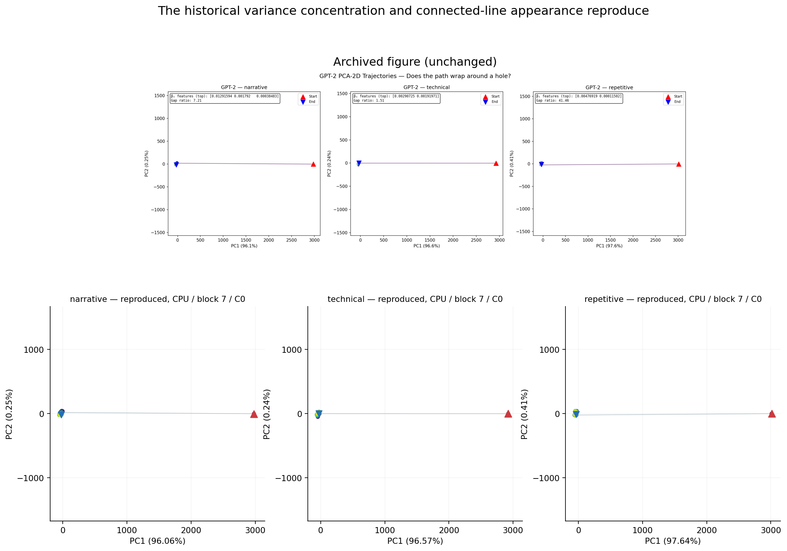
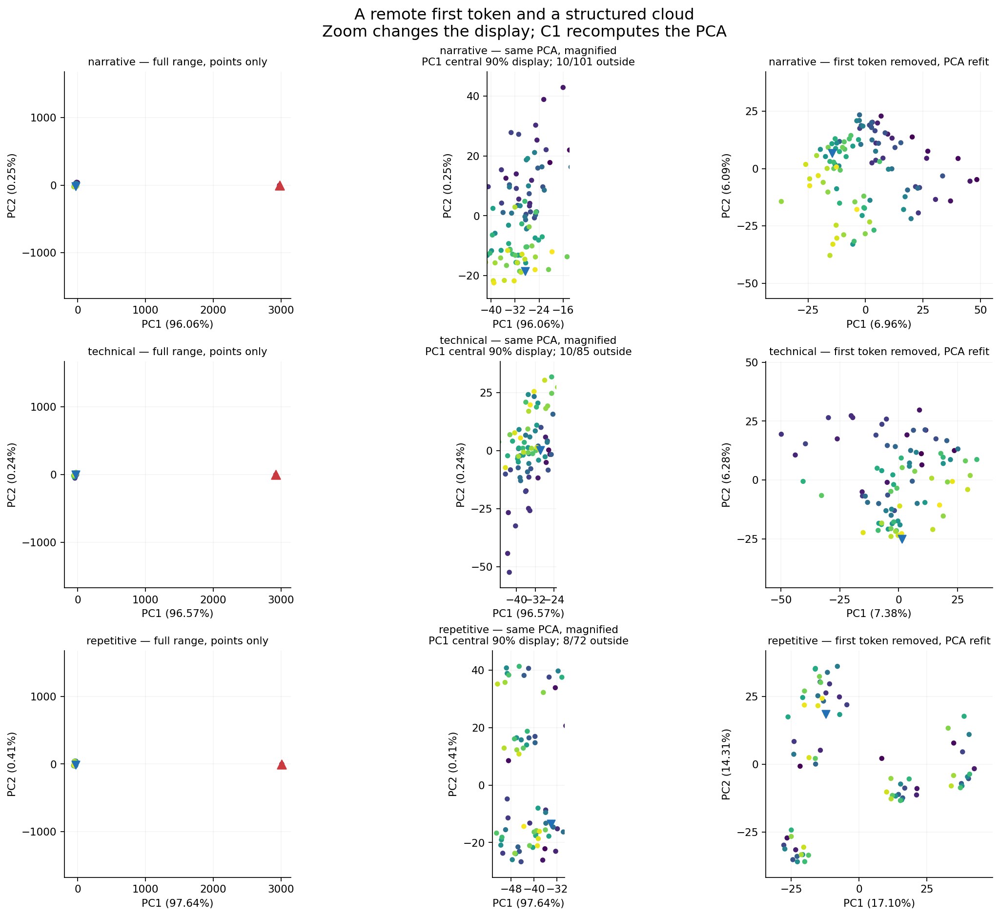
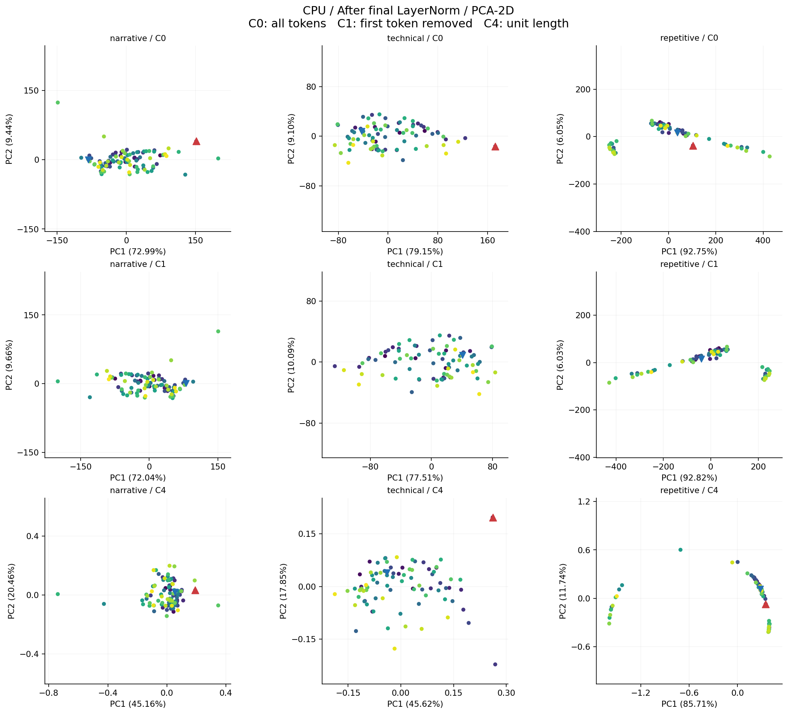
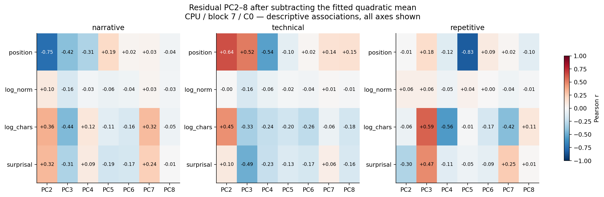

# P5解析レポート：旧図の再現から、長軸の意味を確かめる

run `52dcd57cc2e4`。受領：2026-10-20、解析完了：2026-10-21（JST）。
対象は旧３文章のGPT-2。主条件はCPU・第７ブロック・全token（C0）。
固定した[事前登録](../../prereg/EXP-0005_v1_arc_reproduction.md)に沿って解析した。

## 結論

**旧稿の図にあった強い分散集中と長い線の見た目は、３文章すべてで再現した。
その長軸を作っていたのは、遠く離れた先頭tokenの１点と、近くに集まる残りの点群だった。**
したがって今回の結果は、旧図の観測を回収すると同時に、その形の説明を具体化する。
主条件で「点が連続した一次元の弧を埋めている」という解釈は支持されなかった。

先頭を除く、または各状態を単位長にすると、主成分への極端な集中は大きく下がる。
一方、残りの座標には位置・token長・予測困難度との関連が残った。
論文に残る筋道は、**「先頭点とノルムに強く依存する長軸」と「その周囲の特徴を伴う広がり」**
という、観測に即した二段階の構造である。

比較用の最終LayerNorm後では、反復文に曲線でよく近似できる配置も見られた。
曲がりそのものを一律に否定する結果ではなく、入力と抽出点を明示して形を述べる必要がある。
その条件差も含めて報告し、この固定セットで実験を区切る。

## 1. 旧稿の数値と図は、どこまで戻ったか

旧図と同じ物語文・技術文・反復文を、そのままGPT-2へ入力した。
旧表示のL6はコード上では第７ブロックの出力だったため、今回もそこを主対象にした。
全文の長さは101、85、72tokens。旧図で表示されたPC1寄与率との差は、
３文章とも0.05 percentage point未満で、固定した±0.5ポイントの目安を満たした。

| 文章 | 旧図 PC1 | 今回 PC1 | 差（pp） | 旧図 PC2 | 今回 PC2 | 数値整合 |
| --- | --- | --- | --- | --- | --- | --- |
| 物語文 | 96.1% | 96.062% | -0.0384 | 0.25% | 0.254% | 成立 |
| 技術文 | 96.6% | 96.571% | -0.0290 | 0.24% | 0.236% | 成立 |
| 反復文 | 97.6% | 97.644% | +0.0444 | 0.41% | 0.409% | 成立 |

PC2の寄与率も旧図と近い。以上は、回収した文章と抽出点で旧図の分散構造が
数値的に再現したという結果である。本文中の「層」というラベルのずれで
旧図の現象を見落としていた可能性は、今回の主条件について解消できた。

上段は変更していない旧図の画像。下段は今回のCPU・第７ブロック・C0。
旧図と同じく隣接tokenを線で結び、軸は等縮尺にした。
この線は点の間を描画上で補間するため、線上に観測点が存在するとは限らない。
2D図の色はtoken順（紫→黄）、赤△は先頭、青▽は末尾を示す。

## 2. 線を消すと、長軸の正体が分かる

線を消して観測点だけを見ると、３文章とも先頭点が遠く離れ、
残りの点は短い範囲へ集まる。PC1の全幅を20区間へ分けても、点がある区間は
２つだけだった。最大空隙は全幅の約98〜99%に達した。

| 文章 | 先頭点のPC1二乗寄与 | 最大空隙／全幅 | 20区間の占有 | PC1–元ノルム r |
| --- | --- | --- | --- | --- |
| 物語文 | 98.938% | 98.224% | 2/20 | 0.999606 |
| 技術文 | 98.768% | 98.524% | 2/20 | 0.999611 |
| 反復文 | 98.567% | 98.857% | 2/20 | 0.999850 |

「先頭点の寄与」は、中心化したPC1スコアの二乗和に占める先頭点の割合である。
モデルの全情報量や、全次元の分散の割合を表すものではない。
PC1とノルムのほぼ完全な相関も、この離れた１点を含む配置と併せて読む必要がある。

左は全幅の線なし散布図。中央は**同じPCA座標**のPC1中央90%を拡大表示し、
表示範囲外の点数も記した。右は先頭を除いて**PCAを計算し直した**結果である。
中央の拡大で点群が見えることと、右で主軸そのものが変わることを区別した。

先頭除外後のPC1寄与率は物語文・技術文で約7%、反復文で約17%へ下がる。
単位長化でも近い水準となった。この２つの感度結果は、
元の極端な分散集中が全tokenに広く共有される形として安定している、という読みを弱める。

| 文章 | 全点C0のPC1 | 先頭除外C1のPC1 | 単位長C4のPC1 | C1のparticipation ratio |
| --- | --- | --- | --- | --- |
| 物語文 | 96.062% | 6.957% | 6.354% | 41.36 |
| 技術文 | 96.571% | 7.380% | 7.009% | 37.39 |
| 反復文 | 97.644% | 17.103% | 16.257% | 13.01 |

participation ratioは共分散スペクトルの広がりを表す記述量である。
ここで示す値を、そのまま表現空間の真の固有次元とは解釈しない。

### 曲線の当てはめが大きく失敗した理由

主条件の二次曲線は、全点へ当てはめると非常によいQを示す。
しかし固定した位置順５分割で評価すると、Qは大きな負値になった。
この不利な結果も、全点当てはめのよい値と一緒に保存した。

| 文章 | 全点当てはめQ（2D） | ５分割Q（2D） | ５分割Q（全空間） |
| --- | --- | --- | --- |
| 物語文 | 0.997977 | -1141.91 | -52536.92 |
| 技術文 | 0.998201 | -106.09 | -84591.77 |
| 反復文 | 0.995927 | -21056.87 | -266432.95 |

別の固有値計算とQR回帰でも同じ結果を再現した。失敗の中心は先頭点を含むfoldであり、
３文章とも全空間の二次曲線誤差の99.9999%以上が先頭点に集中していた。
先頭のPC1座標zは約8〜10、学習側の点は約−0.20〜−0.04の狭い範囲にある。
点群で推定した二次式を遠方の１点まで延ばすため、外挿が極端に不安定になる。
この診断は既定の同じ予測誤差を調べたもので、曲線族や評価条件を追加していない。

したがって、巨大な負Qだけを根拠にあらゆる曲線構造を否定する必要はない。
主条件の判断を支えるのは、**観測点の大きな空隙、先頭点への集中、感度処理による分散構造の変化**が
揃っていることである。原観測・fold別SSE・外挿診断は全件保存した。

## 3. 層と正規化を変えると、形はどう変わるか

第６ブロックでも第７ブロックと似た強い集中が見られた。
一方、最終ブロック出力では文章による違いが大きくなり、その後のLayerNormで
３文章ともPC1への分散集中が増した。
これらは同じforwardから取得した直前・直後の状態であり、この条件で正規化が
PCA上の形を大きく変えることを直接確認できる。

| 文章 | 第６ PC1 | 第７ PC1 | 最終LN前 PC1 | 最終LN後 PC1 | 最終LN後 曲線Q（全空間） |
| --- | --- | --- | --- | --- | --- |
| 物語文 | 96.703% | 96.062% | 19.819% | 72.986% | 0.714 |
| 技術文 | 97.099% | 96.571% | 30.699% | 79.148% | 0.777 |
| 反復文 | 98.162% | 97.644% | 69.665% | 92.754% | 0.970 |

反復文の最終LayerNorm後は、全空間でも二次曲線Qが約0.97で、
直線より曲線の当てはまりがよかった。この局所的な肯定結果は残す。
ただし点の分布にはまとまった空隙があり、全幅を密に埋めるという基準には届かなかった。
物語文・技術文は、全空間の曲線Qもそれより低い。

| 文章 | 最終LN後 曲線Q（2D） | 曲線−直線Q（全空間） | 最大空隙 | 占有区間 |
| --- | --- | --- | --- | --- |
| 物語文 | 0.872 | +0.0043 | 14.618% | 16/20 |
| 技術文 | 0.888 | +0.0041 | 18.698% | 17/20 |
| 反復文 | 0.984 | +0.0517 | 21.525% | 13/20 |

固定した分布・曲線の複合基準は、主条件で0/3、CPUの全条件で0/36、GPUでも0/36だった。
これは「どの条件でも曲がりがない」という判定ではない。
反復文の最終出力のように、曲線近似は良好でも占有率や空隙で基準を満たさない配置がある。
基準のどの項目に届かないかを[全条件表](DETAIL_TABLES.md)で確認できる。

## 4. 「特徴のある厚み」はどうなったか

主条件のPC2〜8から、PC1座標に対する二次式の平均的な変化を引き、
残った７座標と４特徴の相関を記述した。以下は全軸・全３文章で、
よい軸だけを選んだ図ではない。

位置との関連は物語文と技術文ではPC2などに現れ、反復文ではPC5で強く現れた。
文字長やsurprisalにも関連があり、その割り当ては文章により異なる。
つまり、元のPCAで小さい分散として見えていた方向にも、tokenごとの違いに対応する構造がある。
先頭点が作る長軸を確認したことで、その残りを調べる意義が消えるわけではない。

今回の厚み解析は、同じ既知文章の座標と特徴の対応を記述する副次解析である。
P2・P3・P4の基底転用や比較モデルの評価とは証拠の役割が異なる。
全72条件×４特徴×７軸の2,016相関を[詳細表](DETAIL_TABLES.md)とJSONに残した。

## 5. データの検証と、実行上の差異

原ZIPは12,462,238bytes（約12.46MB）。
126 ZIP項目のうち125件が証拠ファイルで、manifestと全ファイルのSHA-256が一致した。
配布コード・入力・カードも固定版と一致し、凍結時刻が取得開始より前であることを確認した。
CPU３＋GPU３の計６取得単位、計画した72解析条件、欠測・worker失敗0。

原状態から、token ID・位置・復号長・surprisalの時点対応と最終LayerNormを検算した。
PCAはGram行列の固有分解、曲線はQR回帰で別計算し、全指標・判定・保存基底を照合した。
2,160個のfold SSEと2,016相関も一致。二次曲線Qの差は最大約5.5×10⁻⁹、
特徴相関の差は最大約1.3×10⁻¹³だった。
巨大なSSEの絶対差は最大約0.05だが、`差/(1+|保存値|)`は最大約4.8×10⁻¹³である。

**実際のGPUはNVIDIA L4だった。** 手順に挙げたA100/RTX PRO 6000とは異なるため、
実行候補からの運用上の差異として明記する。主条件のCPU、固定依存版、float32、eager、
TF32無効、入力・重み・抽出点は指定どおりだった。

CPU/GPUの状態比較は12組中11組が固定許容差内、１組は超過した。
超過は反復文・最終LayerNorm前の55,296座標中１座標
（位置46・座標447、token ` to`）。絶対差0.00024414に対し許容差0.00022780だった。
この超過を丸めて合格にはせず、[診断記録](numerical_diagnostics.json)へ残した。
当該状態全体の相対Frobenius差は約7.72×10⁻⁷。
全36対応条件の形状判定はCPU/GPUで一致し、PC1寄与率の差の最大値は約1.73×10⁻⁷だった。
主条件３文章の旧数値整合も両実行先で一致した。

ログ上の処理時間は約172秒（約2分52秒）。最終ZIP圧縮・転送・ユーザーの保存時間を含む総時間ではない。
今回は原ZIPをこの拠点へ受領し、保存コピーと展開後の全原観測を照合した。
モデルの再取得・追加forward・GPU実行は、この受領解析では行っていない。

## 6. 適用範囲と未解決事項

今回の結論の範囲と限界をここにまとめる。

- 旧図とEDA4を知ったうえで固定した、既知３文章・GPT-2の再現である。
  未知文章の確認的な一般化試験として数えず、token数を独立な実験反復数とも扱わない。
- 当時の重みrevision・ライブラリ・実機ログが揃っていないため、
  歴史的な計算環境まで完全に一致した再演とは主張しない。
  今回は回収した文章・抽出点を一致させ、重み・eager・依存版・完全SVDを明示固定した。
- 弧の基準は、点の分布とPC1上の二次グラフ近似に対する操作的基準である。
  別の曲線族、固有次元、連結性や多様体の存在を一括判定するものではない。
  基準未達と、反復文最終出力の良好な曲線近似を両方報告する。
- 先頭除外・単位長化で集中が弱まることは観測できた。
  先頭の巨大な状態がどの計算過程から生まれるか、その因果機序までは調べていない。
- 残差の特徴相関は、同じ文章から作ったPCA・曲線の記述である。
  軸の意味専用性、独立した符号化、因果的機能、未知文章への転用をこの相関から認定しない。
  PCAを全点から求める５分割Qも、独立した未知文章予測として解釈しない。
- CPU主結果は保持し、GPUの１座標の許容差超過と実行機の違いも保存する。
  生成・検算は同じagentの自己監査であり、独立査読ではない。

## 7. 原稿にどう接続できるか、今回どこで区切るか

データに沿って本文へ接続するなら、次の筋道が最も自然である。

> 旧条件のPCA可視化と強い分散集中は再現した。その長軸は、遠く離れた先頭状態と
> 残りの点群の間に形成され、先頭除外や単位長化によって極端な集中が弱まった。
> 点群の残余方向にはtokenの位置や語彙的特徴との関連が残り、層と正規化によって
> 分散と形状の組織化は変化した。

この形なら、旧稿の形状観測から出発し、P1〜P4で積み上げた感度・特徴分析へつながる。
「Transformer内部は普遍的な一次元の弧」という前提を置くより、
**観測された長軸がどう作られ、その残りに何が見えるか**を主張の中心にできる。

今回の主目的だった旧図の再現と解釈の切り分けは完了した。
未解決の機序や普遍性は未解決として残し、本セットの追加取得・曲線探索は終了する。
旧原稿・旧結果・元の事前登録を保持した。原稿への採用・編集はまだ行っていない。

## 証拠への入口

- [全条件の数値表](DETAIL_TABLES.md)、[全19図](GALLERY.md)
- [原観測からの検算](verification.json)、[再計算した全指標](recomputed_metrics.json)
- [数値差と外挿の診断](numerical_diagnostics.json)、[ZIP受領記録](archive_receipt.json)
- [受領ZIPの保全コピー](original.zip)、[未変更の保存summary](raw/summary.json)
- [受領後の解析コード](analysis/verify.py)、[レポート生成コード](analysis/report.py)

原ZIP SHA-256：`34e4f29b393b5a3f9d2a55ce2d5e17c846fcf9a2e4f0b7b4c8587d4f931cb313`。
