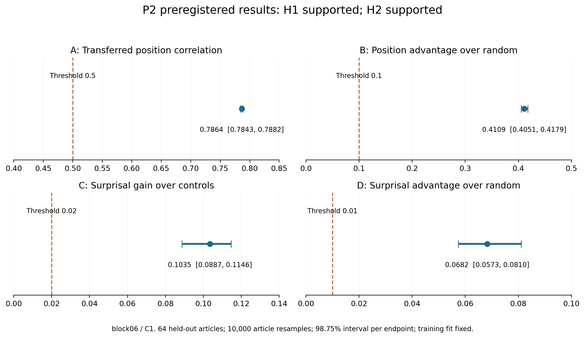
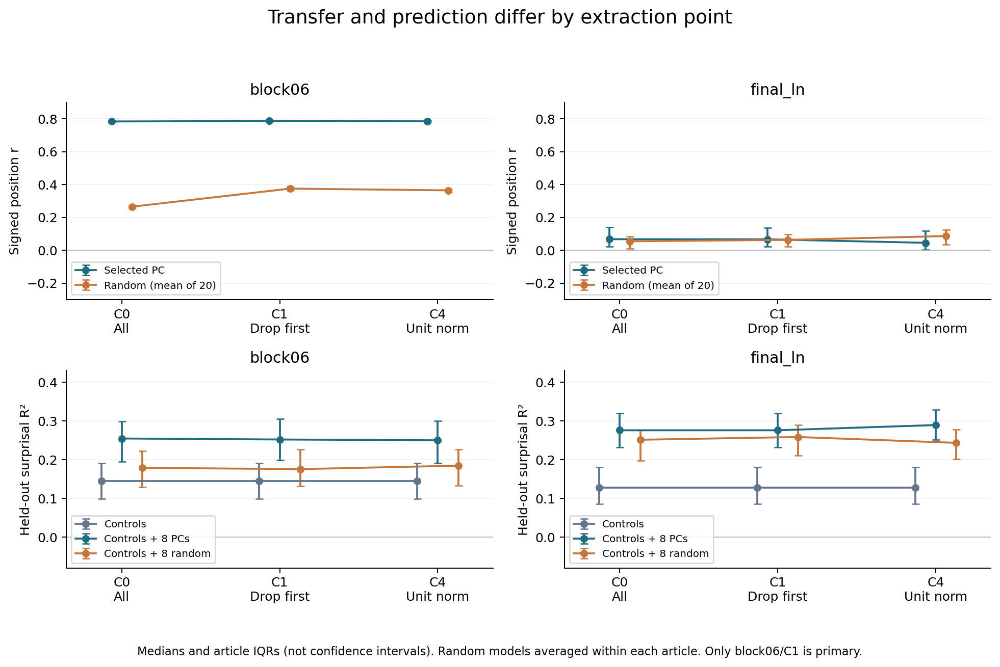
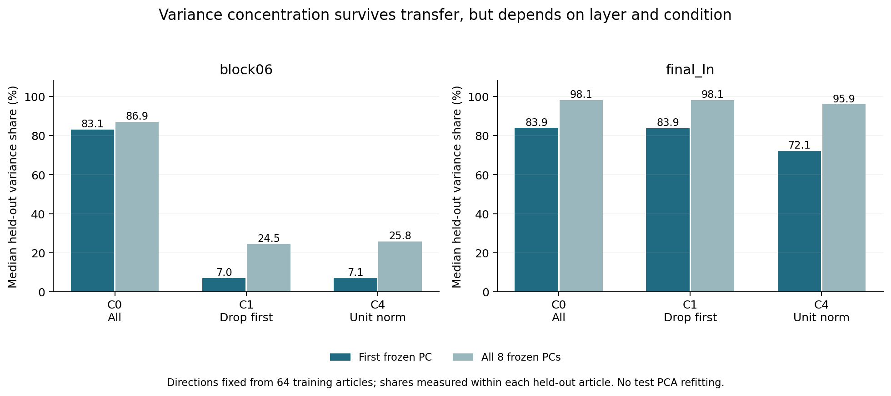
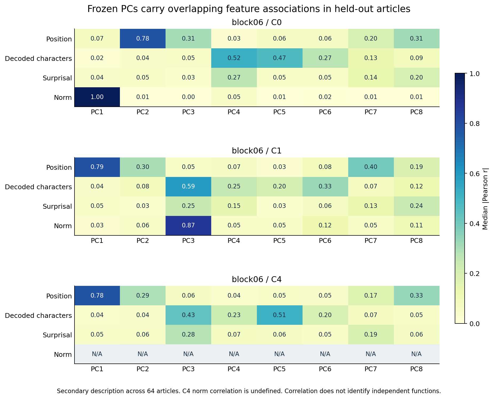

# P2解析レポート：訓練で固定したPCは別記事にも転用でき、単純な説明変数を超える予測情報を持つ

解析日：2026-10-20（JST）  
実験：EXP-0002 v1 / run `6966c146e980`  
対象：GPT-2、WikiText-2の訓練64記事・評価64記事、各512 tokens、2抽出点  
受領検証：**LOCAL_RECEIPT_AND_RECOMPUTE_PASS**

## 1. 結論

**ZIPの完全性、事前登録との一致、原観測からの数値再計算はいずれも合格した。主要条件block06/C1で、P2-H1「位置関連方向の別記事への転用」とP2-H2「単純な説明変数・同次元ランダム方向を上回るsurprisal予測」は、どちらも事前登録の支持基準を満たした。**

訓練64記事だけで決めた位置関連PCを、別の64記事へそのまま適用したところ、符号を固定した位置相関の記事中央値は **0.786**。同じ選択手順を使ったランダム方向の平均より、記事内の対応差中央値で **0.411** 高かった。

位置・復号文字数・頻度・ノルムなどの基礎変数に8PCを加えると、現在トークンのsurprisal予測は **ΔR²中央値0.104** 改善した。同次元のランダム8方向を加えた場合よりも **0.068** 高かった。

平たく言えば、**ある記事群で作った「読み取り用のものさし」が、別の記事でも働いた**。しかも今回指定した位置・長さ・頻度・ノルムの予測式だけでは拾えない情報を、8PCから追加で読み出せた。P1の「同じ記事の中で関連が見える」から、別記事での検証へ一段進んだ結果である。

ただし、位置専用回路やsurprisal専用回路を同定したわけではない。最終LayerNorm後では位置方向の転用は弱く、PCごとの特徴関連も重なる。結論の範囲は、今回のモデル・記事集合・長さ・固定予測器に限定する。旧論文は変更していない。

## 2. 完走・原観測・訓練評価分離の確認

| 項目 | 予定・条件 | 受領検証 |
| --- | --- | --- |
| 訓練記事 / 評価記事 | 64 / 64 | 64 / 64、ID重複なし |
| 保存した記事×抽出点 | 128×2＝256 | 全256行列 |
| 評価記事×点×条件 | 64×2×3＝384 | 全384件 |
| 重複を数えない入力tokens | 65,536 | 65,536 |
| 訓練fit | 2点×3条件＝6 | 全6件の基底・選択・予測式を検算 |
| 主要量A/B/C/Dの有効記事 | 各64 | 各64、欠測0 |
| 記事ごとのforward / commit | 各1回 | 全128記事で各1回 |
| worker失敗 / no-op追加forward | 0 / 0 | 0 / 0 |

ZIP内の証拠ファイル**1,603件**と、その一覧を持つINDEXの計1,604メンバーを確認した。サイズ・SHA-256・run ID・capsule・同梱ソースが固定版と一致し、原ZIPを残して別receiptへコピー・展開した。

受領ZIP内のコードは実行せず、**配布元の凍結検証器とNumPy 2.2.6**で検算した。保存原訓練から平均・共分散・全固有値を再計算し、保存基底の直交性・固有方程式・符号、選択PC・頻度・ridge係数を照合。全評価予測・相関・誤差・記事bootstrap・仮説判定も再計算し、Colab側と規定許容差内で一致した。浮動小数点の末尾には約10⁻¹⁶程度の差があるが、判定は一致する。

さらにログと原観測の参照先から、次の順序を確認した。時刻はJSTへ換算している。

| 記録 | 時刻 |
| --- | --- |
| カード・コードのローカル凍結 | 17:20:52 |
| run作成 | 17:28:32 |
| 最後の訓練記事commit | 17:30:20 |
| 基底・選択・全予測器の封印 | 17:30:26 |
| 最初の評価記事forward | 17:30:36 |

評価64記事すべての着手イベント・原観測が、同じ封印済みfitのハッシュを参照していた。fitが参照するのは訓練64記事の原COMMITで、評価記事の参照はない。4回の抽出プロセスの環境契約・モデル設定が一致し、モデルファイルのハッシュはP1とも一致した。累積処理の既存commitスキップ192件は正常な再利用で、二重計上ではない。

この時系列は保存ログによる照合であり、第三者の時刻証明ではない。また保存原観測の自己監査であり、別研究者・別実装でのモデルforward再現ではない。追加のモデル推論は行っていない。

証拠：[受領検算](receipt_verification.json)、[検算実行記録](verification_execution.json)、[実行・順序の詳細](analysis/aggregates.json)。

## 3. 今回の設計と、数値の読み方

P1で使っていないWikiText-2の記事を、本文・token列だけに基づく固定規則で128件選んだ。元データはtrain splitで、その中をP2の訓練64・評価64に分けた。P0との先頭token一致、P1記事、既使用・採用記事との近重複を除外した。「未使用」は今回の当てはめから未使用という意味で、GPT-2の事前学習から未知とは限らない。

| 条件 | 状態への処理 | PCAに使う記事内点数 |
| --- | --- | ---: |
| C0 | 全点 | 512 |
| C1 | 元位置0を除外。主要条件 | 511 |
| C4 | 各状態を単位ノルム化 | 512 |

訓練記事をまとめて中心・PCA基底を推定し、8方向を固定した。評価時も訓練平均を引き、その基底へ射影する。評価記事でPCAを当て直したり、符号を合わせ直したりしていない。C1は保存状態の除外であり、先頭入力を削除して再forwardした介入ではない。

位置に関連する1PCは、訓練記事での相関中央値の絶対値が最大になるものを選び、符号も訓練側で固定する。ランダム8方向×20組にも同じ選択手順を適用した。

surprisalの基礎予測式は、位置の4項、個別復号文字数・UTF-8 byte数、訓練内token頻度、元状態ノルムの8変数。規定の変換と訓練標準化を使い、ridge係数0.01を固定した。これに8PC、またはランダム8方向を加えた予測式と比較する。GPT-2の重み自体は更新していない。

- **surprisal**は「実際に来たトークンが、その直前までの文脈からどれだけ予想外だったか」。`h_t`には現在トークンがすでに入っているため、未来トークンを当てる性能とは区別する。先頭surprisalはNA、評価分母は各記事511点。
- **ΔR²**は、記事内での予測誤差の減少を、その記事の目的変数の変動で割った量。0.104はR²尺度の約10.4パーセントポイントの追加で、「誤差が10.4%減った」「正答率が10.4%上がった」という意味ではない。
- 表は記事間中央値。対応差は記事ごとに差を作ってから中央値を取るので、中央値同士の引き算とは一致しない。
- 反復単位は評価64記事。トークンやランダム20組を独立記事として数えない。

一次仕様：[事前登録カード](../../prereg/EXP-0002_v1_p2.md)。凍結本文を保持し、判定は[別の結果追補](../../prereg/EXP-0002_v1_results_2026-10-20.md)へ記録する。

## 4. 事前登録した主要仮説の判定

主要点は**block06＝第6ブロック後、主要条件はC1**。旧稿の0始まりL6＝第7ブロック後とは異なる。4量それぞれ、記事bootstrap10,000回の**98.75%区間**を用いた。訓練fitを固定した条件付きの不確実性であり、訓練集合を選び直す変動は含まない。

| 主要量 | 記事中央値 | 98.75%区間 | 支持に必要な下限 |
| --- | ---: | --- | ---: |
| A：符号固定した位置r | 0.786379 | [0.784334, 0.788167] | ≥0.50 |
| B：位置rのランダム平均への優位差 | 0.410946 | [0.405082, 0.417935] | ≥0.10 |
| C：surprisalの基礎モデルへのΔR² | 0.103522 | [0.088701, 0.114574] | ≥0.02 |
| D：surprisalのランダム8方向への優位差 | 0.068226 | [0.057319, 0.081029] | ≥0.01 |

**P2-H1＝支持。** A・Bの両方が基準を満たす。訓練で選ばれたのはPC1で、訓練位置r中央値0.788、評価0.786。評価側で向きを合わせる必要はなかった。ランダム対照への優位差は64/64記事で正だった。

**P2-H2＝支持。** C・Dの両方が基準を満たす。基礎モデルへの改善は63/64記事、ランダム8方向への優位は62/64記事で正だった。残りの記事の負値も保持しており、「すべての記事で改善」とは言わない。

閾値はこの計画の操作的基準で、普遍的な境界ではない。4区間へのBonferroni配分で全体約95%を狙った近似であり、有限標本の厳密な被覆保証ではない。条件・閾値・主要層の差し替えは行っていない。

## 5. 主条件でどれくらい読み出せたか

| block06/C1の比較 | 記事中央値 |
| --- | ---: |
| 訓練で選んだPCの位置r | 0.7864 |
| ランダム方向の位置r・20組平均 | 0.3754 |
| surprisal：基礎変数だけのR² | 0.1442 |
| surprisal：基礎変数＋8PCのR² | 0.2521 |
| surprisal：基礎変数＋ランダム8方向のR²・20組平均 | 0.1756 |

ランダム方向でも位置やsurprisalに関連する情報は読み出せる。その上で、訓練PCAを用いた方向が今回の比較で上回った。これは「高分散の方向が無意味なものだけを拾っている」という見方に対し、具体的な反例になる。

一方、基礎変数＋8PCでもsurprisalのR²中央値は約0.252で、目的変数の全変動を説明するわけではない。また、8PCをまとめた予測性能から、それぞれのPCの固有の貢献量は分からない。専用の成分除去比較や因果介入を行った結果ではない。

## 6. 条件・抽出点を変えるとどうなるか

以下は事前指定した副次結果の記述で、確認的仮説を追加していない。

| 抽出点 | 条件 | 訓練で選択した位置PC | 評価位置r | 位置のランダム優位差 | surprisal ΔR² | surprisalのランダム優位差 |
| --- | --- | ---: | ---: | ---: | ---: | ---: |
| block06 | C0 | PC2 | 0.7835 | 0.5174 | 0.1065 | 0.0720 |
| block06 | C1 | PC1 | 0.7864 | 0.4109 | 0.1035 | 0.0682 |
| block06 | C4 | PC1 | 0.7846 | 0.4188 | 0.1061 | 0.0687 |
| final_ln | C0 | PC3 | 0.0681 | 0.0194 | 0.1367 | 0.0334 |
| final_ln | C1 | PC3 | 0.0673 | 0.0068 | 0.1367 | 0.0228 |
| final_ln | C4 | PC3 | 0.0461 | −0.0194 | 0.1575 | 0.0489 |

**中間層block06：** 位置の強い関連は、C0のPC2からC1/C4のPC1へ番号が変わりながら、別記事でも保たれた。surprisalの追加予測も3条件でおおむね同程度だった。先頭点を除くことで、すべての有用な特徴情報が失われたわけではない。

**最終LayerNorm後final_ln：** 訓練で選んだ位置方向の評価相関は約0.05〜0.07で、中間層より弱い。C4ではランダム対照への優位差中央値が負になる。一方、surprisalの追加予測は正だった。**位置との強い関連と、surprisalの予測に役立つことは、同じ性質ではない。** 最終層の全表現から位置が消えたとも言えず、今回は上位8PC中の訓練選択1方向を測っている。

図の線は条件ごとの中央値、エラーバーは記事間四分位範囲であり信頼区間ではない。条件ごとに訓練した基底と対照が異なるため、条件差を単一の介入効果と解釈しない。

### 転用した方向の分散集中

| 抽出点 | 条件 | 固定PC1方向の分散比 | 固定8PC合計の分散比 |
| --- | --- | ---: | ---: |
| block06 | C0 | 83.06% | 86.93% |
| block06 | C1 | 6.96% | 24.53% |
| block06 | C4 | 7.14% | 25.79% |
| final_ln | C0 | 83.88% | 98.07% |
| final_ln | C1 | 83.86% | 98.06% |
| final_ln | C4 | 72.13% | 95.93% |

これは**訓練から固定した方向が、各評価記事内の中心化分散をどれだけ占めるか**である。評価記事で再PCAした最大分散比ではない。P1の文章内PCAの値とは、基底の推定法も記事集合も違う。

P1と整合する層差が、共通基底を転用しても見られた。中間層の先頭除外では分散集中が下がるが、位置関連と予測情報は残る。最終表現は、単位ノルム化後も固定8PCに評価記事内分散の約96%が集まる。ただし「分散の96%」は「言語機能の96%」や「意味の96%」ではない。

## 7. 個々のPCの特徴と、専用軸と呼べない理由

block06/C1の特徴相関を例示する。数値は評価記事ごとのPearson相関の絶対値の中央値で、次の成分への注目は結果の記述であり、新しい確認的検定ではない。

| 成分 | 位置 | 個別復号文字数 | surprisal | 元状態ノルム |
| --- | ---: | ---: | ---: | ---: |
| PC1 | 0.786 | 0.043 | 0.052 | 0.029 |
| PC3 | 0.048 | 0.588 | 0.245 | 0.867 |
| PC6 | 0.084 | 0.326 | 0.065 | 0.120 |
| PC7 | 0.397 | 0.067 | 0.132 | 0.049 |
| PC8 | 0.190 | 0.122 | 0.238 | 0.107 |

PC1には位置との強い関連がある。PC3は文字数と関連する一方、ノルムとの関連がさらに強く、surprisalとも関連する。複数の特徴が一つの方向に重なっているため、「PC3は純粋な文字数軸」と断定する根拠にはならない。PCの直交性も、特徴や機能の独立性を保証しない。

また、先頭除外後のPC1–ノルム相関が弱くても、ノルム関連はPC3に強く見られる。**PC1での弱さを、表現全体からノルム情報が消えたことへ拡張してはいけない。**

副次的な文字長予測では、目的変数を`log1p(個別復号文字数)`とし、文字数・byte数自体を基礎変数から除いている。block06/C1では基礎R²中央値0.3526、8PC追加後0.6717、記事内ΔR²中央値0.3199、ランダム優位差0.2624だった。両改善は64/64記事で正だが、P2-H1/H2とは別の記述結果である。単語長や形態素長の測定ではなく、空白・部分語・個別復号時の置換文字の影響も含む。

全12,288個の特徴相関のうち、C4のノルム相関1,024個は規定どおりNA。単位ノルム化で定数になるためであり、解析失敗やゼロ相関として扱わない。それ以外の11,264個は定義できた。全PC・全条件の符号付き/絶対相関と分布は[詳細集計表](analysis/DETAIL_TABLES.md)に記載した。

## 8. P1・旧稿から見解がどう進んだか

**P1のH1反証と今回のP2-H1支持は矛盾しない。問いが違う。** P1-H1は「先頭除外後もPC1とノルムが強く結び付くか」、P2-H1は「訓練で見つけた位置関連方向が別記事にも通用するか」を問う。

| 論点 | P1までの状態 | P2で追加された証拠 |
| --- | --- | --- |
| PC1のノルム関連・分散集中 | 中間層は先頭点に敏感。最終表現は別の振る舞い | 共通基底を別記事へ転用しても、中間層と最終表現の分散集中の違いが見られる |
| 位置関連 | 同じ記事内で、C0のPC2からC1のPC1へ関連の強い順位が移る | 訓練だけで選んだ方向・符号を固定しても別記事で約0.786。ランダム対照を上回る |
| PCから読める特徴 | 記事内相関の記述で、別記事予測は未確認 | 固定8PCを加えたsurprisal予測が、指定した基礎変数とランダム方向を上回る |
| PCの独立した意味・機能 | 未確認 | 依然未確認。文字数・ノルム・surprisalが同じPCに重なる |
| 因果機構・多モデル普遍則 | 未確認 | 依然未確認 |

原稿に採用を検討できる中心的な主張は、**「高分散構造は先頭点と抽出点に依存する。一方、先頭点を除いた中間層にも、別記事へ転用できる位置関連方向と、指定した基礎変数を超える特徴予測情報が残る」**という範囲になる。

P2は焦点化改訂版の特徴分析を強める証拠になるが、旧稿の強い機構解釈を全面的に復活させるものではない。旧12モデルの集計を、このGPT-2の検証だけで置換することもできない。先行研究に対する優先権・新規性の確定や、論文の確定主張への採用は今回行っていない。

## 9. 残る限界と次の候補

1. **単純な説明をすべて排除したわけではない。** 比較したのは指定した変換・線形ridgeの基礎モデル。語彙ID、非線形な長さ・頻度・ノルムの組合せ、記事内容などの代替説明は残る。H2支持はこの基礎モデルを上回ったことを示す。
2. **位置と文脈長は区別できない。** 記事先頭から固定長で読んでいるため、位置tと左文脈長が同じ。絶対位置、文脈量、記事の展開のどれを拾っているかは未分離。
3. **現在トークンの読み出しである。** 語彙や文字長の情報が状態に入っている条件でsurprisalを予測する。言語モデル自身の次トークン予測が改善したとは言わない。
4. **一般化の範囲は限られる。** 1モデル、Wikipedia由来の1領域、先頭512 tokens、1つの訓練/評価分割。記事の話題は独立とは限らず、事前学習との重複も不明。64評価記事のbootstrapは、別領域や訓練分割の変動を保証しない。
5. **対照と次元数も固定条件である。** 20組のランダム8方向の平均に対する優位であり、すべてのランダム射影や最良の別手法に勝ったわけではない。上位8PCを使うことが最適とも結論できない。
6. **保存された観測の自己監査である。** 別実装のモデルforward、独立研究者の追試、新VM復旧、GPU間の精度比較は未実施。

次の優先候補は、**より強い語彙・非線形の基礎モデルとの比較を設計し、別の未使用記事・領域でも転用が保たれるか確かめること**。これにより今回の「指定した単純モデルを超える」を、どこまで広げられるかを評価できる。訓練分割を変えた再現も別に必要である。

既存P2評価記事を見て調整した解析は探索と明記し、新しい確認的評価には使い回さない。先頭位置・接頭辞の介入やLayerNormの機構分解は別の問いであり、このレポート作成では開始していない。

## 10. 実測・保存・再計算用ファイル

| 項目 | 実測 |
| --- | --- |
| GPU | NVIDIA RTX PRO 6000 Blackwell Server Edition |
| GPU総メモリ（Torch報告） | 101,974,081,536 bytes ≈94.97 GiB |
| ホスト総RAM | 189,928,599,552 bytes ≈176.88 GiB |
| 記録されたTorch peak allocated最大 | 1,094,174,208 bytes ≈1.019 GiB |
| Colabのsummary生成まで | 165.49秒 ≈2分45.5秒 |
| 手元の受領検算 | 44.24秒 |
| FINAL ZIP | 498,956,097 bytes＝498.96 MB |

summaryまでの時間は最終ZIP圧縮・ブラウザ転送を含まない。実測は事前見積り15〜45分より短かったが、依存導入・キャッシュ・回線・CPUによって変わるため、次回の所要時間保証にはしない。Torchのpeak allocatedはTorch管理の割当量で、GPU全体・予約済みメモリ・ホストRAMの最大使用量ではない。

原ZIP・受領コピー・`raw/`を保持し、派生解析を`analysis/`、図4点のPNG/SVGを`figures/`へ置いた。P0/P1の配布物・観測・解析、旧稿・改訂版は保持。事前登録本文は上書きしていない。

| ファイル | 内容 |
| --- | --- |
| [receipt_verification.json](receipt_verification.json) | 全件検算、主要4量、区間、判定 |
| [receipt_verification.log](receipt_verification.log) | 原訓練fit・評価記事の検算ログ |
| [analysis/aggregates.json](analysis/aggregates.json) | 全384件・全特徴・集約値・実行順序の照合 |
| [analysis/aggregate.py](analysis/aggregate.py) | 保存観測の記述集計・運用検証 |
| [analysis/plot.py](analysis/plot.py) | 図4点・詳細表の生成 |
| [analysis/DETAIL_TABLES.md](analysis/DETAIL_TABLES.md) | 全条件の分布と全PC特徴相関 |
| [raw/summary.json](raw/summary.json) | Colabの原集計。受領前の状態表示も保持 |
| [archive_receipt.json](archive_receipt.json) | 原ZIP・コピーのハッシュと受領時刻 |
| [最終保全記録](../../evidence/p2_final_checks_2026-10-20.json) | 原本保全、固定版、台帳、派生物の照合 |

- ZIP SHA-256：`730f2eb58af84fa6a6017eb2a07fe7324e4f6c4692dbec4ffb720fa2c4626d0a`
- capsule：`de2c8645554c81b2989afc27b9ddae2bfcb18a223c37ee72c47bb09c1cfa933d`
- fit COMMIT SHA-256：`b6afeca1da27ff02421fb7eb7d129eed717d49c17157929abe322df5c017c967`
- GPT-2 revision：`607a30d783dfa663caf39e06633721c8d4cfcd7e`
- WikiText revision：`b08601e04326c79dfdd32d625aee71d232d685c3`
