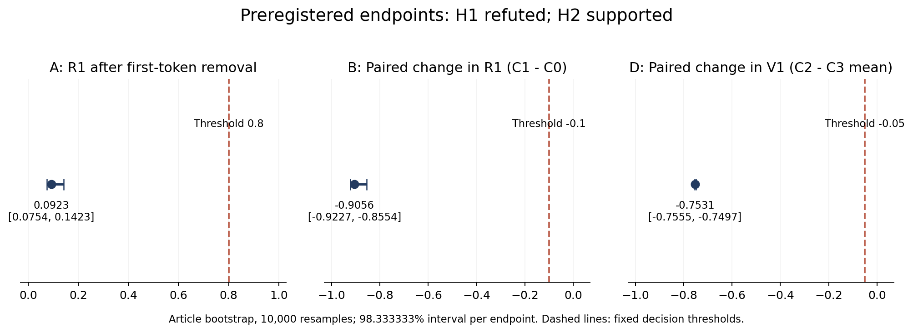
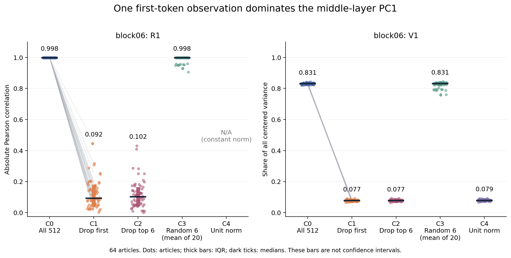
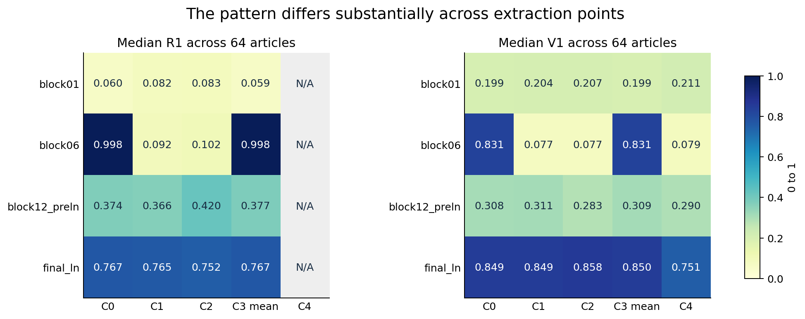
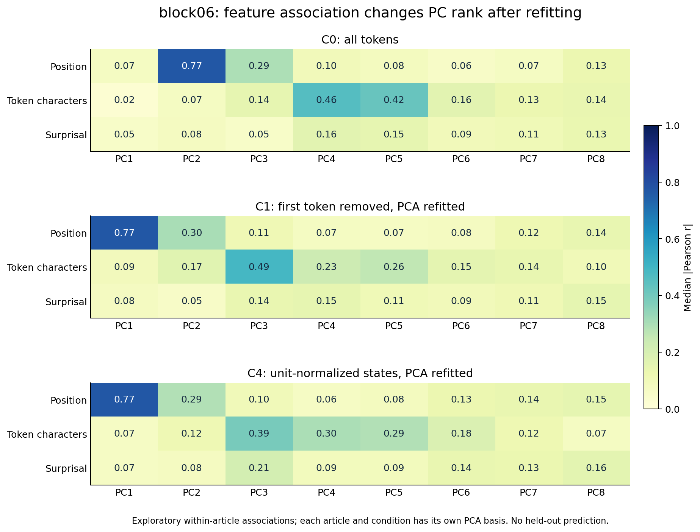

# P1解析レポート：PC1のノルム関連は先頭点に敏感で、分散集中の性質は層によって異なる

解析日：2026-10-20（JST）  
実験：EXP-0001 v1 / run `98a3faf68004`  
対象：GPT-2、WikiText-2の64記事、各512 tokens、4抽出点  
受領検証：**LOCAL_RECEIPT_AND_RECOMPUTE_PASS**

## 1. 結論

**実験は完走し、手元への転送後の検算も合格した。科学的な結果は、H1「先頭を除いても高いPC1–ノルム相関が残る」が反証、H2「高ノルム点の除外でランダム除外より分散集中が下がる」が支持だった。**

主要抽出点block06では、全点を使うPC1–ノルム相関の絶対値は記事中央値 **0.998**、PC1の分散比は **83.08%** だった。しかし、先頭1点だけを除いてPCAを再推定すると、それぞれ **0.092、7.71%** へ低下した。64記事すべてで先頭点が最大ノルムだった。

したがって、今回の強い結果は「中間層のPC1が、ほとんどのトークンに共通する安定したノルム軸である」という解釈を支えるものではない。**全点で見える非常に強い相関・分散集中が、先頭の極端な観測点に大きく左右される**ことを、固定条件と原観測から確かめた結果である。

一方、最終LayerNorm後では、先頭を除いてもPC1分散比は約84.9%のまま、さらに単位ノルム化しても約75.1%が残った。全層を同じ説明で括ることはできない。残りのPCには位置・復号文字数との関連があり、先頭除外によって関連の強いPCの順位も変わる。

これはGPT-2の今回の64記事・先頭512 tokensでの結論であり、多モデルでの普遍則や因果機構の証明ではない。既存論文は変更していない。

## 2. 完走と証拠の確認

| 項目 | 予定 | 受領・検証結果 |
| --- | ---: | ---: |
| 記事 | 64 | 64 |
| 記事×抽出点 | 256 | 256 |
| 重複を数えない入力トークン | 32,768 | 32,768 |
| モデルforward | 64 | 64、各記事1回 |
| 主要量A/B/Dの有効記事 | 各64 | 各64、欠測0 |
| C0/C1/C2/C4のPCA | 1,024 | 全件検算合格 |
| C3ランダム除外 | 5,120 | 全反復再計算合格 |
| worker失敗 | — | 0 |
| no-opによる追加forward | 0 | 0 |

ZIPの全証拠ファイル1,011件のパス・SHA-256・ソース版を検査し、配布元の固定検証器で再検算した。ZIPに入っていたコードは実行していない。固定NumPy 2.2.6を使い、保存された隠れ状態から除外位置・ノルム・中心化総分散・Gram固有値を計算し、保存SVDの平均、基底、スコア、スペクトル、特徴相関を照合した。C3の20反復×全256点を再計算し、記事bootstrapと仮説判定も一致した。これは新しいモデル実験ではなく、保存原観測のCPU検算である。

4回の抽出プロセスで環境契約と読み込んだモデル設定が一致した。抽出点チェックは64記事すべて合格し、最終LayerNormへの変換照合の最大絶対差は0、surprisalの別式照合は最大約1.52×10⁻¹⁴だった。ただし、これらは保存されたチェック記録と実装の整合性確認であり、別実装のモデルforwardを実施した独立再現ではない。

既存コミットのスキップは96件あるが、16/32/48記事で区切った累積処理の正常な挙動である。forwardとcommitは記事ごとに各1回で、二重集計はない。初回カードの凍結記録16:22:40 JSTに対し、run作成記録は16:27:16 JST。ローカル記録上は凍結が先だが、公開レジストリや第三者の時刻証明ではない。

証拠：[受領検算JSON](receipt_verification.json)、[検算実行記録](verification_execution.json)、[原ZIP受領記録](archive_receipt.json)。

## 3. 実験条件と読み方

適格602記事から、結果を使わない固定ハッシュ順で64記事を選んだ。各記事の本文の先頭512 tokensを使い、追加BOS/EOS・paddingはない。**位置0は本文の最初のトークン**であり、追加した特殊トークンではない。見出し除去などの整形は凍結カードどおりで、モデルもtokenizerもrevisionを固定した。

| 条件 | 保存状態に対する処理 | 残る点 |
| --- | --- | ---: |
| C0 | 全点で中心化PCA | 512 |
| C1 | 元位置0を除き、PCAを再推定 | 511 |
| C2 | 原ノルム上位6点を除き、PCAを再推定 | 506 |
| C3 | ランダム6点除外を20反復。記事内の平均を比較に使用 | 各506 |
| C4 | 各状態を単位ノルム化し、PCAを再推定 | 512 |

C2の6点は事前定義 `ceil(512×0.01)` による丸めで、実際の除外率は約1.17%。C1は約0.195%。入力を消してモデルを再実行した実験ではない。他のトークンの隠れ状態は元のforwardのままなので、ここで測るのは**統計量の感度**である。

- **R1**：PC1スコアと状態ノルムのPearson相関の絶対値。符号不定性を避けている。C4ではノルムが一定になるためNAであり、0ではない。
- **V1**：第1固有値÷全中心化分散。上位8PCだけを分母にしていない。
- 表の値は記事間の中央値。対応差は各記事の差を先に作って中央値を取る。「中央値同士の差」とは区別する。
- 統計的な反復単位は記事。32,768トークンやC3の反復数を独立標本数としない。

一次仕様：[凍結カード](../../prereg/EXP-0001_v1_p1.md)、[入力と配布コード](../../p1_v1/README.md)。凍結カードの「未実行」は凍結時点の記録として保持し、今回の判定は別の[結果追補](../../prereg/EXP-0001_v1_results_2026-10-20.md)に記録する。

## 4. 事前登録した主要仮説の判定

block06だけを主要判定に使った。記事単位10,000回のpercentile bootstrap、固定seedによる**各量98.333333%区間**である。3量へのBonferroni配分で全体約95%を狙う設計だが、有限標本での厳密な被覆保証ではない。

| 主要量 | 記事中央値 | 98.333333%区間 | 固定基準との関係 |
| --- | ---: | --- | --- |
| A：先頭除外後のR1 | 0.092305 | [0.075372, 0.142286] | 区間上限が0.80未満 |
| B：R1の対応差 C1−C0 | −0.905597 | [−0.922660, −0.855421] | 区間上限が−0.10未満 |
| D：V1の対応差 C2−C3平均 | −0.753065 | [−0.755477, −0.749695] | 区間上限が−0.05以下 |

**H1＝反証。** 支持にはAの区間下限≥0.80かつBの区間下限≥−0.10が必要だった。今回は両方の量が明瞭に反証側にある。C1のR1は64記事の最大でも0.445で、中央値だけが低いわけではない。

**H2＝支持。** 高ノルム上位6点を除くと、同数ランダム除外に比べてV1が中央値で **75.31パーセントポイント低い**。区間は **[−75.55, −74.97]パーセントポイント**。事前の実質差5ポイントを大幅に超える。これは「75.31%の相対減少」ではなく、分散比の絶対差である。

閾値0.80・0.10・0.05はこの計画の操作的定義であり、普遍的境界ではない。結果に合わせて閾値を変更したり、他の層を主要点へ差し替えたりしていない。



## 5. 主要層で何が起きているか

| block06の条件 | R1中央値 | V1中央値 |
| --- | ---: | ---: |
| C0 全点 | 0.997968 | 83.0785% |
| C1 先頭除外 | 0.092305 | 7.7145% |
| C2 高ノルム6点除外 | 0.101520 | 7.7441% |
| C3 ランダム6点除外・20反復平均 | 0.997885 | 83.1118% |
| C4 単位ノルム化 | NA | 7.8743% |



点は64記事、太線は四分位範囲、横線は中央値。四分位範囲は信頼区間ではない。

### 5.1 先頭1点の影響

事前に保存した診断では、**64/64記事で位置0が最大ノルム**であり、全記事でC2の除外対象に入る。最大ノルム÷記事内中央値は記事間中央値 **38.04倍**、記事間範囲36.73〜39.10倍だった。

C1とC2はほぼ同じ低いV1に到達する。記事ごとの `V1_C2−V1_C1` の中央値は **+0.0508パーセントポイント**で、高ノルム点をさらに5点取り除くことによる追加低下は中央値では見られない。したがってH2支持を、「6個の外れ値がそれぞれ独立に分散を担う」とは解釈しない。今回の主要層では、その中の先頭1点が特に支配的である。

### 5.2 結果を見て追加した説明用診断

以下は**事後の探索的診断**であり、H1/H2の追加検定や判定変更には使っていない。

| 診断 | 結果 |
| --- | --- |
| 先頭点の中心化二乗距離÷全点の中心化二乗和 | 記事中央値82.67% |
| 先頭点のPC1スコア²÷全PC1スコア²の和 | 記事中央値99.49% |
| 除外前PC1と除外後PC1の方向の絶対cosine | 記事中央値0.0624 |
| 除外前PC2と除外後PC1の方向の絶対cosine | 記事中央値0.9976 |
| C3で偶然先頭点を除いた反復 | 15/1,280反復 |
| 上記15反復のV1 | 中央値7.70% |
| C3で先頭点を残した1,265反復のV1 | 中央値83.24% |

二乗和の割合は元のC0平均・C0基底を固定して計算した寄与である。除外すると平均と基底が変わるため、C1への変化量と同一視しない。また、C3を事後に分けた15対1,265反復は記事ごとに偏りがあり、独立標本を使う新しい有意差検定ではない。

この診断は、ランダム除外が大抵は先頭点を残すためC0に近い値を維持すること、先頭除外後は以前のPC2に近い方向が新しいPC1になることと整合する。ただしcosineには記事差があり、「すべての記事で完全に一つずつ順位が繰り上がる」とは言わない。

### 5.3 「ノルム情報が消えた」わけではない

事前に定めた固定基底診断で、C0のPC1方向を固定してC1の残存状態へ射影すると、R1中央値は **0.4504**、その方向の残存総分散に対する割合は **1.522%** だった。

再推定後PC1のR1が0.092になったという結果と両立する。**最も分散の大きい方向が変わった**のであり、残存表現にノルム関連が一切なくなった、あるいはノルムがどの方向からも読み出せなくなったという結果ではない。

## 6. 層を分けると見える違い

主要点以外の3点は事前指定した副次的記述であり、主要仮説の検定を増やしていない。

| 抽出点 | R1 全点→先頭除外 | V1 全点→先頭除外 | V1 単位ノルム化後 | 先頭が最大ノルム |
| --- | --- | --- | ---: | ---: |
| block01 | 0.060→0.082 | 19.94%→20.43% | 21.13% | 64/64 |
| block06 | 0.998→0.092 | 83.08%→7.71% | 7.87% | 64/64 |
| block12_preln | 0.374→0.366 | 30.84%→31.10% | 28.99% | 0/64 |
| final_ln | 0.767→0.765 | 84.92%→84.93% | 75.07% | 0/64 |



**block01：** 先頭点は最大ノルムだが、最大÷中央値は約2.67倍で、中間層の約38倍とは大きく違う。最大ノルムが先頭にあるという事実だけでは、高いR1や分散支配は導けない。

**block12_preln：** 先頭除外の影響は小さい。高ノルム6点除外とランダム除外のV1対応差中央値は−1.78ポイントだが、これは副次的記述であり、主要点のH2判定を転用しない。

**final_ln：** 先頭除外の影響は小さく、V1の対応差中央値は−0.0040ポイント。高ノルム6点除外ではランダム除外よりV1が中央値+1.07ポイント高い。さらに単位ノルム化してもV1が75.07%あるため、**最終出力側には、各ベクトルの長さを揃えても残る強い分散集中**がある。この観測に対して、中間層の先頭外れ値だけで説明することはできない。

ここでの`final_ln`はモデル自身の最終LayerNorm後であり、C4はそこからさらに実施したベクトルの単位ノルム化である。モデルのLayerNormには学習されたアフィン変換があり、「LayerNorm後なので全トークンのノルムが同じ」とは扱っていない。学習パラメータ・方向分布・平均からの偏りのうち何が集中を生むかは、今回の観測だけでは切り分けていない。

## 7. 残りのPCは何と関連するか

全64記事、全4点、C0/C1/C2/C4、PC1〜8について、位置・復号文字数・surprisalとの相関を保存・照合した。計24,576個の特徴相関に未定義値はなかった。下記は記事ごとの相関の絶対値を集約した**探索的な記述**である。記事間で共通の基底を学習した評価ではない。



### 7.1 位置の関連は残るが、PC番号が変わる

block06のC0ではPC2–位置の相関中央値が **0.766**。8PCの中で位置相関が最大の成分は64記事中62記事でPC2だった。

C1ではPC1–位置が **0.768** となり、61/64記事でPC1が最大。C4でもPC1–位置は **0.769**。先頭点の影響を取り除いた後にも、位置と強く関連する分散方向は残る。前節の方向cosineと合わせると、C0でPC2だった位置関連方向が、C1で最上位に現れるという説明に整合する。

ただし位置は、文脈長や記事の展開とも同時に変化する。位置相関だけから「純粋な位置専用軸」や位置の因果的符号化を確定できない。

### 7.2 復号文字数との関連は複数のPCに分かれる

block06のC0ではPC4が **0.460**、PC5が **0.421**。記事ごとに最も強いPCはPC4が30/64、PC5が25/64で、一つの番号に固定されていない。C1ではPC3が **0.488**、38/64記事で最大だった。C4ではPC3が0.389、PC4が0.298、PC5が0.287と複数成分に分布する。

これは長さに関連する方向を調べる動機にはなるが、PC3やPC4を「文字数軸」と命名する十分な根拠ではない。ここでの長さは**トークンを個別に復号した文字数**で、先頭空白や部分語を含む。単語長・形態素長ではなく、一部のbyte-level tokenには個別復号時の置換文字もある。語彙・頻度・文脈との交絡も未統制である。

### 7.3 surprisalとの関連は層依存で、中間層では単一PCにまとまらない

block06のC0ではPC1〜8の各中央値は約0.05〜0.16で、最も高いPC4でも **0.164**。C1も約0.05〜0.15。C4のPC3は **0.210** だが、これを全条件に共通するsurprisal軸とするのは強すぎる。

別の抽出点では、block01のC0・PC3が **0.285**、final_lnのC0・PC3が **0.319** で、最終点では56/64記事でPC3が8PC中最大だった。final_lnのC4・PC3は **0.331**。この違いは後続評価の候補になるが、結果を見て層・PCを選んだ確認的証拠にはしない。

surprisalは `−log p(x_t | x_<t)` を同じトークン位置の`h_t`に対応させる。先頭surprisalはNAなので、C0/C4のsurprisal相関は各511点を使う。入力トークンを既に取り込んだ状態との関連であり、未来のトークンを予測するプローブ性能とは異なる。

### 7.4 特徴分析からまだ言えないこと

PCAは各記事・条件で推定している。同じ「PC2」という番号でも、全記事に共通する一つの方向が検証されたわけではない。最大相関のPCを数えた集計も、同じ記事内で選択・評価した記述であり、選択バイアスを含む。PCの直交性は特徴の統計的独立性や意味的独立性を保証しない。

今回、品詞の正解ラベル、別記事への基底転用、交絡を統制した予測、入力操作による因果検証は行っていない。完全な特徴表は[詳細集計表](analysis/DETAIL_TABLES.md)に示した。

## 8. 論文の主張に対する意味

既存の焦点化改訂版は、PC1のノルム関連・分散集中と残りPCの特徴を中心にし、外れ値感度や別記事評価が未確認であることを留保していた。P1は、その留保のうち**外れ値・先頭点への感度を自然文64記事で直接確認した**。

| 主張の候補 | 今回の証拠による扱い |
| --- | --- |
| GPT-2中間層では、全点PCAのPC1とノルムが非常に強く相関する | 今回の条件で明瞭に確認。ただし先頭点依存を必ず併記 |
| その相関は先頭除外にも頑健で、多くのトークンに共通する主要構造である | 事前登録H1が反証。今回のデータでは採用できない |
| 高ノルム点が分散集中に強く影響する | block06ではH2支持。特に先頭1点の影響が大きい |
| 分散集中はすべての層でノルム外れ値だけから生じる | 最終LayerNorm後の結果と合わず、採用できない |
| 残りのPCに位置・文字数等の関連がある | 文章内の探索的記述として支持。番号固定・共通軸・独立機能は未確認 |
| 新しい普遍機構や多モデル共通の法則を発見した | 単一モデルの今回の設計では判定できない |

この結果に基づく原稿の中心候補は、**「全点PCAで見える強いノルム関連の頑健性を検査すると、先頭点に支配される中間層と、単位ノルム化後も集中が残る最終表現が区別される。特徴関連のPC順位も前処理に依存する」**という記述になる。

研究上の価値は、高相関の再掲に加え、条件を固定した反証、影響の大きさ、層間の違い、PC解釈の感度、原観測からの検算可能性を示せた点にある。今回の解析は先行研究に対する優先権や新規性の確定を行っていない。旧12モデル集計の数値そのものを、このGPT-2の新しい入力だけで取り消したり置換したりもしない。論文の確定主張への採用は別の判断として残す。

## 9. 限界と、次に検証すべき点

今回強く言えるのは、固定したGPT-2・Wikipedia記事先頭・512 tokens・4抽出点における統計量の感度である。次の限界は残る。

1. **モデル・領域・長さの一般化。** 1モデル・1コーパス・固定長のみ。64記事も同じコーパスからで、完全に独立な話題とは限らない。bootstrapは記事を再標本化する近似で、コーパス外の一般化を保証しない。
2. **先頭が特別な理由。** 位置、左文脈の不在、トークンの種類、注意・残差計算のどれが現象を作るかは分離していない。先頭復号文字列は33種類あったが、それで語彙要因が統制されたわけではない。attention sink等の特定機構を本解析から断定しない。
3. **方向と予測性能。** 残存PCの関連は同一記事内。P1はP2の仮説形成に利用できるが、P1記事を改めて「未使用テスト」と呼ぶことはできない。モデルの事前学習データとの重複も不明。
4. **ランダム対照と軸の安定性。** C3は20反復の有限Monte Carlo平均。先頭を引く頻度の影響を受ける。PCAを再推定すると軸・順位が変わり、固有値の近接時には個別軸より部分空間での検討が必要になる。
5. **自己監査の範囲。** 固定コードでの受領検算と、その上に作った記述集計である。別の研究者・別のモデル実装による独立再現ではない。

次の設計候補としては、**未使用記事での基底転用と交絡統制（P2）**を優先するのが妥当である。位置・文脈長・復号長・頻度等の単純な説明と比較し、訓練記事で基底・PC選択・モデル設定を固定してから別記事を評価する。C0と先頭感度を考慮した条件をあらかじめ併記し、結果に都合のよい方だけを選ばない。

先頭特異性の機構を追うための接頭辞・入力位置等の操作や、最終LayerNormの成分別分析、多モデル拡張は別の問いとしてカードを作る必要がある。今回追加実験は行っていない。

## 10. 運用実測・保存・再計算

| 項目 | 実測 |
| --- | --- |
| GPU | NVIDIA RTX PRO 6000 Blackwell Server Edition |
| GPU総メモリ（Torch報告） | 101,974,081,536 bytes ≈94.97 GiB |
| ホスト総RAM | 189,928,599,552 bytes ≈176.88 GiB |
| 記録されたTorch peak allocatedの最大 | 約1.019 GiB |
| Colabのsummary生成まで | 396.50秒 ≈6分36.5秒 |
| 手元の全件受領検算 | 253.22秒 ≈4分13.2秒 |
| FINAL ZIP | 469,779,245 bytes =469.78 MB =448.02 MiB |
| 証拠ファイル展開量 | 506,801,811 bytes |

Torchのpeak allocatedはTorch管理のGPU割当量であり、GPU全プロセス・予約済みメモリ・ホストRAMの最大使用量ではない。Colabの計時はlaunch開始からsummary生成までで、最終ZIP圧縮とブラウザ転送を含まない。実測は事前見積り20〜60分より短かったが、他GPU・新VM・キャッシュ条件で同じ時間になる保証はない。今回の大容量FINALの転送・再読込は確認できたが、新VMへの復旧、GPUを替えた精度比較、長時間上限までの運用は未検証。

原ZIP・受領コピー・抽出した`raw/`を保持し、派生解析を`analysis/`、図を`figures/`へ分離した。旧論文・改訂版・配布P0/P1・事前登録は保持している。THROUGHLINEの台帳には実験成功とH1反証を分けて記録した。仮説反証を、運用検出器の誤判定件数には数えていない。

### 出所と再現用ファイル

| ファイル | 内容 |
| --- | --- |
| [receipt_verification.json](receipt_verification.json) | 全件検算、主要量、CI、仮説判定 |
| [receipt_verification.log](receipt_verification.log) | 記事別の検算ログ |
| [analysis/aggregates.json](analysis/aggregates.json) | 全条件・全特徴・記事別値・補足診断・実行集計 |
| [analysis/aggregate.py](analysis/aggregate.py) | 固定検証後の記述集計・追加診断。モデル実行なし |
| [analysis/plot.py](analysis/plot.py) | 図4点と詳細表の生成 |
| [analysis/DETAIL_TABLES.md](analysis/DETAIL_TABLES.md) | 全層・条件の中央値/IQRと全特徴相関 |
| [raw/summary.json](raw/summary.json) | Colab側の原集計。受領前の状態表示も変更せず保存 |
| [archive_structure.json](archive_structure.json) | ZIP構造・展開量・capsule |
| [最終保全記録](../../evidence/p1_final_checks_2026-10-20.json) | 原本、配布版、契約、台帳追記の照合と派生物ハッシュ |

- 原ZIP SHA-256：`3358100aaac5adb7b2f319c5399a12f034291dbbf20b14591509b579be428222`
- capsule：`679b1d6a328aea86a1214325fbcaf19805a5ba1baeaffea4e1c9e5bd81712a8b`
- GPT-2 revision：`607a30d783dfa663caf39e06633721c8d4cfcd7e`
- WikiText revision：`b08601e04326c79dfdd32d625aee71d232d685c3`
- 入力Parquet SHA-256：`e83889baabc497075506f91975be5fac0d45c5290b6b20582c8cd1e853d0c9f7`

再計算はNumPy 2.2.6環境で、リポジトリルートから次の順に行える。出力先を変える場合は派生レポートを別フォルダに保存し、受領証拠を上書きしない。

```sh
python research/pc_geometry_rerun/p1_v1/p1_verify.py receipt \
  research/pc_geometry_rerun/receipts/98a3faf68004_p1_v1_final/pcgeom_p1_v1_98a3faf68004_FINAL_04cd3d.zip \
  --output /tmp/pcgeom_p1_receipt_recheck.json
python research/pc_geometry_rerun/receipts/98a3faf68004_p1_v1_final/analysis/aggregate.py
python research/pc_geometry_rerun/receipts/98a3faf68004_p1_v1_final/analysis/plot.py
```

`aggregate.py`は保存済みの受領検算PASSを前提に派生集計を再生成する。図の生成のみMatplotlibが必要。原観測からの検算・記述集計にはNumPy 2.2.6を使い、図の実行環境は[plot_environment.json](analysis/plot_environment.json)に別記した。
